# Railway use case on the InteractiveAI pipeline

## Goal

Two names are used throughout:

- **`railway_sim`**: the old standalone prototype, to be replaced (branch `FHNWtec-version`, head
  `b612187`, merge base `ca4e325`): a separate Flask server next to the platform plus an Angular app
  in an iframe. It polled the Flask server every second, fetched a token per request, posted
  notification cards straight to OperatorFabric and did not use the Context Service. It is the
  reference for the user-facing features (§1), not for the design.
- **`railway_use_case`**: the new implementation this plan builds: the cleaned simulator (§5
  "Simulator") on the platform's generic pipeline, with the platform and frontend changes of §5.

`railway_use_case` brings the Railway dispatcher experiment (six scripted Flatland scenarios, two
decision modes) into InteractiveAI so that it runs on the platform's generic pipeline, the same one
PowerGrid uses:

- the simulator only **sends** events and contexts (Event Service, Context Service); it reads no
  platform service and receives only the operator's choice and the session controls, through the
  frontend's proxy, as PowerGrid's simulator does (Q1, Q3);
- the frontend only **reads** the context and draws it in the centre panel;
- recommendations come from the Recommendation Service: Railway's extension point
  (`RailwayManager`) looks up the open decision's hard-coded recommendations in a file generated
  from the scenarios; there is no Railway agent yet, a deviation from the maintainers' directive
  (Q2 a)), and the lookup can later move into an agent route of the simulator (follow-up);
- every operator action is logged by the platform (Historic Service traces).

At the end, the CAB page `/cab/Railway` looks the same as, or very close to, the reference screenshot
[`railway_sim.png`](railway-use-case/railway_sim.png): notifications on the left, "Kartenansicht" / "ZWL Diagramm" tabs in the
centre, the decision panel on the right, the "Szenario-Loader" as a start dialog with a progress bar
at the bottom (Q3 d). The whole flow can be
run and screenshotted without Docker.

## Status

- **2026-11-07:** plan initialised. Nothing implemented yet.
- **2026-11-08:** phases 1 and 2 done (S6, S16, S1, S2): dev stack, screenshot spec, simulator in the
  repo with ZWL distances, planned paths and link map. Commit subjects have no trailing period
  (the repo's commitlint rule), so the planned messages of §7 have none either.
- **2026-11-11:** Q4 (drop the time controls), Q2 a), Q28 a) and Q10 (own compose, so Q24) decided,
  Q6 and Q8 confirmed. No step is blocked by an open question any more.
- **2026-11-11 (later):** S3–S15 implemented and committed (`b7e61eb`…`c663b77`), shots 00–14 in
  [`railway-use-case/shots/`](railway-use-case/shots/). Left: S23, the Kubernetes route to the
  simulator, blocked by Q30 (its address on the server); the draft introductions of scenarios 1, 2,
  4, 5 and 6 wait for `railway_sim`'s texts.
- **Base:** `main` at `600a1ce` (release 1.5.2).
- **Inputs:**
  - the cleaned simulator: `railway_sim`'s simulator, cleaned and headless (Flatland
    4.2.6, 38 pytest tests, no HTTP), delivered outside the repo; its layout and API are in
    §5 "Simulator". It is the functional reference for the simulation and the payload drafts.
  - [`railway_sim.png`](railway-use-case/railway_sim.png): the screenshot of `railway_sim`, the
    visual target.
  - the platform maintainers' integration directives and the handover notes of `railway_sim`; their
    requirements are collected in §2.
- **Motivation:** `railway_sim`'s design cannot be logged, cannot be deployed next to
  PowerGrid on the public server and loaded the platform with continuous requests. The experiments
  depend on the Railway use case running on the generic pipeline; the platform maintainers asked
  for it within a week (early November 2026).

## Design principles

- **The simulator talks to the platform only through the interoperability APIs:** events to
  `/cab_event/`, contexts to `/cabcontext/`, never to OperatorFabric. (§2 D1–D3, D14.)
- **The session lives in the simulator:** the start dialog, the progress bar and the status line are
  rebuilt from the latest context; the frontend keeps no experiment state (§4.2.6, Q3 d).
- **Each context is complete and self-contained.** The frontend only sees the latest one and there is
  no "changes only" mechanism, so every context carries the static infrastructure, the train states
  and the full history the ZWL needs. (§2 D4.)
- **The frontend draws everything from the context.** No images, no status or history endpoints of
  the simulator; the centre panel is a pure function of the latest context plus local UI state. (§2 D5.)
- **Recommendations come from the Recommendation Service**, in the documented response format, so
  the platform shows and logs them. They are hard-coded in the scenario files: the simulator writes
  them into `recommendations.json`, and `RailwayManager` looks the open decision's entry up in its
  copy of that file by the event's ids. No agent for now; the lookup can move into a route of the
  simulator's HTTP app later. (§2 D6, Q2.)
- **The simulator sets the pace;** the participant does not control time. No play, pause, speed or
  reset in the participant UI. (§2 D8, Q4.)
- **The operator's choice returns to the simulator the way PowerGrid's does:** one POST per applied
  recommendation through the frontend's same-origin proxy. The experiment controls (start a session,
  next scenario) use the same route. (Q1, Q3.)
- **Requests are sent on change, not on a fixed timer:** one token per session (refreshed when it
  expires), a context at each change and, while trains move, every N steps (N steps ≈ one 5 s poll
  at the configured pace). (§2 D7.)
- **One code base per concern:** the simulator and the scenario definitions live in one Python
  package; only the simulator reads the scenario files. `RailwayManager` reads a generated copy
  of `recommendations.json`, checked against the simulator's by a test. (Q2.)
- **All text the participant sees is German**, from locale files, not hard-coded; the Railway page
  also exists in English and French, picked by the browser language as for PowerGrid. (§2 D9, Q7.)
- **Base classes and shared platform code stay untouched; only existing extension points are used**
  (the per-use-case folders `resources/<use case>/` of the services, `src/entities/<use case>/`,
  the registration JSONs, users and config). Where a step needs more, it says so: the nginx
  route, `start-webui.sh`, the compose files, `.env.example` and `.secrets.example` (S11), `CHAINS` in
  `surveychainer.html` (S12, Q5), the ConfigMap and deployment files (S15), `cypress.config.ts`
  (S16). (Q15.)
- **As close as possible to PowerGrid's pattern** where Railway needs the same thing (apply path,
  simulator layout, start dialog); deviations are explicit questions (Q1, Q2, Q25).
- **Follow the code where the docs disagree:** `/cabcontext/` instead of the documented
  `/cab_context/`, `actions[0]` instead of "the actions array" (§2 D4, D18).
- **Backwards compatible outside `usecases_examples/`:** every new field in Railway's schemas and
  frontend types is optional; Railway's page and `RailwayManager` keep today's behaviour for data
  without them (GPS contexts, catalog events, no simulator). Only inside
  `usecases_examples/Railway/` is everything required: the simulator always sends the full new
  payload. (§2 D20, Breaking changes.)
- **Everything can run without Docker:** the real Flask services with SQLite and their existing
  `AUTH_DISABLED` switch, plus a small gateway that stands in for Keycloak and OperatorFabric. (§3, Q9.)

Reused concepts:

| Need | Reused concept | Instead of |
|---|---|---|
| Show scenario events as cards | Event Service → OperatorFabric card feed (`RailwayEventManager`, `cabProcess`) | posting cards to OperatorFabric directly |
| Give the frontend the simulation state | Context Service + `servicesStore.getContext()` polling | simulator endpoints `/state`, `/history`, `/render` |
| Ask for recommendations | Recommendation Service → `RailwayManager.get_recommendation()`, Railway's extension point, answering in the response format of `docs/AIAgent_integration.md` from its copy of `recommendations.json`, looked up by the event's metadata (§4.1.2) | a Railway agent service for now (PowerGrid's pattern, later b) of Q2), a Railway-only recommendation endpoint |
| Return the operator's choice | PowerGrid's apply path: `applyRecommendation()` → nginx same-origin proxy (`/powergrid-simu/` → `/railway-simu/`) → simulator `POST /api/v1/recommendations`, runtime upstream via `start-webui.sh` placeholders | a status poll from the frontend; a new platform service |
| Log the choice | `sendTrace(... 'AWARD')` in the Railway `Assistant.vue`, the historic traces | the old `ExperimentLogger` JSON files |
| Close the card after a decision | `cardsStore.resolveCriticality()` + `appStore.tab.assistant = 0`, as today in `onSelection` | a "decision applied" card from the simulator |
| Layout (left, centre tabs, right, bottom) | `views/CAB.vue` slots and the entity components `Railway/CAB/{Notifications,Context,Assistant,Timeline}.vue` | a separate app in an iframe |
| Reflection questionnaire | the survey chainer `public/surveys/surveychainer.html` (per-use-case `CHAINS`, `frontend/README.md` "Changing the questionnaires") and `views/Survey.vue`'s message handling | a questionnaire form of its own |
| Simulator layout in the repo | `usecases_examples/PowerGrid/` (own compose, own port, own README) | a new top-level folder |
| Experiment identity | the platform's trace session (`utils/traceSessionExport.ts`: a random `session_id` per login, timestamps on every trace, the export at logout; also the survey's Participant ID), sent by the start dialog as the experiment's `session_id` (D10, Q11) | users per participant, a participant code typed into the UI |
| Run the services without Keycloak | `AUTH_DISABLED=true` + `DEFAULT_USE_CASE` in `cab_common_auth`, started as in `docs/developer-guide.md` ("Test Mode using python virtualenv"), on the host ports of `docker-compose.yml` | patching the decorators |
| Register the use case | `resources/cabUsecases*/Railway*.json` + the load scripts, the steps of `docs/use_case_managment.md` | hard-coded registration |
| New proxy target | `README.md` "How runtime nginx configuration works": `__NAME__` placeholder, `SUBST_VARS` in `start-webui.sh`, the location in every nginx config and in the k8s ConfigMap | a build-time URL in the bundle |
| Record user-visible changes | `CHANGELOG.md`: each feature commit adds its line under `## Unreleased`, the release commit turns it into a version (as `7ccf097` → `fa2917f`) | a changelog of the plan |
| Clear old cards | `resources/deleteAllCards.sh` | MongoDB deletes from the simulator |
| A start dialog in the use-case page | PowerGrid's `AgentChoice.vue` (a Railway-owned modal in Railway's `Assistant.vue`) | a page of its own |
| Experiment identity for traces and survey | `currentTraceSessionId()`, `recordTraceForSession()` (also for the `RECOMMENDATIONS` trace of `ColearningChoice.vue`) | a session store of the use case |
| A refused choice | the http plugin's error dialog for the 409 | a Railway error view |
| e2e tests with screenshots and video | Cypress (already a dev dependency, `cypress.config.ts`) | a new browser-test framework |
| ZWL distances, link map | `_compute_marey_mapping`, `_build_link_map` of `railway_sim` (`app.py`) | a new algorithm |

## Terms

- **Scenario** (`scenario`, `experiment_scenarios/scenarioN.py`): one scripted run on one map with 2–3
  trains, timed events and one decision point. Six exist, `scenario1`…`scenario6`, German texts. Not a
  Flatland random env: nothing is generated or computed live.
- **Session** (`session`, `make_session()`): one Experiment, an ordered list of scenarios played in
  one login. Fields `session_id` (the platform's trace session id, D10), `scenario_order` (the run list: one `{scenario_id, mode}` per
  run, Q6), `scenario_position`, `started_at`, `ended_at` (set after the last run or by "✕ Beenden").
- **Participant**: the person at the machine. Not in the data: the study lead maps `session_id` to
  a person outside the platform (D10, Q11).
- **Mode** (`scenario.mode`, set per run): `recommendation` ("Empfehlungsmodus": choose one of the scenario's
  options) or `colearning` ("Ko-Lernen": choose a train and an action, mapped to an option by
  `match_colearning()`).
- **Action** (Ko-Lernen): `vorfahrt`, `warten`, `umleiten` (labels "Vorfahrt", "Warten", "Umleiten").
  `invalid_actions` are offered on purpose but not feasible.
- **Event** (scenario): `train_delay` (holds a train `duration` steps) or `info` (only a card). Each
  becomes an InteractiveAI event (`POST /cab_event/api/v1/events`) and an OperatorFabric card.
- **Decision point** (`decision_points[i]`, `decision_index`): the step where the player pauses
  (`paused_for_decision`) until an option is applied. The card that carries it has
  `data.decision_index` set; a **decision event** ("Entscheidung erforderlich") is sent only when no
  scenario event falls on that step (scenario 4).
- **Option** (`options[k]`, `option_index`): one scripted outcome of a decision point with fixed KPIs
  `local_delay`, `global_delay`, `energy`, `anschluss`.
- **Context** (`POST /cabcontext/api/v1/contexts`): the full snapshot of §4.1.2.
- **Recommendation**: one item of `RailwayManager`'s answer `{title, description, use_case, agent_type, kpis,
  actions}`; `actions[0]` = `{scenario_id, decision_index, option_index[, train, action]}`.
- **Kartenansicht** (network map): the Flatland grid with tracks, stations and trains. Not a
  geographic map: today's Leaflet map stays for contexts without `infra` (D20).
- **ZWL** (Zeit-Weg-Linien, time-distance or Marey diagram): distance along the scenario's line
  (`marey_link`) against step.
- **Link map** (`infra.link_map`, tab "Linienansicht"): the scenario's line (`marey_link`) laid out
  straight in three rows: the main track in the middle, side tracks above and below. Not a second
  network map: it shows only the cells reachable from the line.
- **Train** (scenario): three identifiers for one train: the Flatland handle (`"0"`, the key in
  `history` frames), `id_train` (`"Train_0"`, in events, `planned_paths` and `actions[0].train`) and
  the display name (`name`, "S 17"). Labels shown to the participant always use the name.
- **Step** (`scenario.step`): one simulation step; 1 step/s by default.
- **Dev stack**: the Docker-free local setup of §3, §6 and §7 Phase 1. Not a deployment.

## Components

| Component | Responsibility | Change |
|---|---|---|
| Railway simulator (`usecases_examples/Railway/`) | Plays the scenarios of a session, sends events and contexts, waits for the operator's choice. Not for drawing, logging or computing recommendations. | 🟩 added: the scenarios run on the platform instead of in a separate server with its own UI. |
| Railway publisher | Sends events and contexts to the platform with one reused token. Not for OperatorFabric or any other target. | 🟩 added: the platform logs every scenario event. |
| Railway simulator HTTP endpoints | Receive the applied recommendation and the experiment controls (start, next scenario, stop), and give the static scenario list with names and introductions (Q26 a). Not a status, image or history source. | 🟩 added: choosing a recommendation moves the trains on. |
| `RailwayManager` (Recommendation Service) | Answers Railway recommendation requests with the open decision's entry of its copy of `recommendations.json`, looked up by the event's `scenario_id`, `decision_index` and `run_mode`. Not for ranking or changing recommendations, and not for reading the scenario files. | 🟨 modified: "Get recommendation" shows the scenario's options with their KPIs (or the Ko-Lernen choices); events without them still get today's catalog. |
| `MetadataSchemaRailway` (Event and Context Service) | Says which Railway fields an event or context may carry. Not for the meaning of the fields. | 🟨 modified: the services accept the scenario, session and infrastructure fields. |
| Railway `Context.vue` (centre panel) | Shows the latest context: map, ZWL, link map, status. Not for controls that change the simulation. | 🟨 modified: the participant sees the track network, the time-distance diagram and the link map instead of a geographic map. |
| Railway `Assistant.vue` (right panel) | Shows the event, asks for recommendations, lets the operator choose and apply one. Not for computing options. | 🟨 modified: German KPI labels under the platform's cards; in Ko-Lernen the choice is "train, then action" as in the screenshot. |
| Railway `ScenarioLoader.vue` (start dialog, mounted by `Assistant.vue`) | The "Szenario-Loader": session start, introductions, next scenario, end screen, as a modal over the page while no scenario runs (Q3 d). Not for play/pause/speed. | 🟩 added: the participant starts the Experiment and moves to the next scenario here (Q27). |
| Railway `Timeline.vue` (bottom panel) | The progress across the session ("`Experiment i/n · <scenario name> — <mode> · Schritt N`", Q19 c) above the shared `Timeline`, and "✕ Beenden" while a session runs, as in `railway_sim`. No other controls. | 🟨 modified: the participant sees where they are in the session. |
| Railway questionnaire (`public/surveys/railway/`) | The reflection questions, once after the Experiment as Railway's chain of the post-logout survey (Q5 d). Not PowerGrid's chain. | 🟩 added: participants answer the reflection questions in the platform. |
| Railway locales (`de`, `en`, `fr`) | The texts of the Railway page in the browser's language, German for the participants. Not a translation of the other use cases, and not the scenario texts (Q7 d1). | 🟩 added: the Railway page is in German. |
| Frontend nginx `/railway-simu/` | Same-origin route from the browser to the simulator endpoints. Not for the platform services. | 🟩 added: no CORS and no public simulator port. |
| Dev gateway (`usecases_examples/Railway/devstack/`) | Stands in for Keycloak and OperatorFabric and routes to the locally started services, so the platform runs without Docker. Not for any deployment. | 🟩 added: developers and automated checks can run and screenshot the full flow on one machine. |
| Cypress Railway e2e | Clicks through a scenario and records screenshots and a video. Not a load test. | 🟩 added: from the first step on, every change to the page is shown in screenshots, and the final look and flow are checked against the reference screenshot. |
| Railway simulator deployment unit | Runs the simulator next to the platform on the same server. Not a second entry point: it is reached only through the frontend nginx. | 🟩 added: the experiment runs on the public deployment (Q10). |
| Event, Context, Historic Services (core), OperatorFabric, Keycloak | Platform services; only the Railway extension points above change. | ⬜ unchanged |

## 1. Functional requirements (user's view)

Sources: the cleaned simulator, `railway_sim`'s frontend and the screenshot. "F-n"
labels are used in the step tables. All texts are German as quoted.

### 1.1 Layout (screenshot)

- **F1** The CAB page `/cab/Railway` with the platform header (logo, version, user, logout). The
  logged-in user is the shared `railway_user` (Q11).
- **F2** Left: the platform's "Notifications" feed with the event cards (title, train/type line,
  criticality marker, description, the two small actions); the descriptions (2–3 sentences) are
  not cut off.
- **F3** Centre: tabs "Kartenansicht" (default), "ZWL Diagramm" and "Linienansicht" (Q12; not in the
  screenshot), the drawing fitting the panel
  without scrolling (maps up to 25 × 25 cells).
- **F4** Above the drawing, a status line in place of the old control bar: "Schritt N" (the old
  "Start", "Pause", "Zurücksetzen", "Tempo" are dropped, Q4).
- **F5** Right: the decision panel (see 1.4).
- **F6** Bottom: the session's progress bar above the shared Timeline; the "Szenario-Loader" is a start
  dialog over the page (see 1.5, Q3 d).

### 1.2 Centre panel: Kartenansicht

- **F7** Tracks drawn per cell from the Flatland transition ints: straight, curve, switch, crossing,
  dead end; sleepers as in the screenshot.
- **F8** Trains as coloured blocks at their cell, with the direction of travel, and a dark label with
  the train name ("IR 35", "IC 3", "G 3"). Trains not yet departed or arrived are hidden.
- **F9** Held trains (`failure`) in red, with the delay if space allows.
- **F10** Stations ("`Station <id>`") and train start markers; optionally each train's target cell.
- **F11** The view refreshes with every new context; trains do not jump more than the context
  interval allows (5 s poll, §2 D7).
- **F35** While a decision is open, a prompt "Entscheidung erforderlich – bitte Ereigniskarte
  öffnen" above the drawing; optionally the trains involved highlighted (those held, or the
  decision's trains in Ko-Lernen).
- **F36** Optional (nice to have): a train table with name, planned and actual departure and
  arrival, delay and status ("wartet", "unterwegs", "angekommen").

### 1.3 Centre panel: ZWL Diagramm

- **F12** x = distance along the scenario's line, y = step; one line per train in its colour with its
  name; cells off the line are not drawn.
- **F13** The current step as a horizontal line.
- **F14** The planned path as a dashed line (from `planned_departure` and `route`).
- **F31** Linienansicht: the scenario's line as three rows of track (main line in the middle, side
  tracks above and below, their level labelled), stations, and the trains placed through
  `link_map.mapping`; trains off the mapped cells are not drawn. One line per scenario, so no line
  selector (`railway_sim`'s dropdown had one entry).

### 1.4 Right panel: event and decision

- **F15** Clicking a card opens the assistant: "`<title> erkannt.`" and the "Empfehlung anfordern"
  button (today: "Get recommendation from maze").
- **F16** On a card without a decision (pure delay info) `RailwayManager` returns an empty list; the panel
  says "Keine Entscheidung erforderlich".
- **F17** Header of an open decision: badge "⚠ Entscheidung erforderlich", the scenario name, the
  decision description.
- **F18 Empfehlungsmodus:** the platform's recommendation cards, one per option ("R0: <option
  label>", …), and below them Railway's KPI table, one column per recommendation, with the rows
  "Lokale Verspätung", "Gesamtverspätung", "Energie", "Anschlüsse" (Q17 b); the platform's apply
  and confirmation, in German from Railway's locales (S7). Not the screenshot's table ("Option A",
  …, values with units and colours). The two modes are compared in §1.5.2.
- **F19 Ko-Lernen:** "Zug auswählen:" (one button per train, label from `train_labels`), then
  "Aktion auswählen:" ("⏸ Warten", "🚦 Vorfahrt", "🔀 Umleiten"), then "Lösung vorschlagen".
  Infeasible combinations (`kpis.feasible = "False"`) are visible but blocked with the reason (the
  recommendation's `description`); `feasible` is not shown as a KPI. Optional "Vorschau:
  Auswirkungen" KPI preview, with F18's KPI labels. The selected train is highlighted in the Kartenansicht (local UI state, as
  `railway_sim`'s `/session/selected_train`).
- **F20** After applying: the panel closes, the card loses its criticality, the trains move again
  ("✓ Lösung angewendet.").

### 1.5 Szenario-Loader and experiment flow

In the screenshot the Szenario-Loader is the bottom panel, with three columns: "Szenario" (dropdown of
§1.5.1), "Modus" (§1.5.2) and "Module" (§1.5.3). In the platform it is a start dialog with the same
choices, and the bottom panel keeps only the progress (F23, Q3 d). It keeps the Experiment and the
single run (Q13 d, Q23 a).

- **F21** Session start in the start dialog: no participant code (D10, Q11); the Experiment (the run
  list of Q6, modes set per run, F38), plus the single run with "Szenario" and "Modus" (Q13 d,
  Q23 a); "▶ Laden & Starten", "✕ Beenden".
- **F22** Before each scenario: the scenario introduction ("📋 Szenario-Einführung — Run i/n", texts
  per scenario from `railway_sim`'s `SCENARIO_INTROS`, moved into the scenario files as
  `introduction`, Q26 a), then "Weiter" starts the scenario (F25).
- **F23** While running, in the bottom panel: "`Experiment i/n · <scenario name> — <mode> · Schritt N`"
  (the mode as `railway_sim`'s Experiment banner, Q19 c) and "✕ Beenden" (as `railway_sim`'s bottom
  panel; it ends the session, §4.2.6).
- **F24** Once, at the end of the Experiment, not between scenarios (Q5 d): the reflection questions
  as Railway's chain of the post-logout survey, in German, free text. `railway_sim` asked two of the
  five at random after a run ("📋 Reflexionsfragen — Run i/n", "Ihre Antwort..."); the questions:
  "Auf welche Logik habe ich mich gestützt?", "Welche Informationen fehlten, die mir geholfen hätten?",
  "Welche Faktoren habe ich für meine Entscheidung berücksichtigt?", "Was ist die wichtigste
  Erkenntnis für das nächste Mal?", "Gab es ein Bauchgefühl, das ich ignoriert habe?"
- **F25** "Weiter" in the next scenario's introduction starts it; no questions between scenarios
  (Q5 d).
- **F26** End: "✅ Experiment abgeschlossen — Alle Szenarien wurden erfolgreich durchgeführt und
  protokolliert. Vielen Dank für Ihre Teilnahme!" and the hint "Bitte melden Sie sich jetzt oben
  rechts ab. Danach folgen die Reflexionsfragen.", in the start dialog (Q22 b); the logout then opens
  the questionnaire (F24).
- **F27** A new session starts with a clean feed (no cards of the previous participant).

#### 1.5.1 Scenarios

The "Szenario" dropdown lists the six scenarios by their `name`, in this order. All are scripted:
trains, events, the decision and its outcomes are fixed in `experiment_scenarios/scenarioN.py`
(§1.6.1, §1.6.2). Departure and arrival are planned steps.

| Scenario | Map | Trains (departure → arrival) | Situation | Decision at step |
|---|---|---|---|---|
| "Szenario 1 — Zugreihenfolge" | `map1` 25 × 25 | S 17 (1 → 60), S 18 (22 → 77), IC 3 (33 → 68) | An obstacle holds S 17 for 30 steps, a signal fault holds S 18 for 18 steps; the planned order on the shared section no longer works. Who gets priority? | 40 |
| "Szenario 2 — Türstörung" | `map2` 15 × 20 | S 17 (1 → 35), IR 35 (10 → 35), S 17-2 (13 → 39) | A door fault holds S 17 for 6 steps; IR 35 and S 17-2 reach a single-track section at the same time. Who passes first? | 15 |
| "Szenario 3 — Güterverkehr vs Personenverkehr" | `map3` 15 × 20 | G 3 (1 → 40, always half speed), IC 3 (12 → 34), IR 35 (14 → 36) | The slow freight train blocks the section, the two fast trains catch up. Follow, or let G 3 pull aside? | 16 |
| "Szenario 4 — Verschobene Kreuzung" | `map4` 15 × 20 | IR 35 (1 → 20), G 4 (17 → 38), IC 3 (20 → 41) | A signal fault holds IR 35 for 17 steps; it reaches the crossing section together with G 4 and IC 3. Who gets priority? | 22 |
| "Szenario 5 — Fahrt auf Sichtweite" | `map5` 25 × 25 | P 205 (1 → 80), G 501 (15 → 80), P 312 (12 → 85) | A speed limit of 40 km/h delays P 205 by 8 steps; crossing conflict with G 501 and P 312 on the single-track section. Which order? | 22 |
| "Szenario 6 — Anschlusskonflikt" | `map6` 15 × 20 | IC 3 (1 → 20), S 12 (9 → 23), IR 35 (18 → 32) | A fault holds IC 3 for 8 steps; the connection to S 12 is at risk. Does S 12 wait? | 13 |

- **F32** Each scenario has a German introduction ("📋 Szenario-Einführung"), taken from
  `railway_sim`'s `SCENARIO_INTROS`; there, scenario 5's name was misspelt "Sichtweise", the
  scenario file's "Sichtweite" is used.

#### 1.5.2 Modes: Recommendation and Co-Learning

Both modes play the same scenario with the same decision point and the same options (§1.6.2);
they differ in who builds the solution and when the KPIs are shown.

| | "Recommendation" (`recommendation`, "Empfehlungsmodus") | "Co-Learning" (`colearning`, "Ko-Lernen") |
|---|---|---|
| Who proposes | The system: all options of the decision point, side by side. | The participant: picks a train, then an action. |
| What the panel shows | The recommendation cards of all options and their KPI table (F18). | "Zug auswählen:", "Aktion auswählen:" ("⏸ Warten", "🚦 Vorfahrt", "🔀 Umleiten"), then the KPIs of the chosen combination only ("Vorschau: Auswirkungen", F19). |
| How the choice becomes an option | The chosen column is the option. | `match_colearning()` maps train and action to an option: `train_to_option` if the scenario has it, otherwise the first option where the train is not held ("Vorfahrt"), held ("Warten") or rerouted ("Umleiten"). |
| Infeasible choices | none | Actions in `invalid_actions` are shown but blocked: "Diese Aktion ist für dieses Szenario nicht möglich." |
| Button | the platform's apply with its confirmation, in German (F18) | "Lösung vorschlagen" |
| Recorded as | `decisions[].source = "recommendation"` | `decisions[].source = "colearning"` with `train` and `action` |
| In `railway_sim`'s Experiment (§1.5.3) | 3 of the 6 runs; first or second half, the first mode drawn at random. | The other 3 runs. |
| Reflection questions in `railway_sim`'s Experiment | none | After each run; in the platform once at the end instead (F24, Q5 d). |

In all six scenarios only "Vorfahrt" leads to an option: "Warten" is offered in scenarios 1, 2 and 5
but always blocked, "Umleiten" is offered in none. So Co-Learning is in effect "which train gets
priority", worded by `train_labels` where the scenario has them.

- **F37** Both modes play the same scenario, stop at the same decision step and lead to the same
  options; only the panel of the decision differs (F18 in Empfehlungsmodus, F19 in Ko-Lernen).
- **F38** The mode is set per run, not by the participant during the run; every applied choice is
  logged with its mode (`source`), and in Ko-Lernen with the chosen `train` and `action`.
- **F39** An Experiment session plays all six scenarios, as `railway_sim`'s Experiment: the
  scenarios shuffled and split in two halves of 3, the first half in a mode drawn at random, the
  second in the other (Q6); the draw is seeded by the `session_id` (F29).

#### 1.5.3 Modules in `railway_sim`: Testprotokoll and Experiment

The two buttons of the "Module" column; the platform keeps only the Experiment (Q16 b). In
`railway_sim` both asked for a participant
code ("Kürzel") and logged decisions and reflection answers to JSON files. Next to them, "Szenario" +
"Modus" + "▶ Laden & Starten" start one run without introduction or questions (`railway_sim`'s "Free
Mode", decisions not logged there).

| | "Testprotokoll" | "Experiment" |
|---|---|---|
| Purpose | Onboarding a participant, or trying one scenario. | The study session. |
| Runs | One. | Six: every scenario once, 3 in each mode. |
| Scenario and mode | Chosen by the participant in the dialog. | Not chosen: the first mode is random, the scenarios are shuffled and split, first half in the first mode, second half in the other. |
| Steps shown | "1 Anmeldung → 2 Szenario → 3 Reflexion → 4 Protokoll", banner "🧪 Testprotokoll läuft — Schritt 2/3". | Banner "`Experiment i/6 · <name> — <mode> · Schritt N`". |
| Introduction | Before the run. | Before each run. |
| Reflection questions | After the run: two of the five, "Absenden & Protokoll speichern". | After Co-Learning runs only, two of the five, "Weiter ▶". |
| End | "✓ Testprotokoll abgeschlossen", shows the saved log. | "✅ Experiment abgeschlossen …" (F26). |

- ~~**F33** Testprotokoll: a session whose run list (Q6) has one run, scenario and mode chosen in the
  Szenario-Loader, with introduction, reflection questions and an end screen.~~ Dropped (Q16 b).
- **F34** Experiment: a session with the six-run list of Q6, introduction before each run, reflection
  questions once at the end (F24), end screen F26.
- In the platform the Experiment asks for no participant code ("Kürzel"): the session id stands for
  it (D10); every run is logged by the platform (traces), the single run included.

### 1.6 Simulation (from the cleaned simulator)

- **F28** Six scenarios, maps `map1`–`map6`, events at fixed steps, one decision point each; arrival
  steps as in `tests/test_sim.py`'s `EXPECTED_ARRIVALS`.
- **F29** Scenario order per session shuffled with the `session_id` as seed (same order when the
  same login starts again); the order is in every context (`session.scenario_order`).
- **F30** Ko-Lernen mapping and feasibility by `match_colearning()` / `colearning_view()`.

#### 1.6.1 Events: hard-coded, at fixed steps

Every event is written into the scenario file (`events[]`) with its step, type, train, hold and card
text. No rule detects a conflict: `ScenarioPlayer.step()` fires an event when the step counter reaches
its `timestep`, once. Two types:
- `train_delay`: holds the train for `duration` steps, and sends a card;
- `info`: only sends a card (the conflict cards).

A card goes out as an InteractiveAI event unless the event says `push_card: false` (none does). The
card that falls on the decision point's step carries `decision_index`; when no event falls on that
step (scenario 4), the publisher sends a decision event "Entscheidung erforderlich" with the decision
description (`payloads.decision_event()`).

| Scenario | Step | Type | Train | Hold | Card title | Carries the decision |
|---|---|---|---|---|---|---|
| 1 | 14 | `train_delay` | S 17 | 30 | "Betriebsstörung — S 17" | |
| 1 | 25 | `train_delay` | S 18 | 18 | "Signalstörung — S 18" | |
| 1 | 40 | `info` | S 17 | - | "Dispositionskonflikt — Zugreihenfolge" | yes |
| 2 | 3 | `train_delay` | S 17 | 6 | "Türstörung — S 17" | |
| 2 | 15 | `info` | IR 35 | - | "Dispositionskonflikt — Entscheidung erforderlich" | yes |
| 3 | 16 | `info` | G 3 | - | "Dispositionskonflikt — G 3 fährt langsam" | yes |
| 4 | 5 | `train_delay` | IR 35 | 17 | "Signalstörung — IR 35" | |
| 4 | 22 | decision event | - | - | "Entscheidung erforderlich" | yes |
| 5 | 5 | `train_delay` | P 205 | 8 | "Streckenkontrolle — Vmax 40 km/h" | |
| 5 | 22 | `info` | P 205 | - | "Dispositionskonflikt — Kreuzungsreihenfolge" | yes |
| 6 | 5 | `train_delay` | IC 3 | 8 | "Betriebsstörung — IC 3" | |
| 6 | 13 | `info` | IC 3 | - | "Anschlusskonflikt — IC 3 verspätet" | yes |

Scenario 3 has no delay event: its conflict comes from G 3's fixed half speed.

#### 1.6.2 Recommendations: hard-coded per scenario

The question, the options, their KPIs and their outcomes are written into the scenario file
(`decision_points[0]`); nothing is computed. A simulator script reshapes them with
`payloads.recommendations()` into `recommendations.json`, and `RailwayManager` returns the
decision's entry from its copy of the file (S5, Q2): one recommendation per option in Recommendation mode, one per train
and offered action in Co-Learning (blocked ones with `feasible: "False"` and the reason). The
outcome of an option is fixed too: holds per train (`holds`) and scripted moves
(`scripted_actions`).

| Scenario | Option | Label | Lok. Verspätung | Glob. Verspätung | Energieeffizienz | Anschlüsse | Co-Learning choice ("Vorfahrt" for) |
|---|---|---|---|---|---|---|---|
| 1 | A | "S 18 Vorfahrt — S 17 und IC 3 warten" | 33 | 25 | 76 | 3 | S 18 |
| 1 | B | "IC 3 Vorfahrt — S 17 folgt nach 5, S 18 wartet" | 28 | 20 | 80 | 2 | IC 3 |
| 1 | C | "S 17 Vorfahrt — S 18 wartet, IC 3 wartet" | 35 | 28 | 72 | 3 | S 17 |
| 2 | A | "IR 35 wartet — S 17-2 passiert zuerst" | 14 | 8 | 78 | 1 | S 17-2 |
| 2 | B | "IR 35 weiterfahren — S 17-2 wartet" | 24 | 14 | 72 | 2 | IR 35 |
| 3 | A | "IC 3 + IR 35 folgen G 3 mit halber Geschwindigkeit" | 20 | 18 | 85 | 2 | "G 3 vorne" |
| 3 | B | "G 3 weicht aus — IC 3 überholt, G 3 fährt vor IR 35" | 12 | 7 | 74 | 1 | "IC 3 dann G 3" |
| 3 | C | "G 3 weicht aus — IC 3 + IR 35 überholen" | 8 | 4 | 72 | 0 | "IC 3 dann IR 35" |
| 4 | A | "G 4 + IC 3 zuerst — IR 35 wartet 15 Schritte" | 16 | 8 | 78 | 1 | "G4 dann IC3" |
| 4 | B | "IR 35 zuerst — G 4 + IC 3 warten 12 Schritte" | 24 | 14 | 72 | 2 | IR 35 |
| 4 | C | "IR 35 wartet 12 Schritte — G 4 passiert, IC 3 wartet 20 Schritte" | 18 | 10 | 75 | 1 | "G4 dann IR35" |
| 5 | A | "P 205 Vorfahrt — G 501 und P 312 warten" | 20 | 14 | 78 | 2 | P 205 |
| 5 | B | "G 501 Vorfahrt — P 205 und P 312 warten" | 29 | 20 | 72 | 3 | G 501 |
| 5 | C | "P 312 Vorfahrt — P 205 und G 501 warten" | 28 | 23 | 70 | 3 | P 312 |
| 6 | A | "S 12 passieren lassen — Passagiere über Anschlussverlust informieren, Späterer Anschluss: IR 35" | 0 | 8 | 90 | 0 | S 12 |
| 6 | B | "S 12 wartet 7 Schritte — Anschluss für IC 3 sichern" | 7 | 4 | 82 | 2 | IC 3 |

The decision questions (`description`, shown under the badge, F17):
1. "Aufgrund der Verspätungen von S 17 und S 18 ist die geplante Zugreihenfolge im gemeinsamen
   Streckenabschnitt nicht mehr einzuhalten. Bitte entscheiden Sie, welchem Zug Vorfahrt gewährt
   werden soll."
2. "IR 35 und S 17-2 nähern sich gleichzeitig einem eingleisigen Abschnitt. Entscheiden Sie, welcher
   Zug zuerst passiert."
3. "G 3 fährt mit halber Geschwindigkeit und blockiert den Streckenabschnitt. Wie soll disponiert
   werden?"
4. "Infolge der Signalstörung hat IR 35 Verspätung und nähert sich gleichzeitig mit G 4 und IC 3 dem
   Kreuzungsabschnitt. Bitte entscheiden Sie, welchem Zug Vorfahrt gewährt werden soll."
5. "Durch die Geschwindigkeitsreduktion auf dem Streckenabschnitt ist die ursprünglich geplante
   Kreuzungsreihenfolge nicht mehr möglich. Welchem Zug soll Vorfahrt gewährt werden?"
6. "IC 3 hat durch die Betriebsstörung 8 Zeitschritte Verspätung. S 12 nähert sich dem
   Kreuzungspunkt. Soll S 12 auf IC 3 warten oder normal weiterfahren?"

Changing a text, an option or a KPI means editing the scenario file; only the simulator reads it
(Q2).

### 1.7 Dropped on purpose

- Play, pause, speed and reset controls (Q4); free-run mode as a mode of its own (the single run
  replaces it, Q13 d, Q23 a),
  live conflict detection, `/resolve`;
  the participant code dialog ("Kürzel"), replaced by the platform's session id (D10); the Testprotokoll (Q16 b),
  trying a scenario is done on the dev stack (§6), or as the single run (Q13 d);
  reflection questions between scenarios (Q5 d); users per participant (Q11).

## 2. Design requirements

The target requirements for integrating the Railway use case into the existing InteractiveAI
architecture. Labels `D1`… are stable (referenced by the steps); the groups only order them.

### 2.1 Platform base

- **D13 Base:** `main` of InteractiveAI, version 1.3.4 or later (`main` is at 1.5.2), deployed
  locally as described in the README.
- **D1 One server, one generic pipeline.** No separate application server next to the platform: the
  simulator is deployed with the platform and reached only through it. The pipeline
  is the one PowerGrid uses; keeping it generic is what makes logging possible and what allows the
  public deployment, which is shared with PowerGrid.
- **D17 Reference documentation:** the Event Service, Context Service and AI agent integration docs
  (`docs/AIAgent_integration.md`, the `Docs` branch's `docs/overview.md`, `docs/getting-started.md` and `docs/api/`), the Postman collections in
  `docs/postman_collections/` and each service's OpenAPI page (`/docs`). On `main` also:
  `README.md` (setup, runtime nginx placeholders, default ports, credentials),
  `docs/use_case_managment.md` (adding a use case to the three services),
  `docs/developer-guide.md` (one service in a virtualenv without Docker), `frontend/README.md`
  (custom entity, survey chains, Cypress), `docs/troubleshooting.md` (`checkPorts.sh`) and
  `CHANGELOG.md`. The plan follows them and updates them where the Railway use case changes what
  they say (§5 Documentation).

### 2.2 What the platform already provides, and the main new work

- **D15 Cards, assistant panel and recommendation cards exist.** A posted event is shown as a card;
  clicking a card opens the assistant, whose "Get recommendation" button asks the Recommendation
  Service, which hands the request to the use case's manager; an answer in the documented format is shown as recommendation cards with
  KPIs. Railway adapts only its own panel: wording, KPI labels and layout (§1.4, Q17).
- **D5 The centre panel (context view) is the main new frontend work.** The frontend only reads the
  context, through the Context Service: the Railway `Context.vue` reads the latest context only and
  draws the Flatland infrastructure and the time-distance diagram from it; no images, state or
  history from the simulator (D11).

### 2.3 Interoperability APIs

- **D14 The simulator replaces the example publisher script** (the script on an older branch that
  sends three events and their contexts): it sends the same kinds of requests, driven by the
  scenarios.
- **D2 Events** go to `POST /cab_event/api/v1/events`. Required: `use_case`, `title`, `description`,
  `criticality` (`HIGH` / `MEDIUM` / `LOW`), `start_date`; optional: `end_date`, `parent_event_id`,
  `data`. The response carries the event `id`.
- **D4 Contexts** go to `POST /cabcontext/api/v1/contexts` with `use_case` and `date`. The docs
  (handover notes and `Docs` branch) write `/cab_context/`, but every nginx config on `main` (dev compose,
  k8s ConfigMap) routes only `/cabcontext/`, and PowerGrid's simulator and the frontend use it; a
  post to `/cab_context/` falls through to the static `location /`, and nginx answers 405. `data` is free:
  it holds whatever the centre panel needs (grid, train positions in the grid, steps, time-distance
  data) instead of the GPS coordinates of the example. The frontend reads `GET
  /cabcontext/api/v1/contexts` (the latest context of the user's use case; the documented
  `GET …/contexts/{date}` returns the one closest to a date); there is no "changes only"
  mechanism.
- **D6 Recommendations.** Directive: recommendations come from an agent called by the
  Recommendation Service. Railway deviates for now (Q2 a)): `RailwayManager` receives
  `{event, context}` from the Recommendation Service and answers
  with the documented JSON list of `{title, description, use_case, agent_type, kpis, actions}`
  (`docs/AIAgent_integration.md`); KPI values are strings (`"best": "False"` style). The list is the
  entry of its copy of `recommendations.json` for the event's `scenario_id`, `decision_index` and
  `run_mode`; no agent is called. The lookup can later move into a route of the simulator's HTTP app,
  which meets the directive (Q2, follow-up).
- **D3 Never post to OperatorFabric directly** (`:2102/cards`, `/cardspub`) and never log in as
  `admin`. The simulator authenticates as `publisher_test` (`POST /auth/token`, form-encoded
  `username`, `password`, `grant_type=password`, `clientId=opfab-client`) and sends
  `Authorization: <token_type> <access_token>`.
- **D19 The simulator only sends.** It posts events and contexts from the player's hooks (D2, D4)
  and reads no platform service. It receives only the operator's choice and the session controls,
  through the frontend's proxy (Q1, Q3). At a decision point it pauses until the choice arrives,
  then applies it (`apply_decision`).
- **D18 Not documented by the platform:** nothing Railway needs (no agent, so no agent token or
  timeout, Q2). The way back of the chosen recommendation *is*
  documented, on the `Docs` branch (`docs/overview.md`, `docs/getting-started.md` §3 "Implement a
  recommendations endpoint"): the platform calls the simulator at `POST /api/v1/recommendations`
  with the chosen recommendation's actions (Q1). The doc says "the actions array", PowerGrid's and
  ATM's frontends post `actions[0]`; Railway follows the code.

### 2.4 Payload rules

- **D16** Use the routed paths (`/cab_event/`, `/cabcontext/`, D4); every context has a `date`; all
  dates carry a timezone (UTC ISO 8601); a field always has the same type (no number sent as a
  string in one payload and as an int in the next); no unused imports or fields copied from the
  example script.
- **D7 Request budget:** no continuous requests; contexts are sent on change, not on a timer.
  - Simulator → platform: one token per session, reused until it expires. Contexts at start, at
    each event, at the decision, after the decision, at the end, and every N steps while trains
    move: ≈ 10–20 contexts and 2–4 events per scenario. More than one context per frontend poll
    interval is wasted, since the frontend sees only the latest. Fact checked on `main`: the
    frontend polls the context every **5 s** (`stores/services.ts`, `delay = 5000`), not every
    30 s as documented, so N is chosen for ≈ 5 s.
  - Frontend → simulator: no polling (D11); one request per applied choice (Q1) and per session
    control (start, next, stop; Q3), and the static scenario list once per page load (Q26 a).
  - Pace: `RAILWAY_STEPS_PER_SECOND`, default 1 step/s as in `railway_sim`, so a scenario (30–90
    steps) takes 1–1.5 min plus the decision time. The trains jump by the steps between two
    polls (Limitations).
- **D11** No polling of the simulator: `railway_sim`'s continuous calls (`/state`,
  `/session/status`, `/render`, …) are not carried over; on `main` the only call, the post to
  `VITE_RAILWAY_SIMU + '/transport_plan'`, stays for catalog recommendations; the apply of Q1 is a
  second call next to it (D20). The variable keeps its meaning, the simulator's base URL; the new
  configs set it to the proxy path `/railway-simu`.
- **D20 Backwards compatible outside `usecases_examples/`** (2026-11-10): every field added to
  Railway's event and context schemas is `required=False, allow_none=True`, today's required
  fields stay required; every field added to `frontend/src/entities/Railway/types.ts` is optional.
  The Railway page picks its path by the data: the new views, the status line, the progress bar,
  the two-step choice and the new apply only when the new fields are there; otherwise today's
  Leaflet map, Timeline, recommendation list, KPI keys, "Add a solution" and
  `/transport_plan`. The start dialog appears only when the simulator answers
  `GET /api/v1/scenarios`. Existing locale keys keep their texts; new texts get new keys. Inside
  `usecases_examples/Railway/` everything is required: the simulator always sends all fields.

### 2.5 Use case and experiment

- **D8** The participant must not control simulation time.
- **D9** All participant-visible text German; KPI names shown in German.
- **D10** Every logged record is tied to the Experiment by the session id or by its timestamp
  within the session: the experiment's `session_id` is the platform's trace session id (one login,
  random, also the session log export's and the survey's id), sent by the start dialog; every event
  and context carries it, every trace and export row has its date. No participant code and no user
  per participant: the platform logs no user (`TraceModel`) and has no participant concept; the
  study lead maps session ids to people outside the platform. (Replaces the handover's "one
  Keycloak user per participant", 2026-11-10.) Where the id goes: an event's or context's `data`
  is not free-form, each use case's `MetadataSchema` (`resources/Railway/schemas.py`, Railway's own
  file) validates it and rejects unknown fields with a 422, so S3 declares `session_id` there; a
  trace's `data` has no schema (`TraceModel.data` is a `PickleType`), so Railway's frontend can add
  it to its traces without any schema change.
- **D12** Registration: the Railway use case registered in all three services and in the users'
  perimeters, without manual steps after a restart (today `railway_user` needs `loadTestConf.sh`).

## 3. Test requirements (no Docker)

- **T1** The full flow (login → cards → recommendation → apply → next scenario → end) runs on one
  machine without Docker: real Event, Context, Recommendation and Historic services on SQLite with
  `AUTH_DISABLED=true`, `DEFAULT_USE_CASE=Railway`; the dev gateway stands in for Keycloak
  (`/auth/token`, `/auth/check_token`) and OperatorFabric (`/users/CurrentUserWithPerimeters`,
  `/cards/cardSubscription` stream, `/cards/cards/{id}`, `/cardspub/cards/userAcknowledgement/{uid}`,
  and the card publication the Event Service calls).
- **T2** One command starts the dev stack, one runs the Cypress Railway test; both on one line, for
  a Linux sandbox and the developer's macOS host. The frontend runs either as `vite` dev server
  (HMR) or as a built bundle, chosen by one variable.
- **T3** The simulator has a fast pace setting (`RAILWAY_STEPS_PER_SECOND`) so a scenario runs in
  seconds in tests, and a decision can be applied by the test through the UI.
- **T4** The Cypress test saves screenshots at fixed points (cards visible, decision open per mode,
  after apply, questionnaire, end) and a video of the run, to compare with `railway_sim.png`. It
  exists before the first UI change (S16, with a baseline of today's page), and every step that
  changes the page adds its screenshots to it (§7).
- **T5** Unit tests: simulator (`tests/test_sim.py` kept), publisher (token reuse, request budget),
  the simulator's HTTP app (apply, 409 on a choice for another decision, session start, next, stop),
  the scenario list, the run list seeded by `session_id`, the first context on session start, the end of a running session of another `session_id`,
  409 on a second start with the same `session_id` (Q29 a),
  `recommendations.json` against the script's output and its service copy, schema tests in the Event
  and Context services with the new and today's payloads, `RailwayManager` with and without
  `scenario_id` in the event (catalog fallback); Vitest tests for the grid decoding, the ZWL mapping,
  the link-map placement, the Ko-Lernen grouping, the start dialog's view from the latest context
  (another session, between runs, end screen, after "✕ Beenden", §4.2.6) and the D20 path switch (`api.ts` apply routing,
  old or new view by the data).
- **T6** CI is optional: a job running the simulator tests and the backend schema tests; the Cypress
  job only if it stays under the CI time budget (follow-up otherwise).

## 4. Design

In arc42's terms: the building block view ([arc42 section 5](https://docs.arc42.org/section-5/)) holds
the static structure, the building blocks and their data models; the runtime view ([arc42 section
6](https://docs.arc42.org/section-6/)) holds the behaviour, as sequence diagrams. Each shows the
current design (`main`) next to the target.

### 4.1 Building block view

**Current (`main`): InteractiveAI and the PowerGrid use case.** The platform as it runs today
with PowerGrid, the reference the Railway design follows (Q1, Q2, Q15). Checked in the code and
the nginx configs: `frontend/src/api/*.ts`,
`config/dev/cab-standalone/nginx-cors-permissive.conf` and `docker-compose.yml`,
`backend/event-service/api/clients/`, `resources/PowerGrid/manager.py`,
`usecases_examples/PowerGrid/config/API_POWERGRID_CAB.toml`.

Notation: [flowchart in Mermaid](https://mermaid.js.org/syntax/flowchart.html); boxes are building
blocks, solid arrows are calls in the direction of the request, labels name the route and the
main endpoints; dotted arrows are the token checks every service makes for each request it receives
(only the first is labelled). Every block is unchanged (grey).

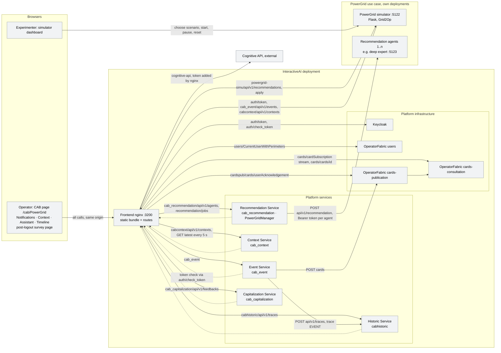

What the diagram shows:
- **One entry point:** the browser and the simulator call the platform only through the frontend
  nginx (`/auth/`, `/cab_event/`, `/cabcontext/`, …); only nginx reaches the services. The
  simulator uses the platform's public URL and logs in as `publisher_test`.
- **Information flows:**
  - events: simulator → Event Service → a card in OperatorFabric (cards-publication) and an
    `EVENT` trace in the Historic Service → the card stream the browser subscribes to;
  - contexts: simulator → Context Service ← the browser reads the latest one every 5 s;
  - recommendations: browser → Recommendation Service (`agents`, `recommendation/jobs`) →
    `PowerGridManager` → the agents; the browser polls the job;
  - the operator's choice: browser → `/powergrid-simu/api/v1/recommendations` → simulator (Q1),
    plus an `AWARD` trace and a feedback to the Capitalization Service;
  - operator actions: browser → `cabhistoric/api/v1/traces` (`ASKFORHELP`, `AWARD`, …).
- **Token checks** (dotted): each of the five services validates the caller's token through nginx's
  `/auth/check_token` (`URL_INTROSPECT=http://frontend:80/auth/check_token`), which forwards to
  Keycloak.
- **Outside the platform:** the simulator with its experimenter dashboard (scenario choice and run
  controls, Q6) and the agents run as their own deployments; the cognitive API is external and
  nginx adds its token.
- **Not drawn:** the static files (bundle, `/surveys/` questionnaires) served by nginx's `location
  /`; the unused `/rl-api/` route; the frontend's rare calls (`cab_event` event delete,
  `cab_recommendation/api/v1/procedure`).

Who polls, who pushes (checked in the frontend's timers and API calls, `stores/services.ts`,
`stores/cards.ts`, `api/*.ts`):

| Service | How the frontend talks to it | When |
|---|---|---|
| Context Service | polled, `GET /cabcontext/api/v1/contexts` | every 5 s (`delay = 5000`) |
| OperatorFabric cards (the events) | a stream, not polled: one long-lived `/cards/cardSubscription` connection, OperatorFabric sends each new or changed card | opened with the use-case page, reconnected when it drops |
| Recommendation Service | on demand, "Get recommendation"; PowerGrid then polls the job (`GET …/recommendation/jobs/{id}`) | per request; job every 1 s until all agents answered |
| Historic Service | write only, one trace per operator action (`EVENT`, `ASKFORHELP`, `AWARD`, …) | when the action happens |
| Capitalization Service | write only, a feedback on the chosen recommendation | on apply |
| OperatorFabric users, Keycloak | user and perimeters, token and its refresh | at login, before the token expires |
| Cognitive API (external) | fetched with a recommendation request and with the session export | on demand |

The Event Service is never polled: events reach the browser as cards through the stream. The
simulator pushes (one login, then `POST` events and contexts, PowerGrid a context every N steps,
its "Context sending frequency") and never polls; the platform calls it only to apply a chosen
recommendation (Q1).

**Target.** Notation: [flowchart in Mermaid](https://mermaid.js.org/syntax/flowchart.html); boxes are building
blocks, arrows are calls in the direction of the request, labels name the endpoint. Subgraphs are
deployment units: one server for everything, the dev stack (§6) replaces Keycloak and
OperatorFabric with its gateway and keeps the rest.


Legend: green added, yellow modified (dashed border), grey unchanged.

- **No arrow from the browser to the simulator except through nginx's `/railway-simu/`** (Q1, Q3),
  and no arrow from the simulator to OperatorFabric (§2 D3).
- **Only the simulator reads the scenario files** (Q2); the Recommendation Service reads its copy
  of the generated `recommendations.json`, so it has no arrow to the Railway package.
- **Event Service:** only its Railway schema changes (S3); its card and trace calls are today's.
- **The simulator reaches Keycloak, the Event and the Context Service through the frontend nginx**
  with the platform's public URL, as PowerGrid's does; nginx is left out of the arrows.
- **Deployment unit of the Railway package:** its own compose next to the platform, as PowerGrid's
  simulator (Q10).

#### 4.1.1 Current data model

Source files: `backend/event-service/resources/Railway/schemas.py`,
`backend/context-service/resources/Railway/schemas.py`, `frontend/src/entities/Railway/types.ts`.

Notation: [UML class diagram in Mermaid](https://mermaid.js.org/syntax/classDiagram.html).

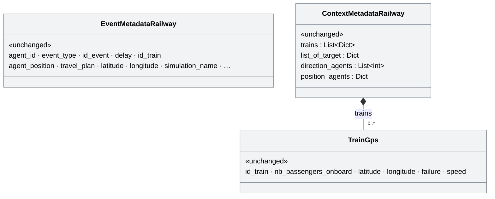

`EventMetadataRailway` and `ContextMetadataRailway` stand for the two `MetadataSchemaRailway`
classes. Both are marshmallow schemas with the default `unknown = RAISE`: a field not listed is
rejected with a 422. This is why the schemas must change (S3); every added field is optional
(`required=False, allow_none=True`, D20), so today's publishers stay valid.

Current context (today's schema, illustrative; also the dev stack's seed context in S6):

```json
{
  "use_case": "Railway",
  "date": "2024-03-15T10:00:00",
  "data": {
    "trains": [
      {"id_train": "AB001", "nb_passengers_onboard": 468, "latitude": 46.58, "longitude": 0.33, "failure": true}
    ]
  }
}
```

#### 4.1.2 Target data model

```mermaid
classDiagram
    namespace Event_Service {
        class EventMetadataRailway {
            «modified»
            agent_id · event_type · id_event · delay · id_train · …
            +scenario_id : str
            +timestep : int
            +decision_index : int or null
            +session_id : str
            +run_mode : str
        }
    }
    namespace Context_Service {
        class ContextMetadataRailway {
            «modified»
            trains · list_of_target · direction_agents · position_agents
            +session : Session
            +scenario : ScenarioState
            +infra : Infra
            +history : List~Frame~
            +decisions : List~Decision~
        }
        class Session {
            «added»
            session_id · scenario_order · scenario_position · started_at · ended_at
        }
        class ScenarioState {
            «added»
            id · name · mode · step · state · decision_open
        }
        class Infra {
            «added»
            map · rows · cols · grid · stations · marey_link
            marey_mapping · planned_paths · link_map
        }
        class Train {
            «added»
            id_train · name · position · direction · done · failure
            planned_departure · planned_arrival · actual_departure · actual_arrival · delay · route
        }
        class Decision {
            «added»
            scenario_id · decision_index · timestep · option_index · option_label · kpis · source · train · action
        }
    }
    namespace Recommendation_Service {
        class Recommendation {
            «added»
            title · description · use_case · agent_type · kpis · actions
        }
        class RailwayAction {
            «added»
            scenario_id · decision_index · option_index · train · action
        }
    }
    ContextMetadataRailway *-- "1" Session : session
    ContextMetadataRailway *-- "1" ScenarioState : scenario
    ContextMetadataRailway *-- "1" Infra : infra
    ContextMetadataRailway *-- "0..*" Train : trains
    ContextMetadataRailway *-- "0..*" Decision : decisions
    EventMetadataRailway ..> Recommendation : looked up by scenario_id, decision_index, run_mode
    Recommendation *-- "0..1" RailwayAction : actions
    Decision ..> RailwayAction : recorded from
    style EventMetadataRailway fill:#fff3bf,stroke:#e67700,stroke-width:2px,stroke-dasharray:4 2,color:#000
    style ContextMetadataRailway fill:#fff3bf,stroke:#e67700,stroke-width:2px,stroke-dasharray:4 2,color:#000
    style Session fill:#d3f9d8,stroke:#2b8a3e,stroke-width:2px,color:#000
    style ScenarioState fill:#d3f9d8,stroke:#2b8a3e,stroke-width:2px,color:#000
    style Infra fill:#d3f9d8,stroke:#2b8a3e,stroke-width:2px,color:#000
    style Train fill:#d3f9d8,stroke:#2b8a3e,stroke-width:2px,color:#000
    style Decision fill:#d3f9d8,stroke:#2b8a3e,stroke-width:2px,color:#000
    style Recommendation fill:#d3f9d8,stroke:#2b8a3e,stroke-width:2px,color:#000
    style RailwayAction fill:#d3f9d8,stroke:#2b8a3e,stroke-width:2px,color:#000
```

Namespaces `Event_Service`, `Context_Service` are the services' schemas, `Recommendation_Service`
the response format `RailwayManager` returns; `_` stands for a space.
`Train` replaces `TrainGps` as the content of `trains` (the list stays `List(Dict())` in the schema).
`Frame` is one entry of `history`: `{"<handle>": {position, direction, moving, target, done}}`.

Legend: green «added», yellow «modified» (new fields with `+`), grey «unchanged».

**Example 1, event** (from `payloads.event_payload()`; values illustrative; `id_event` joins it to
the trace; `scenario_id`, `decision_index` and `run_mode` are the key of the recommendations):

```diff
 {
   "use_case": "Railway",
   "title": "Dispositionskonflikt — G 3 fährt langsam",
   "description": "G 3 fährt mit halber Geschwindigkeit. ...",
   "criticality": "HIGH",
   "start_date": "2026-11-20T09:00:16+00:00",
   "data": {
     "id_event": "4f1c…_scenario3_16",
     "event_type": "INFRASTRUCTURE",
     "id_train": "Train_0",
     "agent_id": "0",
     "delay": 0,
+    "scenario_id": "scenario3",            // added
+    "timestep": 16,                        // added
+    "decision_index": 0,                   // added: not null -> this card carries the decision
+    "session_id": "4f1c…",                 // added
+    "run_mode": "colearning"               // added: not "mode", which the catalog path reads
   }
 }
```

**Example 2, context** (shortened; `session.session_id` joins it to the events):

```diff
 {
   "use_case": "Railway",
   "date": "2026-11-20T09:00:16+00:00",
   "data": {
-    "trains": [{"id_train": "AB001", "latitude": 46.58, "longitude": 0.33, "failure": true}],
+    "trains": [{"id_train": "Train_0", "name": "G 3", "position": [7, 9], "direction": 1, "done": false,
+                "failure": false, "planned_departure": 1, "planned_arrival": 40, "actual_departure": 1,
+                "actual_arrival": null, "delay": 0, "route": [[7, 2], [7, 3]]}],   // modified: grid cells instead of GPS
+    "session": {"session_id": "4f1c…",
+                "scenario_order": [{"scenario_id": "scenario3", "mode": "colearning"},
+                                   {"scenario_id": "scenario1", "mode": "colearning"}],
+                "scenario_position": 0,
+                "started_at": "2026-11-20T08:59:00+00:00", "ended_at": null},        // added
+    "scenario": {"id": "scenario3", "name": "Szenario 3 — Güterverkehr vs Personenverkehr",
+                 "mode": "colearning", "step": 16, "state": "paused_for_decision", "decision_open": true},  // added
+    "infra": {"map": "maps/map3.json", "rows": 15, "cols": 20, "grid": [[0, 0]],
+              "stations": [{"id": 1, "r": 7, "c": 17, "name": "Station 1"},
+                           {"id": "start_0", "r": 7, "c": 2, "name": "G 3", "type": "start"}],
+              "marey_link": {"start": [7, 1], "end": [7, 18]},
+              "marey_mapping": {"7,2": 1, "7,3": 2},
+              "planned_paths": {"Train_0": [[1, 1], [3, 2]]},
+              "link_map": {"grid": [[1025, 1025], [1025, 1025], [1025, 1025]],
+                           "mapping": [[[7, 2], [1, 1]], [[5, 9], [0, 7]]],
+                           "levels": [[[5, 9], -1]]}},                           // added: static per scenario
+    "history": [{"0": {"position": [7, 2], "direction": 1, "moving": true, "target": [7, 17], "done": false}}],  // added
+    "decisions": []                                                                    // added
   }
 }
```

**Example 3, recommendations** (Ko-Lernen; Empfehlungsmodus has one item per option without
`train`/`action`): the decision's entry of `recommendations.json` (written by
`payloads.recommendations()`), returned as it is by `RailwayManager` from its copy:

```json
[
  {"title": "IC 3 dann G 3: vorfahrt", "description": "G 3 weicht aus — IC 3 überholt, G 3 fährt vor IR 35",
   "use_case": "Railway", "agent_type": "AI",
   "kpis": {"local_delay": "12", "global_delay": "7", "energy": "74", "anschluss": "1", "feasible": "True"},
   "actions": [{"scenario_id": "scenario3", "decision_index": 0, "option_index": 1, "train": "Train_1", "action": "vorfahrt"}]}
]
```

Nothing is removed from the schemas: the GPS fields stay optional, so old publishers are still
accepted, and the Railway frontend still draws them on today's Leaflet map when a context has no
`infra` (D20). Every «added» field below is optional in the schemas; the simulator sends all of them.
  
What changes, and why:

| Change | Why |
|---|---|
| 🟨 Railway events carry the scenario, step, decision, the run's mode (`run_mode`) and the session. | The Recommendation Service and the log know which decision a card belongs to, what to offer and who saw it. |
| 🟨 Railway contexts carry the session, scenario state, track network, train states, history and decisions. | The centre panel draws the map and the ZWL from the latest context alone. |
| 🟨 The Recommendation Service answers Railway requests with the scenario's options or the train-and-action choices. | The platform shows them as recommendation cards and logs the chosen one. |
| 🟩 The chosen recommendation is sent to the simulator. | The trains move on according to the choice. |

Kept small on purpose:

- no new endpoint in the platform services, no new card process, no new trace step;
- no new event type: all events are `INFRASTRUCTURE`;
- `infra` is computed once per scenario and repeated, not sent separately: the Context Service has no
  second channel (≤ 30 KB per context, 25 × 25 grid at most); the link map is part of it (three rows
  as long as the line, a few KB);
- the link map has no `incompleteCells`, which `railway_sim` always sent empty.

### 4.2 Runtime view

#### 4.2.1 Current: the card stream, how events reach the browser

Everything a simulator posts to `/cab_event/` reaches the browser as an OperatorFabric card
through one stream; contexts do not, they are polled. The Event Service turns each event into a
card (`base_event_manager.py`, `create_card()`):

| Event field (`POST /cab_event/api/v1/events`) | Card field |
|---|---|
| `title` | `title.parameters.title` |
| `description` | `summary.parameters.summary` |
| `criticality` (`HIGH`, `MEDIUM`, `LOW`, `ROUTINE`) | `data.criticality`, and `severity` (`ALARM`, `ACTION`, `COMPLIANT`, `INFORMATION`) |
| `data` (the use case's own fields, e.g. PowerGrid `line`, `kpis`; Railway `id_train`, `delay`) | `data.metadata` |
| `parent_event_id` | `data.parent_event_id` |
| `start_date`, `end_date` | `startDate`, `endDate` |
| the event's id | `processInstanceId`; the card id is `cabProcess.<event id>` |
| `use_case` | `entityRecipients: [use case]`: only users of that use case receive it |

- **Messages:** one per change, `ADD`, `UPDATE`, `DELETE`, `ACK`. An event posted again with the
  same unique fields comes back as an `UPDATE` of the same card; deleting an event deletes its
  card; an acknowledgement on another screen arrives as `ACK`.
- **What the browser does with each message** (`stores/cards.ts`): keeps the use case's card list
  (for `hydrated` use cases it first fetches the full card, `/cards/cards/{id}`), records an
  `EVENT` trace for the session export, and feeds the Notifications feed (left), the Timeline
  (bottom) and the use case's own panels: the selected card's `data.metadata` is what "Get
  recommendation" sends as `event`.
- **Resolving a card:** after a decision, `resolveCriticality()` sets the card's criticality to
  `ND` in this browser only; the card on the server is unchanged.

#### 4.2.2 Current: one PowerGrid event up to the applied choice

Notation: [UML sequence diagram in Mermaid](https://mermaid.js.org/syntax/sequenceDiagram.html);
token checks and the frontend nginx are left out.

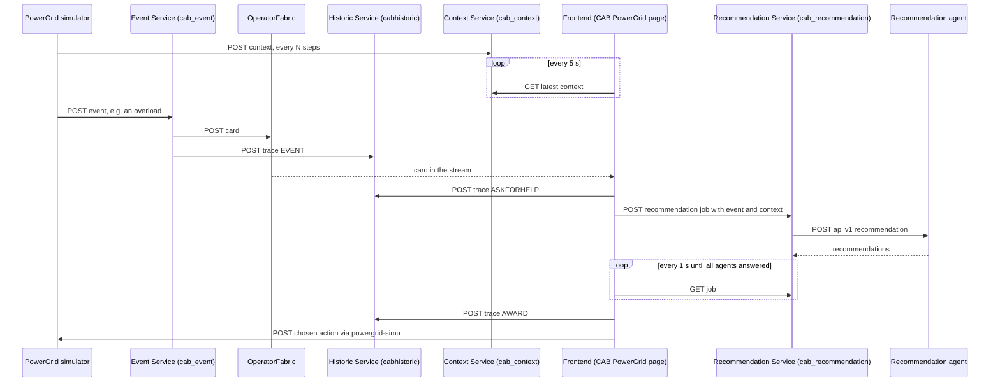

- **Order:** simulator → Event Service → OperatorFabric → browser; only then, and only when the
  operator asks, browser → Recommendation Service → agents; the choice goes browser → simulator.
  The Recommendation Service never creates events or calls the simulator.
- **Every event comes from the simulator:** PowerGrid's `event_type`s `KPI`, `agent`,
  `anticipation`, `consignation` are all posted by its simulator (`Communicate.send_event_online()`).
  Railway's decision takes the same path: the scenario event on the decision step carries
  `decision_index`, or, when no event falls on that step (scenario 4), the simulator posts a
  decision event "Entscheidung erforderlich" when the player pauses (§1.6.1); either is a card like
  any other.
- **Pause:** at an overload PowerGrid's simulator pauses and waits until the experimenter clicks
  "Resume" in its dashboard; the applied recommendation is only stored until then (Q25). Not drawn.

#### 4.2.3 Current: a PowerGrid session from login to the agent choice

Notation: [UML sequence diagram in Mermaid](https://mermaid.js.org/syntax/sequenceDiagram.html);
token checks and the frontend nginx are left out. The operator's start and the experimenter's start
are independent: they can happen in either order.

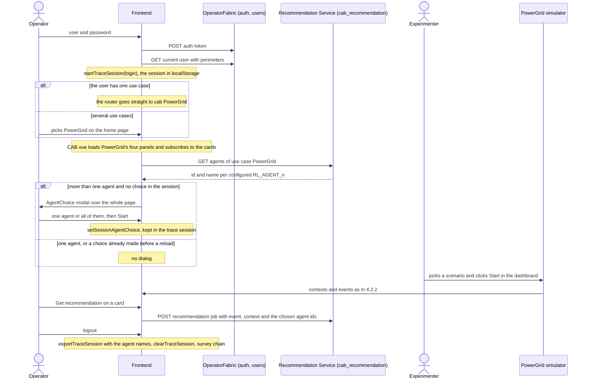

- **The choice stays in the browser:** it reaches only the Recommendation Service, as `agents` in
  each recommendation request (`select_agents()` in PowerGrid's manager). The simulator never
  learns it, and the scenario is the experimenter's choice in the dashboard (Q3 b).
- **Extension points it uses:**
  - the use case's own panels: `CAB.vue` loads `entities/<UC>/CAB/Assistant.vue` per use case;
    PowerGrid's `Assistant.vue` mounts `AgentChoice.vue` (in the PowerGrid folder, texts in
    PowerGrid's locales);
  - an optional manager hook: the generic `GET /cab_recommendation/api/v1/agents?use_case=` returns
    the manager's `get_agents()` if it has one, `[]` otherwise;
  - the generic `agents` field of the recommendation request.
- **Hard-wired:**
  - the shared trace session holds the choice: `utils/traceSessionExport.ts` has the field
    `agentChoice`, `sessionAgentChoice()`/`setSessionAgentChoice()`, shows it in the HTML report
    and exports it as `agents`. Shared code, but named neutrally, not after PowerGrid;
  - there is no session-start hook: the trigger is "PowerGrid's assistant is mounted and the
    session has no choice". Login knows nothing of it; a reload keeps the choice (localStorage),
    logout clears it;
  - the modal covers the page (teleported to `body`, with a backdrop) but not the card stream:
    cards that arrive while the operator chooses are already received.

#### 4.2.4 Target: one scenario with one decision

Notation: [UML sequence diagram in Mermaid](https://mermaid.js.org/syntax/sequenceDiagram.html). The
first note spans the participants on the one server; the frontend runs in the participant's browser
and reaches the server through the frontend nginx, which is not drawn.

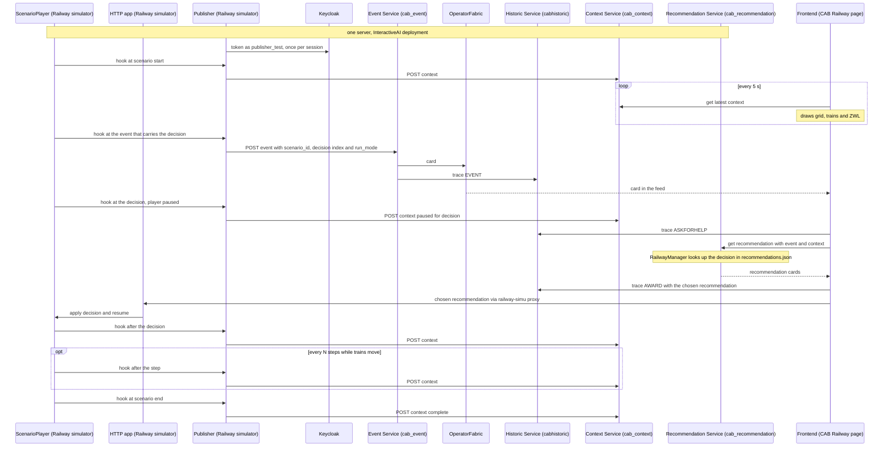

- **Who calls whom matches the building blocks:** the simulator only sends (events, contexts), the
  frontend only reads the context and calls the simulator once per decision (Q1).
- **Event Service:** the card and the `EVENT` trace are today's behaviour (`base_event_manager.py`).
- **Contexts at the other events** (D7) are not drawn; on the decision step the decision's context
  covers the event's.
- **Between scenarios** the player waits for "next scenario" from the Szenario-Loader, through the same
  HTTP app (Q3); not drawn.

#### 4.2.5 Target: pausing and resuming at a decision

From the context that announces the open decision to the simulation running again. The event that
carries the decision has been posted just before (§4.2.4).

Notation: [UML sequence diagram in Mermaid](https://mermaid.js.org/syntax/sequenceDiagram.html); the
frontend nginx and the token checks are left out, the browser reaches the simulator's HTTP app
through `/railway-simu/` (Q1).


- **The pause is part of the scenario:** the player pauses itself at the decision point; there is no
  pause command and no "Resume" button, and the participant never controls time (D8, Q4). The
  operator's choice is what resumes it (D19), unlike PowerGrid's manual "Resume" (Q25).
- **No requests while paused:** nothing changes, so the simulator sends no context until the choice
  arrives (D7); the frontend keeps its 5 s poll.
- **No timeout, no default:** the run waits until a matching choice arrives; PowerGrid instead falls
  back to a do-nothing action. A choice for another decision (a stale tab, a second click) is refused
  with 409 and changes nothing.
- **Apply order as today's Railway `onSelection()`:** the `AWARD` trace first, then the post; the
  card is resolved only on success, otherwise the http plugin's error dialog shows and the card
  stays open. So a refused choice still leaves an `AWARD` trace (Limitations).

#### 4.2.6 Target: a session from the start dialog to the end screen

Who drives what, with Q3 d), Q5 d), Q6, Q26 a), Q27 a) and Q29 a); the `alt` blocks set Q3 e) (not chosen; today's page,
the experimenter starts the simulation outside the platform, shaded orange) against d). Notation: [UML sequence diagram in
Mermaid](https://mermaid.js.org/syntax/sequenceDiagram.html); the frontend nginx (`/railway-simu/`),
OperatorFabric (the card stream, §4.2.1) and the recommendation request (§4.2.4) are left out.

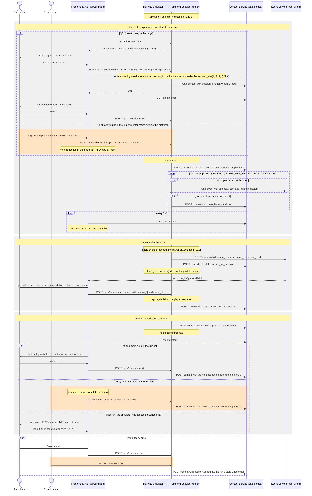

- **Stepping runs in the simulator, not in the frontend:** `SessionRunner` calls `step()` at the
  pace `RAILWAY_STEPS_PER_SECOND` (S4). The frontend never triggers a step; it only reads the
  latest context every 5 s (D11), and the participant does not control time (D8, Q4).
- **At a decision nobody pauses the simulator from outside:** the player pauses itself at the
  decision step, and the applied choice resumes it (D19, Q25 b, §4.2.5). Without a choice the run
  stays paused. The decision step is fixed in the scenario file, `decision_points[i]["timestep"]`
  (scenario 3: 16): `ScenarioPlayer.step()` fires that step's events, then, if the next decision
  point's timestep is reached, sets `paused_for_decision` and calls `on_decision` without moving
  the trains; `apply_decision(i)` applies the option's holds and scripted actions and sets it
  running again. No conflict detection decides it (dropped, §1.7). This is `railway_sim`'s
  mechanism unchanged (its `ScenarioPlayer`, `b612187`): its own thread stepped at the "Tempo"
  speed and skipped steps while paused; the cleaned player dropped the thread, `SessionRunner`
  brings the loop back without the "Start", "Pause" and "Tempo" controls (Q4).
- **Only three kinds of request go from the frontend to the simulator,** all through
  `/railway-simu/`: the session controls (start, next, stop), the scenario list, and the applied
  choice. Everything the page shows comes from the context and the cards.
- **Q3 e) differs only where the session is started and moved on:** the experimenter, outside the
  platform (`Exp`), starts the session and each next scenario, with the simulator's start command
  or the same HTTP routes; the step loop, the decision pause and the apply are identical. The page
  shows no introduction, no "Weiter" and no end screen, at most `INFO` cards (Q3 e). With Q27 a)
  the simulator already runs; the experimenter only sends the commands.
- **What the start dialog reads from the latest context** (no extra request): no running session
  for this login when `session.session_id` is not `currentTraceSessionId()`, so a new login shows
  the start view even though the latest context is the previous session's; before run 1 when
  `scenario.state` is `ready` (Q29 a), so a reload shows the introduction again; between runs when
  `scenario.state` is `complete` and `session.ended_at` is empty; the end screen when
  `session.ended_at` is set and the last run of `scenario_order` is `complete`. "✕ Beenden" sets
  `session.ended_at` without completing the run, so the page returns to the start view (Q26 a), as
  `railway_sim`'s `endSession()`).
- **Between scenarios the simulator waits:** after `complete` it steps no more until "next"; the
  frontend sees `complete` in the context and shows the start dialog with the next introduction
  (Q3 d).

## 5. Change inventory

### Simulator (`usecases_examples/Railway/`)

Starting point, the standalone `railway_sim` prototype to be replaced, in its cleaned, headless form
(the cleaned simulator; Python 3.10+, `flatland-rl==4.2.6`, `numpy<2`, `pytest`):

| Path | Content |
|---|---|
| `sim/scenario_player.py` | `ScenarioPlayer`: plays one scenario step by step; `Hooks` for the integration |
| `sim/dispatcher.py` | moves the trains along their routes in Flatland |
| `sim/timetable.py` | planned and actual times per train |
| `sim/map_loader.py` | `maps/mapN.json` → Flatland env, shortest routes |
| `sim/decisions.py` | decision rules: holds, Ko-Lernen matching (`match_colearning()`, `colearning_view()`) |
| `integration/payloads.py` | draft, no HTTP: builds the context, event and recommendation JSON |
| `integration/session.py` | draft: participant, mode, scenario order (`make_session()`); S4 replaces participant by `session_id` (D10) |
| `experiment_scenarios/`, `maps/` | the six scripted scenarios (German texts), `map1`–`map6` (drawn maps) |
| `run_scenario.py`, `config.py` | terminal demo (`PRINT_PAYLOADS = True` prints the JSON) |
| `tests/test_sim.py` | pytest: 38 tests (13 test functions, three of them parametrized), all green on Flatland 4.2.6 |

```python
from sim.scenario_player import ScenarioPlayer, Hooks, PAUSED, COMPLETE
p = ScenarioPlayer(scenario, Hooks(on_event=..., on_decision=..., on_step=..., on_resume=..., on_complete=...))
p.step()                      # one simulation step; does nothing while PAUSED / COMPLETE
p.apply_decision(i, source="recommendation" | "colearning", meta={...})
p.state, p.step_index, p.active_decision, p.decisions, p.history, p.frame(), p.timetable
```

There is no thread and no timer: the caller sets the pace (`railway_sim` stepped once per
second).

Added:
- `sim/`, `experiment_scenarios/`, `maps/`, `tests/test_sim.py`, `requirements.txt`: the cleaned
  simulator, unchanged (S1).
- `export_recommendations.py`: writes `recommendations.json`, one entry per
  `"<scenario_id>/<decision_index>/<mode>"` with the list `payloads.recommendations()` returns (train
  names from the scenario's train definitions, as `ScenarioPlayer` names them); `recommendations.json`
  committed; a test checks that the file equals the script's output (S5, Q2). A copy goes to
  `backend/recommendation-service/resources/Railway/recommendations.json`, since the service's
  image is built from its own folder only; a test checks that both are equal (S5).
- `sim/marey.py`: `marey_mapping()`, `planned_paths()` and `link_map()`, ported from `railway_sim`'s
  `_compute_marey_mapping`, `/plans` and `_build_link_map`; `infra_payload()` adds
  them (S2).
- `integration/publisher.py`: `Publisher` with token cache and refresh on expiry or 401, `send_event()`,
  `send_context()`; base URL, user, password from `RAILWAY_PLATFORM_URL`, `RAILWAY_PUBLISHER_USER`,
  `RAILWAY_PUBLISHER_PASSWORD` (S4).
- `integration/loop.py`: `SessionRunner`: plays `scenario_order`, hooks → publisher, context policy of
  D7, waits while paused, applies the received choice, waits for "next scenario" between scenarios;
  sets `scenario.state` `ready` before run 1 and `session.ended_at` after the last run; pace `RAILWAY_STEPS_PER_SECOND` (S4).
- `app.py`: one small HTTP app (Flask, as PowerGrid's simulator): `POST /api/v1/recommendations`
  (apply: `actions[0]` and `event_id`; 409 when it does not match the open decision, §4.2.5),
  `GET /api/v1/scenarios` (static: `id`, `name`, `introduction` per scenario, Q26 a),
  `POST /api/v1/session` (start: `session_id`, experiment or single run; posts the first context with
  run 1 `ready`; ends a running session of another `session_id` first; 409 for the same
  `session_id`, Q29 a), `POST /api/v1/session/next` (starts the next run),
  `POST /api/v1/session/stop` (sets `session.ended_at`), `GET /health` (S4).
- `devstack/` (S6): `gateway.py` (standard library only), `start.sh`, `seed.py` (today's Railway
  event and context), `smoke.py`, `requirements.txt` (the services' Railway path with the Event
  Service's pins, no `torch`; `setuptools<70` because `python-keycloak` 3.0.0 imports
  `pkg_resources`); the simulator added to the start script (S4); `Dockerfile`,
  `docker-compose.yml` (S15).
- `README.md`: the simulator (S1) and the dev stack with its commands (S6, S16).

Modified:
- `integration/payloads.py`: `infra_payload()` with `marey_mapping`, `planned_paths` (S2); events
  carry `scenario_id`, `timestep`, `decision_index`, `session_id`, contexts `session` (with
  `ended_at`), `scenario` (with `mode`) and `decisions` (S4); `event_payload()` adds the run's mode as
  `run_mode`, the key of `recommendations.json` (S5).
- `integration/session.py`: `make_session()` builds the run list `[(scenario_id, mode)]` as
  `railway_sim`'s Experiment did, or takes one run (Q6), seeded by `session_id` instead of the
  participant (D10, F29) (S4).
- `experiment_scenarios/scenarioN.py`: an `introduction` per scenario, the text of `railway_sim`'s
  `SCENARIO_INTROS` (F22, F32, Q26 a) (S4).
- `run_scenario.py`, `config.py`: kept as the terminal demo.

### Platform backend

Modified:
- `backend/event-service/resources/Railway/schemas.py`: the added fields of §4.1.2, each
  `required=False, allow_none=True` (D20); today's fields unchanged.
- `backend/context-service/resources/Railway/schemas.py`: `session`, `scenario`, `infra` (`Dict`),
  `history`, `decisions` (`List(Dict())`), each `required=False, allow_none=True` (D20).
- `backend/recommendation-service/resources/Railway/manager.py`: `get_recommendation()` returns the
  entry of `recommendations.json` for the event's `scenario_id`, `decision_index` and `run_mode` when
  the event comes from the simulator (`scenario_id` set; an empty list without a decision or for an
  unknown key, F16); otherwise today's catalog path, unchanged (D20). The run's mode travels as
  `run_mode`, not `mode`, since the catalog path selects its sorting by `event["mode"]`
  (`basic`/`deontic`/`risk`/`risk_tie_break`) (S5).
- tests in `event-service/tests`, `context-service/tests`, `recommendation-service/tests`, with
  today's payloads (seed event and context, Postman) still accepted and answered as before (D20).

### Frontend

Added:
- `src/entities/Railway/CAB/NetworkMap.vue` (Kartenansicht), `ZwlDiagram.vue`, `LinkMap.vue`
  (Linienansicht), `StatusBar.vue` (with the optional train table, F36), `ColearningChoice.vue`,
  `ScenarioLoader.vue` (the start dialog, mounted by `Assistant.vue`, Q3 d), `ScenarioProgress.vue`
  (used by `Timeline.vue`).
- `src/entities/Railway/grid.ts`: transition-int decoding into track pieces; `zwl.ts`: points per
  train; `linkmap.ts`: placement on the link map; Vitest tests next to them.
- The selected Ko-Lernen train (F19) as Railway UI state shared by `ColearningChoice.vue` and
  `NetworkMap.vue`: a `ref` in a Railway-owned module (`src/entities/Railway/colearning.ts`); the
  shared app store has no per-use-case state, and none is added (Q8 a).
- `src/entities/Railway/locales/de.json` and `src/entities/Railway/i18n.ts`, which registers it as
  `de-Railway` (Q7 d); Railway's `en.json` and `fr.json` get the new keys, existing keys keep
  their texts (D20).
- `public/surveys/railway/reflection.html` + `CHAINS.Railway` in `surveychainer.html`.
- `cypress/e2e/railway.cy.ts` (answers the consent question after login); `video: true` and a
  1600×900 browser window in `cypress.config.ts` (S16, extended by every UI step, §6).

Modified:
- `src/entities/Railway/CAB/Context.vue`: tabs "Kartenansicht", "ZWL Diagramm", "Linienansicht" when
  the context has `infra`; otherwise today's Leaflet map, kept (D20).
- `src/entities/Railway/CAB/Assistant.vue`: for events with `scenario_id`, KPI keys `local_delay`,
  `global_delay`, `energy`, `anschluss` with German labels, the Ko-Lernen choice, apply to
  `/api/v1/recommendations` and no "Lösung hinzufügen"; for other events today's list, KPI keys,
  button and `/transport_plan` (D20); mounts `ScenarioLoader.vue` while no scenario runs and the
  simulator answers `GET /api/v1/scenarios`.
- `src/entities/Railway/CAB/Timeline.vue`: the progress bar above the shared `Timeline` when the
  context has `session`; otherwise the Timeline only, as today.
- `src/entities/Railway/types.ts`: `Context`, `Metadata`, `Action` of §4.1.2, every added field
  optional (D20).
- `src/entities/Railway/api.ts`: `applyRecommendation()` → `VITE_RAILWAY_SIMU + '/api/v1/recommendations'`
  when `actions[0]` has `scenario_id`, today's `/transport_plan` otherwise (D20); `getScenarios()`,
  `startSession()`, `nextScenario()`, `stopSession()`.
- `frontend/default.conf`, `start-webui.sh`: `/railway-simu/` location with the
  `__RAILWAY_SIMU_UPSTREAM__` placeholder (`SUBST_VARS`, with a default as `POWERGRID_SIMU_UPSTREAM`
  has, since `start-webui.sh` exits on an unset placeholder), next to `/powergrid-simu/` in every nginx
  config that has it: `config/dev/cab-standalone/nginx-cors-permissive.conf`,
  `nginx-kubernetes.conf` and the ConfigMap (§5 Config and deployment).

### Config and deployment

Modified:
- `config/dev/cab-standalone/.secrets.example`, `.env.example`: `VITE_RAILWAY_SIMU=/railway-simu`,
  `RAILWAY_SIMU_UPSTREAM`.
- `config/dev/cab-standalone/docker-compose.yml`, `docker-compose-hub.yml`: the variables passed to
  `frontend`; `VITE_RAILWAY_SIMU` is also a build argument, so a changed value needs a rebuild.
- `config/dev/cab-standalone/users-docker.yml`, `deploy-chart/configmap-assistant-platform.yaml`:
  `railway_user`'s Railway perimeter loaded without `loadTestConf.sh` (D12); no participant users
  (Q11).
- `deploy-chart/configmap-assistant-platform.yaml`: the `/railway-simu/` location in the nginx key
  too, since the ConfigMap overrides the image's `default.conf`; pushed with `apply-nginx-conf.sh`
  only after the pod that substitutes `__RAILWAY_SIMU_UPSTREAM__` runs (README's ordering rule) (S15).
- `deploy-chart/values.ovh.yaml`: `RAILWAY_SIMU_UPSTREAM` on the frontend pod (S15).

Unchanged on purpose: Event, Context, Historic Service code outside the Railway schemas; OperatorFabric
config and perimeters (`cabProcess` already covers Railway); PowerGrid and ATM entities; the
post-logout survey's code (`views/Survey.vue`, `utils/survey.ts`; Railway only adds a chain entry
and a page).

### Documentation

Modified:
- `README.md`: "About The Project" names the Railway use case next to PowerGrid with a link to
  `usecases_examples/Railway/README.md`; key variables `VITE_RAILWAY_SIMU=/railway-simu`,
  `RAILWAY_SIMU_UPSTREAM`; "Default ports" with the Recommendation
  Service (5400) and the Railway simulator (5124); "Authentication data" with `railway_user` for the
  Experiment (S15).
- `CHANGELOG.md`: one line under `## Unreleased` per user-visible step (S3–S5, S7–S12, S15, S17).
- `docs/developer-guide.md`: "Running the Services without Docker (Railway dev stack)" pointing to
  the dev stack (S6).
- `frontend/README.md`: an entity's own extra language (`de.json` + registration) (S7);
  the Railway reflection chain next to "Changing the questionnaires" (S12); the Railway visual check
  under the Cypress section (S16); `VITE_RAILWAY_SIMU` as a proxy path under "Environment
  variables" (S15).
- `docs/postman_collections/Event-service.postman_collection.json`: the "event Railway" examples
  replaced by §4.1.2 Example 1 (S3).

Added: `usecases_examples/Railway/README.md` (S6, extended in S16, S1, S4, S5, S13 and S15), in the layout of
`usecases_examples/PowerGrid/README.md`.

Unchanged on purpose: `docs/use_case_managment.md` (PowerGrid stays its example; Railway follows
it), `docs/troubleshooting.md` (`checkPorts.sh` already takes a compose file),
`docs/Install_Prequisites.md`, the images in `docs/img/`, the Recommendation-service and OF Postman
collections (their Railway requests still pass; events without `scenario_id` get the catalog),
`resources/README.md`.

## 6. Local dev stack and visual checks

- **Processes:** Event (5000), Context (5100), Historic (5200), Recommendation (5400) services (the
  host ports of `docker-compose.yml`) via `flask run` as in `docs/developer-guide.md`, but with
  `create_app('dev')` and `DATABASE_URL=sqlite:///<service>.db` instead of `create_app('test')`, whose
  `sqlite:///:memory:` loses the registration on restart; `AUTH_DISABLED=true`,
  `DEFAULT_USE_CASE=Railway`; the simulator app (5124); the gateway on 3200 serving the frontend
  (`FRONTEND=vite` proxies to the Vite dev server, `FRONTEND=dist` serves `frontend/dist`).
- **Gateway** (Python, `devstack/gateway.py`): routes `/cab_event/`, `/cabcontext/`,
  `/cab_recommendation/`, `/cabhistoric/` to the services and `/railway-simu/` to the simulator, as
  nginx does on the server; answers `/auth/token` with a fixed token and
  `/users/CurrentUserWithPerimeters` with `railway_user` (`entities: ["Railway"]`); keeps cards in
  memory: `POST /cardspub/cards` (target of the Event Service's `CARDS_PUBLICATION_SERVICE`), the
  `/cards/cardSubscription` stream in the shape of `types/cards.ts` `CardEvent`, `/cards/cards/{id}`,
  acknowledgements.
- **Setup:** `devstack/start.sh` creates a venv per OS and CPU on first start (or uses
  `DEVSTACK_PYTHON`), starts all processes with their SQLite files and logs in
  `.cache/railway-devstack/` of the repo root (gitignored, `DEVSTACK_HOME`), registers the Railway use
  case in the three services from `resources/cabUsecases*/Railway*.json` (as `loadTestConf.sh` does)
  and stops everything on Ctrl-C. `FRONTEND_DIST` and `FRONTEND_DIR` point to another build or
  checkout of the frontend (the Linux sandbox uses its own build copy).
- **Card stream:** chunked, `Cache-Control: no-transform` and `X-Content-Type-Options: nosniff`, as
  OperatorFabric sends it; without them Cypress's proxy (it compresses) and the browser (it sniffs the
  first KB) hold the events back. Stored cards are replayed on the range subscription only, not on
  the notification one.
- **Commands** (one line each, from the repo root):
  - start: `RAILWAY_STEPS_PER_SECOND=4 FRONTEND=vite usecases_examples/Railway/devstack/start.sh`
  - shortest: `usecases_examples/Railway/devstack/start.sh` (1 step/s, built bundle)
  - visual check: `cd frontend && CYPRESS_BASE_URL=http://localhost:3200 npx cypress run --spec cypress/e2e/railway.cy.ts`
- **Output:** screenshots in `frontend/cypress/screenshots/railway.cy.ts/`, the video in
  `frontend/cypress/videos/`; both gitignored. Named shots, each added by the step that changes what
  it shows:

  | Shot | Shows | Added by |
  |---|---|---|
  | `00-baseline` | today's Railway page (Leaflet map) with the seed card and context | S16 |
  | `01-feed` | cards sent by the simulator in the feed | S4 |
  | `02-recommendations` | the scenario's recommendations in today's assistant panel | S5 |
  | `03-german` | the page in German | S7 |
  | `04-map` | the Kartenansicht | S8 |
  | `05-zwl` | the ZWL Diagramm | S9 |
  | `13-link-map` | the Linienansicht | S17 |
  | `06-status` | status line and open decision in the centre panel | S10 |
  | `07-decision-recommendation`, `08-decision-colearning`, `09-after-apply` | the decision panel per mode, after applying | S11 |
  | `10-intro`, `11-reflection`, `12-end` | the Szenario-Loader's introduction and end screen; the Railway chain of the post-logout survey | S12 |
  | `14-compare` | scenario 3 in Ko-Lernen at its decision, the state of `railway_sim.png` | S13 |

- **Documenting a step:** the step copies its shots into `docs/plans/railway-use-case/shots/`
  (committed, replacing older versions of the same shot) and links them from its "Carried out" row,
  so the plan and the PR show the effect of each step; videos stay local. Until S12, the spec starts
  a session with `cy.request` to `/railway-simu/api/v1/session` and `/railway-simu/api/v1/session/next`
  instead of the Szenario-Loader.
- **Against the full Docker stack** the same Cypress spec runs with `CYPRESS_BASE_URL` pointing to it
  and the `railway_user` login (`CYPRESS_USER`, `CYPRESS_PASSWORD`).

## 7. Phases and steps

Each step is one commit, green on its own, with its tests and documentation (§5 Documentation);
a user-visible step adds its line under `## Unreleased` in `CHANGELOG.md`. A step that changes
the page also adds its shots to `railway.cy.ts` and commits them (§6 "Documenting a step"). Phases
are in the order they are carried out; step labels are stable IDs, not the order.

### Phase 1: local dev stack and visual check ✅

The dev stack and the screenshots come first, so every later step can be run and shown on it.

| ID | Findings | Step | Category | Severity | Commit message | Commit(s) | Req. | Needs | Blocked by |
|---|---|---|---|---|---|---|---|---|---|
| S6 | - | `devstack/` gateway and start script, §6; seed script posting one Railway event and the §4.1.1 context in today's schema; `usecases_examples/Railway/README.md` with the dev stack, `docs/developer-guide.md`; a smoke script that posts one event and reads the context back. | feature | - | `feat(railway): run the platform locally without Docker` | b82cbb3 | T1, T2 | - | - |
| S16 | - | `cypress/e2e/railway.cy.ts` (login through the gateway, `/cab/Railway`, shot `00-baseline`), `video` and screenshot settings in `cypress.config.ts`, one-line command in the Railway README and `frontend/README.md`; shot [`00-baseline`](railway-use-case/shots/00-baseline.png). | test | - | `test(railway): screenshot and record the Railway page on the dev stack` | a5fdde4 | T2, T4 | S6 | - |

### Phase 2: simulator in the repo ✅

| ID | Findings | Step | Category | Severity | Commit message | Commit(s) | Req. | Needs | Blocked by |
|---|---|---|---|---|---|---|---|---|---|
| S1 | - | Add the cleaned simulator (without `__pycache__`), `tests/test_sim.py` green; simulator section in the Railway README. | chore | - | `chore(railway): add the scripted Railway simulator under usecases_examples` | ba54610 | F28–F30 | - | - |
| S2 | - | `sim/marey.py`, `infra_payload()`; tests for every scenario's `marey_link` and `link_map`. | feature | - | `feat(railway): add ZWL distances, planned paths and the link map to the scenario infrastructure` | 1979e78 | F12, F14, F31 | S1 | - |

### Phase 3: platform contract ✅

| ID | Findings | Step | Category | Severity | Commit message | Commit(s) | Req. | Needs | Blocked by |
|---|---|---|---|---|---|---|---|---|---|
| S3 | - | Both `MetadataSchemaRailway`, every added field optional; service tests with the payloads of §4.1.2 and with today's payloads; Postman Railway event example. | feature | - | `feat(railway): accept scenario, session and infrastructure fields in Railway events and contexts` | b7e61eb | D2, D4, D10, D20, T5 | - | - |
| S4 | - | `publisher.py`, `loop.py`, `session.py` (run list seeded by `session_id`), the scenarios' `introduction`, `app.py` apply, scenario-list and session routes; simulator in the dev stack's start script with `RAILWAY_STEPS_PER_SECOND`, `/railway-simu/` in the dev gateway and `VITE_RAILWAY_SIMU=/railway-simu` for the dev frontend; tests with `requests_mock` for the token reuse and request count, Flask test client for the routes; shot [`01-feed`](railway-use-case/shots/01-feed.png). | feature | - | `feat(railway): publish events and contexts from a session runner and receive the operator's choice` | 1b83049 | D3, D7, D8, D14, D16, D18, D19, F20, F21, F25, F29, F38, F39, T3, T5 | S1, S3, S16 | - |
| S5 | - | `export_recommendations.py` and the committed `recommendations.json` (test: file equals the script's output); its copy in `backend/recommendation-service/resources/Railway/` (test: copy equals the simulator's); `payloads.event_payload()` adds `run_mode`; `RailwayManager` looks the entry up, catalog for other events; tests; shot [`02-recommendations`](railway-use-case/shots/02-recommendations.png). | feature | - | `feat(railway): answer recommendation requests from a file generated by the simulator` | 2b4c7da | D6, D15, F16, F18, F19, T5 | S1, S3, S4 | - |


### Phase 4: frontend ✅

Each step adds its shots (§6) and commits them, and adds its new texts to Railway's `de.json`,
`en.json` and `fr.json` (S7's files).

| ID | Findings | Step | Category | Severity | Commit message | Commit(s) | Req. | Needs | Blocked by |
|---|---|---|---|---|---|---|---|---|---|
| S7 | - | Railway `de.json` registered as `de-Railway`, Railway texts translated; `frontend/README.md`; shot [`03-german`](railway-use-case/shots/03-german.png). | feature | - | `feat(i18n): show the Railway page in German, English and French` | 84391bc | D9, F1, F2, F5, F6 | S16 | - |
| S8 | - | `NetworkMap.vue`, `grid.ts` + Vitest; `Context.vue` tabs when the context has `infra`, the Leaflet view kept for contexts without it; shots [`04-map`](railway-use-case/shots/04-map.png) and [`00-baseline`](railway-use-case/shots/00-baseline.png) (old path unchanged). | feature | - | `feat(railway): draw the track network and the trains from the context` | 8da776c | D5, D20, F3, F7–F11, T5 | S2, S7 | - |
| S9 | - | `ZwlDiagram.vue`, `zwl.ts` + Vitest; shot [`05-zwl`](railway-use-case/shots/05-zwl.png). | feature | - | `feat(railway): draw the time-distance diagram from the context history` | 69b0200 | F12–F14 | S8 | - |
| S17 | - | `LinkMap.vue` (track pieces from `grid.ts`), `linkmap.ts` + Vitest for the placement; third tab; shot [`13-link-map`](railway-use-case/shots/13-link-map.png). | feature | - | `feat(railway): draw the link map from the context` | bb3d04a | F31 | S8 | - |
| S10 | - | `StatusBar.vue`, decision prompt "Entscheidung erforderlich – bitte Ereigniskarte öffnen", optional train table; shot [`06-status`](railway-use-case/shots/06-status.png). | feature | - | `feat(railway): show scenario status and the open decision in the centre panel` | 6c44c50 | F4, F17, F35, F36 | S8 | - |
| S11 | - | `Assistant.vue`, `ColearningChoice.vue`, `api.ts` apply; nginx `/railway-simu/` location with its default upstream in every nginx config of the repo (the ConfigMap's in S15) and `start-webui.sh`, `.secrets.example`, `.env.example`, compose files, the old apply to `/transport_plan` kept for catalog recommendations (D20), `CHANGELOG.md` "Added" line; shots [`07-decision-recommendation`](railway-use-case/shots/07-decision-recommendation.png), [`08-decision-colearning`](railway-use-case/shots/08-decision-colearning.png), [`09-after-apply`](railway-use-case/shots/09-after-apply.png) (committed with S13). | feature | - | `feat(railway): choose and apply recommendations in German, train then action in Ko-Lernen` | d0129eb | D11, F15–F20, F37, F38 | S5, S7, S8 | - |
| S12 | - | `ScenarioLoader.vue` (start dialog: the Experiment and the single run, Q13 d; end screen with the logout hint, Q22 b), `ScenarioProgress.vue` in `Timeline.vue` (with the mode, Q19 c), intros, end screen; the reflection page `public/surveys/railway/` and `CHAINS.Railway` (`de` only, Q5) in `surveychainer.html`, played after logout; `frontend/README.md`; shots [`10-intro`](railway-use-case/shots/10-intro.png), [`11-reflection`](railway-use-case/shots/11-reflection.png), [`12-end`](railway-use-case/shots/12-end.png) (committed with S13), the spec starts sessions through the Szenario-Loader. | feature | - | `feat(railway): start sessions, move on between scenarios and ask the reflection questions at logout` | 17e8657 | F21–F26, F32, F34, F39 | S4, S7 | - |

### Phase 5: final check and deployment

| ID | Findings | Step | Category | Severity | Commit message | Commit(s) | Req. | Needs | Blocked by |
|---|---|---|---|---|---|---|---|---|---|
| S13 | - | The spec plays one scenario per mode from login to the end screen; all shots and the video refreshed; side-by-side comparison with `railway_sim.png` (remaining differences listed) in the Railway README; shot [`14-compare`](railway-use-case/shots/14-compare.png); all shots refreshed. | test | - | `test(railway): check the full run in both modes against the reference screenshot` | 4190e38 | T4 | S8–S12, S17 | - |
| S14 | - | CI job; Cypress job only if fast enough. | ci | - | `ci(railway): run the simulator and Railway schema tests` | 6a4ee06 | T5, T6 | S1–S5 | - |
| S15 | - | `Dockerfile`, compose (`restart: unless-stopped`, so the simulator runs from the deployment on, Q27 a), `RAILWAY_SIMU_UPSTREAM` on the server, `railway_user`'s perimeter in the seed files (no `loadTestConf.sh` after a restart; no participant users, Q11), ConfigMap location; README checklist with `deleteAllCards.sh` before a session; `README.md`, `frontend/README.md`, `docs/AIAgent_integration.md`-style references checked against D17. Done without the ConfigMap location and the server's `RAILWAY_SIMU_UPSTREAM` (S23). | feature | - | `feat(deploy): deploy the Railway simulator next to the platform` | c663b77 | D1, D10, D12, D13, D17, F27 | S4, S5 | - |
| S23 | - | The `/railway-simu/` location in the ConfigMap's nginx key (pushed with `apply-nginx-conf.sh` after the frontend pod with the new `start-webui.sh` runs) and `RAILWAY_SIMU_UPSTREAM` on the frontend pod in `values.ovh.yaml`. Left out of S15: without a resolvable upstream the frontend's nginx does not start. | feature | - | `feat(deploy): route /railway-simu/ to the Railway simulator on Kubernetes` | | D1, D12 | S15 | Q30 |

### Phase 6: decisions settled with others ✅

The open findings (Code Review Findings): decisions to confirm with the `railway_sim` author and
SystemX. Each records its answer in the plan; they run alongside the other phases and unblock the
steps that name the question in Blocked by.

| ID | Findings | Step | Category | Severity | Commit message | Commit(s) | Req. | Needs | Blocked by |
|---|---|---|---|---|---|---|---|---|---|
| S18 | 1 | Decide Q4: decided 2026-11-11, the time controls are dropped. | decision | low | `docs(plans): record the confirmation of Q4` | 091b3cc | - | - | - |
| S19 | 2 | Confirm Q2: decided 2026-11-11, a). | decision | medium | `docs(plans): record the confirmation of Q2` | 091b3cc | - | - | - |
| S20 | 3 | Confirm Q6: confirmed 2026-11-11. | decision | medium | `docs(plans): record the confirmation of Q6` | 091b3cc | - | - | - |
| S21 | 4 | Confirm Q8: confirmed 2026-11-11, a). | decision | medium | `docs(plans): record the confirmation of Q8` | 091b3cc | - | - | - |
| S22 | 5 | Decide Q10: decided 2026-11-11, its own compose, as proposed. | decision | medium | `docs(plans): record the deployment decision of Q10` | 091b3cc | - | - | - |

## Limitations

The code's own list will be the docstring of `integration/loop.py` (simulator), written in S4,
with a `TODO` per limitation that has a fix; the simulator has no `TODO`s today.

- Scenario KPIs and outcomes are hand-written; nothing is computed live (by design of the scenarios).
- Two paths in Railway's `Context.vue`, `Assistant.vue` and `api.ts`, picked by the data (D20): more
  code, and the old path needs its own tests (the `00-baseline` shot, service tests with today's
  payloads).
- Some planned arrivals do not fit the travel times, so delays can look odd (scenario data).
- Scenario texts: scenario 2's conflict card says "Train 0" instead of "S 17", and the KPI delays are
  shown in "min" although the simulation counts steps (§1.6.1, §1.6.2).
- With a 5 s context poll, trains move in jumps of up to 5 steps at 1 step/s, and the decision prompt
  appears up to 5 s after the pause.
- No decision timeout: a participant who never decides keeps the run paused (§4.2.5).
- A refused choice (409) still leaves an `AWARD` trace, as today's apply order does (§4.2.5).
- `resolveCriticality()` acts in this browser only: after a reload the decision card shows its
  criticality again.
- The simulator keeps the session in memory: a restart loses it (the seeded order replays, F29).
- Co-Learning is in effect "which train gets priority": "Warten" is always blocked, "Umleiten" never
  offered (§1.5.2).
- Scenario recommendations come only from the scenario files: no free-text "Add a solution"
  ("Lösung hinzufügen" hidden for events with `scenario_id`; kept for catalog events, D20).
- Ko-Lernen applies the chosen train and action without a confirmation (Q8 a, as `railway_sim`).
- Reflection answers are not tied to a scenario, and a skipped questionnaire is lost for good (Q5).
- The login page is not a Railway page, so a German browser shows it in the platform's languages
  (Q7); the questionnaire's questions are German, but the survey chainer's frame ("Start",
  "Finish") stays English (Q5); in English and French the scenario texts stay German (follow-up).
- The simulator's routes have no authentication of their own: any user of the deployment can start
  or stop a Railway session through `/railway-simu/` (Assumptions).
- A scenario change needs the Recommendation Service image rebuilt, for its copy of
  `recommendations.json` (Q2 a)).
- A clean feed (F27) needs `deleteAllCards.sh` by hand before a session.
- Reflection answers are a downloaded JSON file, as for the post-logout survey, not stored by the
  platform (Q5).

## Assumptions

Not checked in code; they hold by construction of the experiment setup or are checked at setup.

- One Railway participant at a time per deployment and per simulator process (PowerGrid users may
  use the same deployment meanwhile). A session nobody ended is ended by the next
  participant's start (Q29 a).
- One Experiment per login: the participant logs in as `railway_user`, plays the Experiment and
  logs out, so the trace session, the Experiment and the questionnaire share one id (D10); the
  study lead notes which session id belongs to whom.
- Old cards are deleted before a session (`resources/deleteAllCards.sh`, in the README checklist).
- The Context Service returns the latest context for the use case; contexts of the same scenario are
  not reordered. That latest context is shared by all users of the use case, which is safe because
  of the one participant at a time above.
- Only the simulator reads the scenario files (one package, one image); the card's
  `data.metadata` passes the event's `scenario_id`, `decision_index` and `run_mode` unchanged into the
  recommendation request.
- The frontend nginx reaches the simulator; the simulator reaches the platform's `/cab_event/`,
  `/cabcontext/` and `/auth/token`.
- The dev stack is never exposed beyond localhost (no auth); on the server, the simulator's routes
  are reached only through the platform's nginx, without authentication of their own.
- The participants' browsers are set to German, so the page shows German (Q7 d; checked at setup).

## New patterns

Compared with `main`; the reused concepts are listed under the design principles.

| New | Reuses | Defined in |
|---|---|---|
| Recommendations looked up by the use case's manager in a file generated by the simulator and copied into the service, no agent for now; the catalog stays for events without `scenario_id` | `RailwayManager`, today's catalog manager (Railway data in the service); the documented response format | Q2, S5 |
| A simulator that pauses itself at a decision and is resumed by the applied choice, refusing a choice for another decision | PowerGrid's apply path and `POST /api/v1/recommendations` | Q25, §4.2.5 |
| A decision event sent by the simulator when no scenario event falls on the decision step | the Event Service, like any other event | §1.6.1 |
| Scenario and mode order seeded by the session id | `make_session()` of the cleaned simulator | F29, Q6 |
| Experiment controls (session start, next scenario, stop) from a start dialog of the Railway page to the simulator, and the page reading the scenario list from the simulator | PowerGrid's apply path, PowerGrid's `AgentChoice.vue` as a use-case modal | Q3, Q26, S4, S12 |
| One Railway page with two paths, old or new by the data present | the use case's own panels | D20, S8, S11, S12 |
| An always-on simulator, idle until the page starts a session | the platform services' deployment (`restart: unless-stopped`, k8s Deployment) | Q27 a) |
| A use-case component instead of the shared `Recommendations.vue`, recording the `RECOMMENDATIONS` trace itself, and a use-case module shared between two panels | `recordTraceForSession()`, the shared atoms | Q8 |
| A generated file committed in two places, kept equal by a test | `recommendations.json` and its copy in `resources/Railway/` | Q2, S5 |
| A `de` chain in the survey chainer's `CHAINS` | `CHAINS` per use case and language | Q5, S12 |
| A session start posts run 1 as `ready` and ends a running session of another login | the context as the only status source, the simulator's own session routes | Q29 a), §4.2.6 |
| The start dialog derives its view (start, between runs, end screen) from the latest context, comparing `session.session_id` with the trace session and reading `ended_at` | the context as the only status source, as the other panels | §4.2.6 |
| The platform's trace session id as the experiment's id in a use case's events and contexts | `currentTraceSessionId()` of the trace export, as the post-logout survey uses it | D10, Q11 |
| A use case registering an extra UI language itself, including the platform texts its page shows | vue-i18n's `mergeLocaleMessage()`, the `<locale>-<entity>` naming of `setupEntitiesLocales()` | Q7, S7 |
| Docker-free dev gateway with Keycloak/OperatorFabric stand-ins | `AUTH_DISABLED`, the nginx routes of `nginx-cors-permissive.conf` | §6, S6 |
| Screenshots of every UI step committed with the plan, from a baseline on | Cypress screenshots and video (gitignored output), the plan's material folder | §6, S16 |

Not new on purpose: no platform endpoint, no event type, no trace step, no card process, no new
frontend dependency (SVG by hand), no new test framework (Cypress, Vitest).

## Breaking changes

None (D20): the platform's Railway parts stay backwards compatible; only
`usecases_examples/Railway/` requires the new fields. What keeps working, and how:

- **Railway centre panel:** contexts without `infra` (today's GPS contexts) still show the Leaflet
  map; the new views appear only for contexts with `infra`.
- **Railway apply:** catalog recommendations still post to `VITE_RAILWAY_SIMU + '/transport_plan'`;
  only recommendations whose `actions[0]` has `scenario_id` post to `/api/v1/recommendations`.
  `VITE_RAILWAY_SIMU` keeps its meaning (the simulator's base URL), so a host URL still works; the
  new configs set it to `/railway-simu`, whose nginx placeholder has a default, so deployments
  without the Railway simulator still start.
- **`RailwayManager`:** events with `scenario_id` are answered from `recommendations.json`; all
  others (Postman, seed) keep today's catalog with its `basic`/`deontic`/`risk`/`risk_tie_break`
  modes, which is why the run's mode is called `run_mode`.
- **Railway KPI table:** catalog recommendations keep today's keys `cost`,
  `nb_impacted_passengers`, `total_cost`, `delay`; scenario recommendations show the new German
  ones.
- **Railway page, other panels:** the start dialog appears only when the simulator answers
  `GET /api/v1/scenarios`; the progress bar only for contexts with `session`; "Add a solution"
  stays for catalog events; existing English and French texts keep their keys and wording, new
  texts get new keys; a German browser shows the page in German (Q7 d), new for every user of the
  Railway page.

## Follow-ups (not in this PR)

| Follow-up | Why not in this PR | From | Findings | Issue |
|---|---|---|---|---|
| Store reflection answers in the platform. | Needs a trace step or service change, outside the generic pipeline. | Q5, Limitations | - | - |
| Export script of the decision log over the historic traces. | Needed after the experiment, not for running it. | §2 D10 | - | - |
| Cypress job in CI. | Only if the run fits the CI budget. | T6 | - | - |
| Recommendations from an agent route of the simulator instead of `RailwayManager`'s file. | The lookup in the file is enough for the experiment; the route can follow (Q2 a)). | Q2 | - | - |
| A dashboard for the experimenter. | The start dialog meets the requirement (Q3 d). | Q3 b) | - | - |
| Mark a "best" option. | The scenarios define none. | §2 D6 | - | - |
| Scenario texts (cards, decision questions, option labels) in English and French. | Needs per-language texts in the scenario files and the language in the session. | Q7 | - | - |
| Fetch the context once more right after an event. | Platform-wide polling change. | Limitations | - | - |

## Code Review Findings

PR [#34](https://github.com/ainetus/InteractiveAI/pull/34) (draft), based on `main` at 600a1ce. No code
review yet. PR review comments (1-5) were added on 2026-11-10; their line numbers refer to the PR head
b978bcd, except finding 2, whose thread is outdated (line at 4c41d66). The branch adds no `TODO`s to
the code. Re-checked on 2026-11-11 at 81edf24 (pushed): no new comments, none resolved.
Fixed: ✅ fixed, ⏭️ open and taken over by a follow-up, — dropped, ⚠️ resolved on GitHub
without a code change and without a reason, ❌ next to ✅ fixed but the comment is not resolved on
GitHub yet; "resolved" in Source marks threads resolved on GitHub.

| Fixed | ID | Source | Category | Severity | Finding | Commit message |
|---|---|---|---|---|---|---|
| ✅❌ | 1 | [PR comment](https://github.com/ainetus/InteractiveAI/pull/34#discussion_r4522272271) | decision | low | `docs/plans/railway-use-case.md:2063` (Q4): to settle with the `railway_sim` author; per "Plan B" the simulation runs at a configured constant stepping speed. Decided 2026-11-11 as the proposal and the comment: play, pause, speed and reset are dropped, the pace is `RAILWAY_STEPS_PER_SECOND` (S18). | `docs(plans): record the confirmation of Q4` |
| ✅❌ | 2 | [PR comment](https://github.com/ainetus/InteractiveAI/pull/34#discussion_r4522508725) | decision | medium | `docs/plans/railway-use-case.md:1667` at 4c41d66 (Q2): double-check the decision with the `railway_sim` author. Decided 2026-11-11 as a): `RailwayManager`'s copy of `recommendations.json`, no agent; the agent route stays a follow-up (S19). | `docs(plans): record the confirmation of Q2` |
| ✅❌ | 3 | [PR comment](https://github.com/ainetus/InteractiveAI/pull/34#discussion_r4522513695) | decision | medium | `docs/plans/railway-use-case.md:2035` (Q6): double-check the decision with the `railway_sim` author. Confirmed 2026-11-11: six runs as `railway_sim`'s Experiment (S20). | `docs(plans): record the confirmation of Q6` |
| ✅❌ | 4 | [PR comment](https://github.com/ainetus/InteractiveAI/pull/34#discussion_r4522846116) | decision | medium | `docs/plans/railway-use-case.md:2171` (Q8): double-check the decision with the `railway_sim` author; the two levels (train, then action) are not clear yet. Confirmed 2026-11-11 as a) (S21); §1.5.2 notes that only "Vorfahrt" leads to an option in all six scenarios, so the second level is in effect fixed. | `docs(plans): record the confirmation of Q8` |
| ✅❌ | 5 | [PR comment](https://github.com/ainetus/InteractiveAI/pull/34#discussion_r4522858147) | decision | medium | `docs/plans/railway-use-case.md:2246` (Q10): to decide with SystemX (the platform maintainers). Decided 2026-11-11 as proposed: the simulator in its own compose next to the platform, as PowerGrid's, plus the k8s values; Q24 follows (S22). | `docs(plans): record the deployment decision of Q10` |

- **Issue references:** the PR closes no issue (its description is empty), and the branch references
  none in the code.

## Open questions

- ✅ ~~**(Q1) How does the operator's choice reach the simulator?**~~ **Decided 2026-11-07:** a), to
  stay as close as possible to the existing PowerGrid pattern.
  - a) The frontend posts `actions[0]` to the simulator through the nginx proxy `/railway-simu/`,
    as PowerGrid does (`/powergrid-simu/` → `POST /api/v1/recommendations`). One request per decision;
    the choice is also logged as an `AWARD` trace. PowerGrid's path today:
    - "Apply" calls `applyRecommendation()` (`frontend/src/entities/PowerGrid/api.ts`), which posts
      to `/powergrid-simu/api/v1/recommendations` on the page's own origin;
    - the frontend nginx forwards `/powergrid-simu/` to the runtime upstream
      `POWERGRID_SIMU_UPSTREAM`, so there is no CORS and no public simulator port;
    - the simulator applies it at `POST /api/v1/recommendations`
      (`usecases_examples/PowerGrid/PowerGrid_poc_simulator_app.py`).

    For Railway this means a `/railway-simu/` location in every nginx config and the ConfigMap,
    `RAILWAY_SIMU_UPSTREAM`, and one small simulator endpoint. It replaces today's post to
    `VITE_RAILWAY_SIMU + '/transport_plan'` (`frontend/src/entities/Railway/api.ts`) for scenario
    recommendations; catalog recommendations keep it (D20).
  - b) The simulator polls the Historic Service for `AWARD` traces (`GET /cabhistoric/api/v1/traces`
    is unauthenticated). No simulator endpoint, but continuous requests, which the directives forbid.
  - c) A platform change so the Recommendation Service forwards the choice. Not generic, not ours.
  - What a) means beyond the Railway code:
    - it is the platform's documented simulator callback (§2 D18), which the handed-over design,
      showing the simulator as a client only without an endpoint, left out;
    - it changes the shared deployment (nginx configs, ConfigMap), which PowerGrid also runs on and
      the platform maintainers own;
    - it fits D1 (no separate application server) the way PowerGrid's simulator does: the endpoint
      is reached only through the platform's nginx.

    b) would break the no-continuous-requests rule (§2 D7), c) would need a change to the platform
    services. Q3 can use the same route.
- ✅ ~~**(Q2) Where does the agent run?**~~
  **Decided 2026-11-11: a)**, which confirms a) of 2026-11-10's ab); the agent route (b) stays a
  follow-up. **Decided 2026-11-10: ab), a) now with the option of b) later.** `RailwayManager` looks the open
  decision's recommendations up in its copy of `recommendations.json` (in `resources/Railway/`) by
  the event's `scenario_id`, `decision_index` and `run_mode`; the simulator's `export_recommendations.py`
  writes the file from the scenario files, and a test checks that the copy equals the simulator's
  (S5). When an agent is wanted, the lookup moves into a route of the simulator's HTTP app (b) and
  the copy goes. Replaces d) of 2026-11-07, the recommendations travelling in the event: with a)
  the event and its schema need no `recommendations` field, and `RailwayManager` keeps Railway data
  as it does today (its catalog). The ids travel in the event, not the context, since the context
  the browser sends can be one poll (5 s) old.
  Remainder: the platform maintainers' directives say "recommendations come from an agent called
  by the Recommendation Service". a) keeps the Recommendation Service, its response format, the
  recommendation cards and the `ASKFORHELP`/`AWARD` traces, but calls no agent. The maintainers
  confirm that this is acceptable (as for Q1); otherwise b) (an agent route in the simulator's HTTP
  app) is the fallback, with the same response.
  Background: PowerGrid's agent is a service of its own (FastAPI, own `Dockerfile` and port, the
  layout of `docs/AIAgent_integration.md`), called by `PowerGridManager` with `RL_AGENT[_<n>]_*`
  variables and a Bearer token. The Recommendation Service is pulled, never pushed: the browser
  sends the root card's metadata as `event` and its last polled context as `context`
  (`recommendationAsk()`); the service reads no other platform service (§4.1).
  - a) Inside `RailwayManager`, with a copy of the scenarios: two copies, Railway domain code in the
    service. With `recommendations.json` (S5) the copy is a generated file, not code: a test checks
    that the copy in `resources/Railway/` equals the simulator's, and the event needs no
    `recommendations` field. Today's `RailwayManager` already keeps Railway data (its catalog).
  - b) A route of the simulator's HTTP app, called by `RailwayManager` over HTTP, like PowerGrid's
    agent: one package, one copy of the scenarios (with S5: the simulator's `recommendations.json`).
    The fallback.
  - c) A separate agent container: b) plus one image to deploy; with `recommendations.json` it needs
    only the file, not the simulator package.
  - d) No agent: the recommendations come from the simulator, refined to travel in the event (above).
  - ab) a) first, b) later. S5 builds a): `RailwayManager` reads its copy of `recommendations.json`.
    When an agent is wanted, the lookup moves into a route of the simulator's HTTP app, which reads
    the simulator's own file, and `RailwayManager` calls it instead (b); the copy in
    `resources/Railway/` and its test go. The event never carries `recommendations`, so neither
    step changes the event schema.
    - Changed with ab) on 2026-11-10 (was d)): the design principles "Recommendations
      come from the Recommendation Service" and "One code base per concern" (the file is read in two
      places), §1.6.2, D6, the building block bullet "Only the simulator reads the scenario files",
      the Components row of `RailwayManager`, Examples 1 and 3 of §4.1.2 (no `recommendations` in the
      event), the inventory entries of `payloads.py` and `RailwayManager`, S3, S5 and the New patterns
      row; Q26 keeps "only the simulator reads the scenario files", since the copy holds no names or
      introductions.

    | | d) | a) | b) | ab) |
    |---|---|---|---|---|
    | Agent called | no | no | yes: a route of the simulator's HTTP app | no, later yes (b) |
    | `recommendations` field in the event and its schema | yes | no | no | no |
    | Copies of the data | one, the simulator's | two: the generated file in the simulator and in `resources/Railway/`, checked by a test | one, the simulator's | two, later one |
    | What `RailwayManager` needs | nothing | its copy of the file | the simulator's URL in its environment | its copy, later the URL |
    | Answers for a card after the simulator stopped | yes | yes | no | yes, later no |
    | Directive "an agent called by the Recommendation Service" | deviates (confirmation) | deviates (confirmation) | met | deviates, later met |
    | Later move to a separate agent (c) | the field leaves the event, `RailwayManager` calls the agent | the file and the lookup move into the agent, `RailwayManager` calls it | the route moves into its own container | as b) |
    | Matches today's code | no | yes: `RailwayManager` keeps its catalog | yes: PowerGrid's manager calls its agents | yes |

  - **d), a) and the later agent (b, c), as sequences.** Notation: [UML sequence diagram in
    Mermaid](https://mermaid.js.org/syntax/sequenceDiagram.html). Only the way to the recommendations
    is drawn; contexts, traces and the apply are as in §4.2.4.

    d), decided on 2026-11-07 and replaced: the options travel in the event.

    ```mermaid
    sequenceDiagram
        participant Player as ScenarioPlayer (Railway simulator)
        participant Pub as Publisher (Railway simulator)
        participant Ev as Event Service (cab_event)
        participant OF as OperatorFabric
        participant FE as Frontend (CAB Railway page)
        participant Rec as RailwayManager (cab_recommendation)
        Player->>Pub: hook at the event that carries the decision
        Note over Pub: the decision's entry of recommendations.json
        Pub->>Ev: POST event with scenario_id, decision_index, mode and recommendations
        Ev->>OF: card, its data.metadata holds the event's fields
        OF-->>FE: card in the feed
        FE->>Rec: POST recommendation with the card's metadata as event
        Note over Rec: returns event.recommendations as they are
        Rec-->>FE: recommendation cards
    ```

    a) as decided, the first step of ab): `RailwayManager` looks the options up itself, from a copy of
    `recommendations.json` in `resources/Railway/` (the service's image is built from
    `backend/recommendation-service/` only, so the file has to be copied there).

    ```mermaid
    sequenceDiagram
        participant Player as ScenarioPlayer (Railway simulator)
        participant Pub as Publisher (Railway simulator)
        participant Ev as Event Service (cab_event)
        participant OF as OperatorFabric
        participant FE as Frontend (CAB Railway page)
        participant Rec as RailwayManager (cab_recommendation)
        Note over Rec: loads its copy of recommendations.json once at start
        Player->>Pub: hook at the event that carries the decision
        Pub->>Ev: POST event with scenario_id, decision_index and run_mode
        Ev->>OF: card, its data.metadata holds the event's fields
        OF-->>FE: card in the feed
        FE->>Rec: POST recommendation with the card's metadata as event
        Note over Rec: looks up scenario_id, decision_index and run_mode
        Rec-->>FE: recommendation cards
    ```

    Later, b) or c) with the JSON file: an agent looks the options up by the event's ids. In b) it is
    a route of the simulator's HTTP app reading the simulator's file, in c) a container of its own;
    b) is also the second step of ab).

    ```mermaid
    sequenceDiagram
        participant Player as ScenarioPlayer (Railway simulator)
        participant Pub as Publisher (Railway simulator)
        participant Ev as Event Service (cab_event)
        participant OF as OperatorFabric
        participant FE as Frontend (CAB Railway page)
        participant Rec as RailwayManager (cab_recommendation)
        participant Ag as Railway agent (b simulator HTTP app, c own container)
        Note over Ag: loads recommendations.json once at start
        Player->>Pub: hook at the event that carries the decision
        Pub->>Ev: POST event with scenario_id, decision_index and run_mode
        Ev->>OF: card, its data.metadata holds the event's fields
        OF-->>FE: card in the feed
        FE->>Rec: POST recommendation with the card's metadata as event
        Rec->>Ag: POST api v1 recommendation with event and context
        Note over Ag: looks up scenario_id, decision_index and run_mode
        Ag-->>Rec: recommendations
        Rec-->>FE: recommendation cards
    ```

    - Why d) needs the `recommendations` field: the Recommendation Service sees only what the browser
      sends, the card's metadata as `event` and the last polled context (§4.1); it reads no other
      service and, in d), has no scenario data: the plan's former design principle "no copy of the
      scenarios outside the simulator", set with d) and dropped with ab) (today's Components row:
      `RailwayManager` "not for reading the scenario files"). That rule was the plan's own; it came
      from no README, docstring, directive or code. On `main` the opposite holds: `RailwayManager` keeps
      Railway domain data, its recommendation catalog (`resources/Railway/mockRecommendations/`)
      and the SNCF sorting (`sncf_recommender.py`). Only the simulator knows the options, so it puts
      them where the service will see them: in the event, not in the context, which can be one poll old (above). Without the field
      `RailwayManager` needs the scenarios itself (a) or someone to ask (b, c).
    - Why an agent needs no Flatland: the hard-coded recommendations depend only on the scenario
      definitions (`experiment_scenarios/scenarioN.py`, plain dicts) and the Ko-Lernen rules
      (`sim/decisions.py`, standard library). Flatland comes in only through the import chain
      `payloads.py` → `sim/map_loader.py`, which `recommendations()` does not use. In b) the route runs
      in the simulator's app, which loads Flatland anyway; in a) and c) the JSON file means no
      simulator code is loaded at all:
      - `recommendations.json`: one entry per `"<scenario_id>/<decision_index>/<mode>"` with the list
        `payloads.recommendations()` returns, written by `export_recommendations.py` and committed
        (S5); a simulator test checks that the file equals the script's output, so it cannot drift
        from the scenario files. In d) the simulator already reads it.
      - the agent: a small HTTP app (the layout of `docs/AIAgent_integration.md`) that loads the file
        once and answers with the entry for the event's `scenario_id`, `decision_index` and `run_mode`,
        `[]` for an unknown key.
    - Extracting later: from d), the event drops `recommendations` (schema of S3, `event_payload()`
      of S5); from a) (ab), the copy in `resources/Railway/` and its test go. In both,
      `RailwayManager` calls the agent, configured by URL and token in the Recommendation Service's
      environment as PowerGrid's `RL_AGENT_*`. The frontend, the response format, the traces and the
      apply stay as they are.
- ✅ ~~**(Q3) Where are sessions started and how does the participant move to the next scenario?**~~
  **Decided 2026-11-10:** d), the start dialog and the progress bar; the Szenario-Loader is
  `ScenarioLoader.vue` in Railway's own panels (§4.2.6).
  Existing concepts in InteractiveAI (`main`):
  - No chain of scenarios, no experiment and no per-scenario introduction: PowerGrid plays one
    scenario per simulator run, picked by the experimenter in the simulator's dashboard (Q6,
    screenshot under b).
  - A chain exists only for questionnaires: the post-logout survey chainer (Q5) has a language
    choice, a start screen ("Press Start button below") and a progress line ("Survey 1 of 4:
    …"). It is the platform's only "intro → item i of n → done" sequence:

    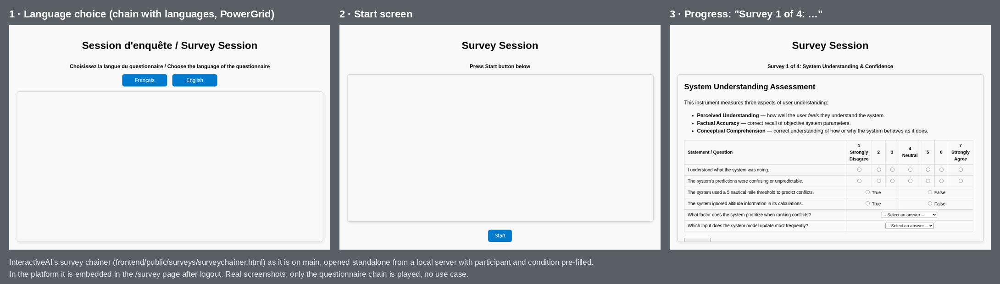

  - A start dialog inside the use-case page: PowerGrid's `AgentChoice.vue`, a modal over the CAB
    page at the start of a session (choose the agents, then "Start"), owned by the PowerGrid
    folder. A Railway introduction before a run can follow it (a Railway-owned modal, no shared
    code).
  - Progress within a run: the bottom panel of PowerGrid and of today's Railway is the shared
    `Timeline` component (the session's cards on a time axis with a "now" line from the context
    date). The Szenario-Loader of a) takes that panel's place for Railway, so the timeline goes;
    there is no progress across runs anywhere in the platform.

    Both, as real components with sample data (*caveat:* mounted in a screenshot harness outside
    the CAB page, with the platform's CSS and texts but 3 sample agents, 4 sample cards and a fixed
    "now"; the platform's web font does not load there, so headings show a serif font):

    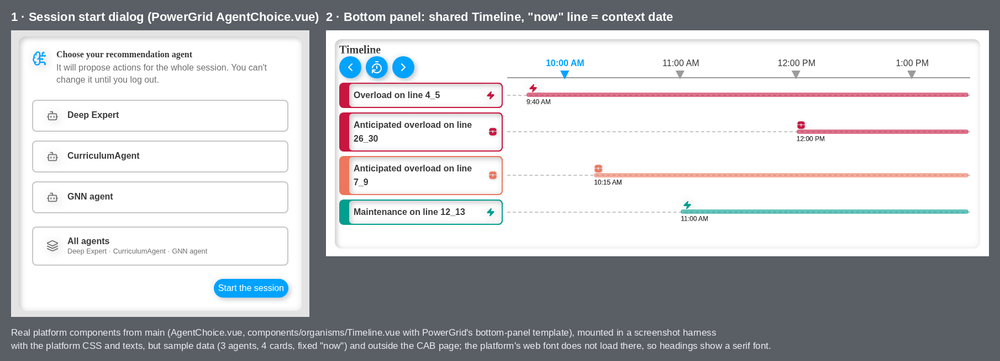
  - a) In the bottom panel "Szenario-Loader" (as in the screenshot), posting to the simulator through
    `/railway-simu/` (Q1's route): start, next, stop. No status polling: the Szenario-Loader itself
    (bottom panel) reads the latest context, the same one the centre panel draws from, for the run
    position (`session.scenario_position`) and the scenario state (`scenario.state`).
  - b) In a separate experimenter page of the simulator (as PowerGrid's simulator dashboard), the
    participant only answers questions; the experimenter clicks "next".
    PowerGrid's dashboard: the scenario dropdown and "Start" / "Pause" / "Stop and reset" (red
    boxes), outside the InteractiveAI page:

    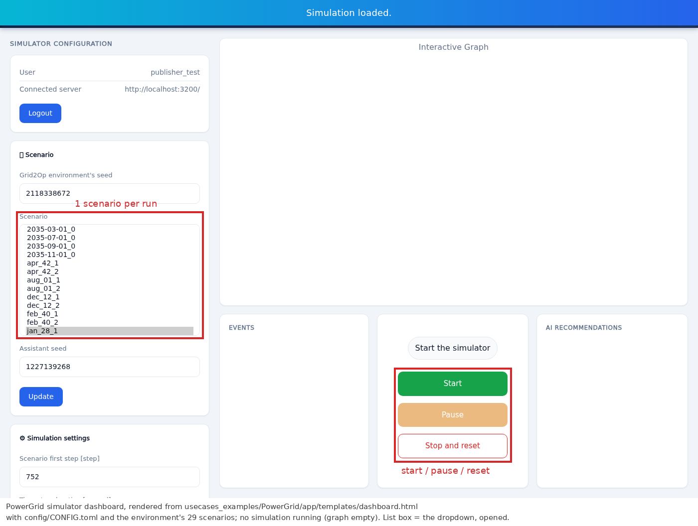
  - c) Simulator config only; every scenario started by the experimenter from a terminal.
  - d) A start dialog and a progress bar, after PowerGrid's agent choice (§4.2.3). After login a
    Railway-owned modal, mounted by Railway's `Assistant.vue` when the latest context has no running
    session (§4.2.6), offers the Experiment and the single run (Q13 d) and starts the chain with one
    `POST /api/v1/session` through `/railway-simu/`, sending the platform's trace session id
    (`currentTraceSessionId()`) as the experiment's `session_id` (D10). Between two scenarios the same modal shows the
    next introduction and "Weiter" (next). The bottom panel's Railway `Timeline.vue` shows a progress
    bar above the shared Timeline ("`Experiment i/n · <scenario name> — <mode> · Schritt N`", F23, from the context's
    `session.scenario_position`), so the Timeline stays. The modal is the Szenario-Loader
    (`ScenarioLoader.vue`) with the Experiment and the single run (Q13 d).
    - Extension points: only Railway's own panels, as `AgentChoice.vue`. No shared code: unlike the
      agent choice, nothing goes into the trace session, since the session lives in the simulator and
      comes back in the context; a reload shows the current progress.
    - Like a), it needs the scenario list and introductions before any context exists (Q26).
    - Differs from a): no permanent controls in the bottom panel, so the bottom panel no longer looks
      like the screenshot; the Szenario-Loader keeps the Experiment and the single run (Q13 d).
  - e) Today's Railway page as it is, no start UI in the platform: the participant logs in and the
    page waits for whatever a simulator posts; the experimenter starts the session outside the
    platform (simulator config or command line: experiment), as PowerGrid's experimenter
    does in the simulator's dashboard (b) and as the handover suggests (Q20). Like c), but the page
    keeps its bottom panel; the progress across runs can still show in the status line above the
    drawing (F4, S10), which reads the context's `session.scenario_position`. That line is the
    centre panel's top row, where the reference screenshot has the control bar ("Start", "Pause",
    "Zurücksetzen", "Tempo", dropped by Q4) and "Schritt 16" (green box; the text is an example):

    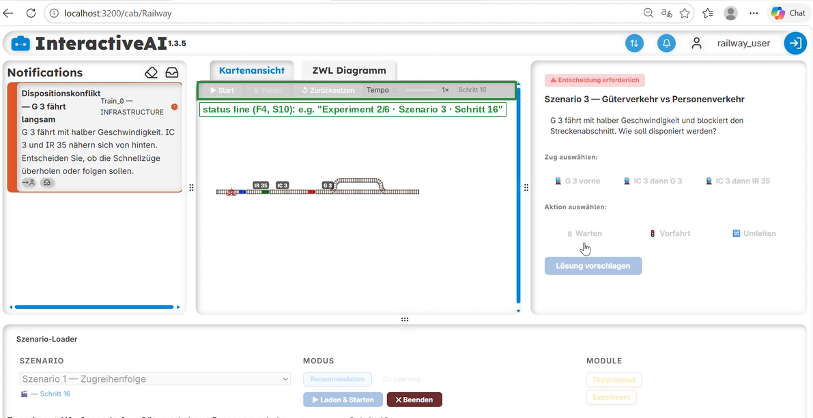

    Today's page has no such row yet (below); S10 adds it in Railway's `Context.vue`
    (`StatusBar.vue`). Today's page with the dev stack's seed event (S16):

    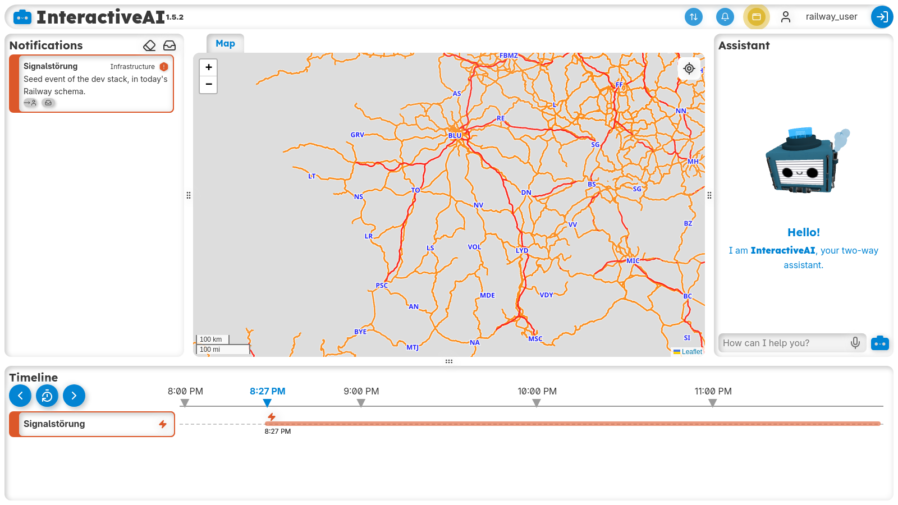

    No platform work for the start; but the participant cannot move to the next scenario
    (F25: "Weiter" in the next introduction) without the experimenter, and the
    introductions and the end screen need another place. An `INFO` event card in the feed would
    do, with platform concepts as they are (the simulator posts it as any event, `ROUTINE`
    criticality); but a feed card is easy to miss and does not hold the next start the way a
    dialog does. The feed sorts by criticality, so the introduction sinks below the decision card
    once that arrives:

    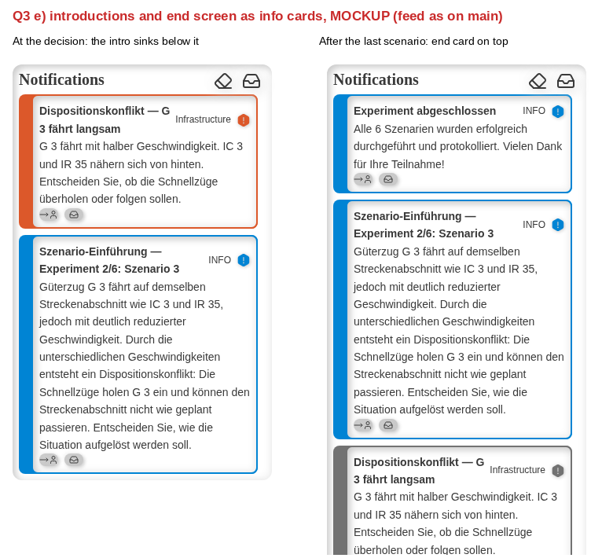

    *Caveat:* Railway's `Notifications.vue` and the shared feed as on `main`, fed with three
    sample cards in a screenshot harness (no OperatorFabric, no simulator); the introduction is
    `railway_sim`'s text for scenario 3 (`SCENARIO_INTROS`, `b612187`), the end card its end
    screen's text; `INFO` is shown as is, since Railway's locales have no label for it. Only the
    feed panel is shown.
  - f) e) with an overlay between scenarios: the experimenter starts the session outside the
    platform as in e); when a scenario ends (the context's `scenario.state = "complete"`), a small
    Railway-owned overlay over the page shows the next scenario's introduction (F22) and "Weiter"
    (F25), which posts "next scenario" through `/railway-simu/` (Q1's route); after the last
    scenario it shows the end screen (F26). The same extension point as d) (Railway's own panels, no
    shared code); d) without the start part.
    - Needs: the simulator's "next" route (S4) and the next scenario's name and introduction
      before it runs (Q26); without the start dialog the `session_id` comes from the experimenter's
      command, not from the page's trace session (D10).
    - Differs from d) only in who starts the session: the experimenter outside the platform (f) or
      the start dialog (d). f) has no experiment choice in the page and no "✕ Beenden".
  - *Proposal (2026-11-10):* d), which follows an existing pattern (PowerGrid's `AgentChoice.vue`)
    without shared code and keeps the Timeline; b) can be added later on the same endpoints. Was a),
    which keeps the screenshot's bottom panel.
- ✅ ~~**(Q6) One mode per session, or both modes per session?**~~ **Decided 2026-11-10, confirmed 2026-11-11:**
  as `railway_sim`'s Experiment: six runs, the scenarios shuffled and split, 3 per mode, the first mode
  drawn at random (F39); the single run is a one-run list (Q13). The draw
  is seeded by the `session_id` (F29, D10). The cleaned simulator
  has one mode per session (`usecases_examples/Railway/integration/session.py`,
  `make_session(participant, mode, scenario_ids)`, added in S1); `railway_sim`'s experiment played
  6 runs, 3 per mode, first mode random.
  - Technically a mode per run adds little: the platform has no mode, session or experiment concept
    (the Recommendation Service, the cards and the traces are the same for both modes), so both
    a mode per session and a mode per run are Railway-only. Every place that uses the mode reads it
    per run anyway: the simulator's lookup key and `decisions[].source`, the event's `run_mode` for
    `RailwayManager` and the assistant panel (Q8), the context's `scenario.mode` for the status line. The extra code is
    the run list in `make_session()` and `SessionRunner` (simulator only).
  - The modules answer most of it (§1.5.3): the Experiment defines both modes in one session (six
    runs, 3 + 3), the single run one run with its scenario and mode (the Testprotokoll is dropped,
    Q16 b).
    So the session needs a run list either way; both are kept (Q13 d).
  - Existing concept in InteractiveAI: none for playing scenarios in a row. PowerGrid plays one
    scenario per simulator run; the experimenter picks it in the simulator's dashboard ("🧩
    Scenario"), and starts, pauses, resets and loads the next one there (screenshot under Q3 b,
    [`powergrid_dashboard.png`](railway-use-case/powergrid_dashboard.png)). What spans several
    scenarios is the platform's trace session (login to logout, `utils/traceSessionExport.ts`),
    whose export covers all of them.
  - Remainder: the order. `railway_sim`'s Experiment drew the first mode and the order at random on
    every start; the plan seeds both with the `session_id` (F29, D10).
  - *Proposal:* a run list `[(scenario_id, mode)]` in the session, built by default as `railway_sim`'s
    Experiment did but seeded. Decided as such (above).
  - Data model impact of the run list: the mode moves from `session.mode` to the current run
    (`scenario.mode`), and `session.scenario_order` holds the runs; §4.1.2 shows this.
- ✅ ~~**(Q4) Drop play, pause, speed and reset?**~~ **Decided 2026-11-11:** dropped, as proposed. The screenshot shows them in the control bar above
  the Kartenansicht ("▶ Start", "⏸ Pause", "↻ Zurücksetzen", "Tempo" slider with "1×"; red boxes
  below), the design requirement D8 says the participant must not control time. *Proposal:* drop
  them; keep "Schritt N" in the status line (green box); the pace is `RAILWAY_STEPS_PER_SECOND`.

  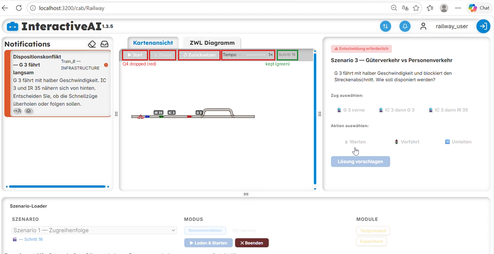
- ✅ ~~**(Q5) Reflection questionnaire.**~~ **Decided 2026-11-10:** d), one questionnaire at the end,
  no questions between scenarios (F24, F25). Existing concept: the post-logout survey
  (`frontend/README.md` "Post-logout survey"). `public/surveys/surveychainer.html` plays a chain of
  questionnaire pages (vendored from the hmisurveys repository, GPL-3.0) in an iframe; `CHAINS`
  holds one chain per use case (today only PowerGrid, in `en`/`fr`; Railway plays `DEFAULT_CHAIN`);
  the platform pre-fills the participant (trace session id) and the condition (use case); on
  "Finish" the answers are posted to the embedding page and downloaded as JSON; nothing goes to the
  backend. It is opened only after logout (`/survey` route, `utils/survey.ts`), not during a session.
  - Why after logout: the platform's session is login to logout (the trace session). On logout
    (`Navbar.vue`, `leave()`) the frontend reads the session id and the use case, `logout()` ends
    the session and writes its session log export (the HTML report held back so it does not cover
    the questionnaire), and `/survey` then plays the chain for the session that just ended; no
    session, no survey. For Railway the logout ends the Experiment (F26).
  - How answers are tied to a person: the Participant ID is the trace session id (random, made at
    login), not the login; the answers file carries no login. The link is the session log export,
    which holds both `userLogin` and the same session id: answers → session id → export → login.
    With D10 the same id is the Experiment's `session_id` in every Railway event and context, so
    answers, export and Experiment share one id; who it was is the study lead's note (Q11).
  - How they are collected: not by the platform. `surveychainer.html` downloads the answers as a JSON
    file in the participant's browser and only tells the page it is done; the Historic Service
    stores no survey answers (`views/Survey.vue`: "Nothing is sent to the backend - the file is the
    deliverable"). The session log export is downloaded too (JSON and an HTML summary). The
    experimenter collects both files from the participant's machine; a skipped survey is lost for
    good, the chain cannot be reopened after the session.
  `railway_sim` had no final questionnaire, only per-run reflection dialogs (A:
  Experiment, after Co-Learning runs only; B: Testprotokoll, after its run; two of the five
  questions at random; answers sent with the run's log to its own server) and an end screen
  without questions (C). It branched off before the post-logout survey existed (1.4.1).
  *Caveat:* the image is a reconstruction, not a screenshot of the running app: the dialogs'
  markup and styles from `railway_sim`'s `Timeline.vue` (`b612187`), rendered without the platform's
  global CSS and without an emoji font (the boxes are 📋, 🧪, ✅); the two questions are one
  possible draw.

  

  - a) A Railway questionnaire page for the existing survey chainer, opened in the bottom panel after
    each scenario; answers downloaded as JSON (as the post-logout survey) with participant and scenario.
  - ~~b) An OperatorFabric card with a response form (card bundle, answers stored by OperatorFabric).~~
    **Discarded 2026-11-07:** a new pattern. No use case, doc or bundle uses OperatorFabric
    responses: the only bundle, `resources/bundles/cab-bundle`, has one display state without a
    response, and the frontend does not show OperatorFabric's card templates at all (it reads the
    card stream and draws cards with its own components, `api/cards.ts`: subscription, read,
    delete, acknowledge). b) would need a response state in the bundle and response handling in
    the shared frontend code, against Q15's principle.
  - c) An external survey tool with the participant code.
  - d) One questionnaire for the whole use case, in the existing design: a `CHAINS.Railway` entry
    in `surveychainer.html` with a Railway reflection page, played by the post-logout survey after
    the Experiment, exactly as PowerGrid's chain. Nothing new besides the chain entry and the page:
    no questionnaire during the session, no new parameter, the existing participant and condition
    pre-fill and JSON download. Trade-offs: the questions are asked once, at the end, not after
    each run; the answers are not tied to a scenario (the chainer knows the participant and the use
    case, not the runs played); F24 and F25 are rewritten (one questionnaire at the end, "Weiter"
    after the introduction) and Q14 falls away; the Experiment goes from one run's end straight to
    the next run's introduction.
  - *Proposal:* d) if the study accepts one reflection at the end, since it reuses the survey
    unchanged; otherwise a). Decided by the study lead; storing answers in the platform is a
    follow-up.
  - For a) and d) the Railway page needs a German questionnaire page; the chainer's `CHAINS` are
    per language, so `CHAINS.Railway` is `{ de: [...] }`: one language, so the chainer asks for none,
    plays the German page and records `language: "de"`; its own frame ("Start", "Finish") stays
    English, since its `TEXT` has only `en` and `fr` (Q7 d).
- ✅ ~~**(Q7) How is the Railway page German while the rest of the platform follows the browser?**~~
  **Decided 2026-11-07:** d) with d1): Railway texts and the platform texts its page shows in
  Railway's `de.json`, `en.json`, `fr.json`, registered as `de-Railway` from the Railway folder and
  picked by the browser language; the scenario texts stay German in the scenario files.
  PowerGrid today: the browser language picks the UI language, `en` or `fr` (`plugins/i18n.ts`,
  `SUPPORT_LOCALES`, fallback `en`); `views/CAB.vue` switches to that language's entity messages
  (`fr-PowerGrid`); there is no language switch in the UI. Only the post-logout survey asks the
  operator for a language (1.5.2, per-language `CHAINS`). Adding `de` to `SUPPORT_LOCALES` needs a
  `de.json` for every entity, since `setupEntitiesLocales()` imports each entity × locale.
  - a) A per-entity locale (`ENTITIES_CONFIG.Railway.locale = 'de'`) applied on entering the page, with
    `de` locale files (missing keys fall back to English).
  - b) German strings in the Railway `en.json`/`fr.json`. No new mechanism, but wrong files.
  - c) Rely on the browser language being German: PowerGrid's approach, plus `de` in
    `SUPPORT_LOCALES`. Works only on browsers set to German.
  - d) All three languages for Railway with the existing mechanism: the German texts of
    `railway_sim` in a new Railway `de.json`, translated into Railway's `en.json` and
    `fr.json`; the browser language picks one, as for PowerGrid. Per use case, without shared code:
    - in a German browser `views/CAB.vue` already switches to `de-Railway`, and vue-i18n looks up
      `de-Railway`, then `de`, then `en`; so Railway only registers its own `de.json` as
      `de-Railway` (`i18n.global.mergeLocaleMessage()`), from a module in `src/entities/Railway/`
      imported by its panels;
    - `SUPPORT_LOCALES` stays `en`, `fr`: adding `de` there would make `setupEntitiesLocales()` import
      a `de.json` for every use case, and a missing one stops the loop and the languages after it;
    - PowerGrid and ATM are unchanged; the platform texts the Railway page shows (header, feed,
      logout, the assistant's generic buttons) go into Railway's `de.json` too: `de-Railway` is
      looked up first, so they apply on the Railway page only. Pages outside a use case (login,
      post-logout survey) stay English in a German browser;
    - the participants' browsers set to German (an assumption checked at setup, Assumptions);
    - the scenario texts (card titles and descriptions, decision questions, option labels, §1.6.1,
      §1.6.2) come from the simulator, not from the locale files. Two ways:
      - d1) they stay German in the scenario files, in every UI language; English and French
        scenario texts are a follow-up;
      - d2) they move into Railway's `de.json`/`en.json`/`fr.json` as keys
        (`railway.scenario3.event16.title`, …): the simulator sends the keys, the
        Railway panels translate them with `t()` (card text in `Notifications.vue`, question and
        options in `Assistant.vue`). Costs: OperatorFabric's card bundle (`cab-bundle/i18n.json`)
        passes title and summary through as they are, for every use case, so the feed shows keys
        unless every place that shows card text is Railway's; the traces and the session export
        hold keys, not readable texts; the simulator's tests and terminal demo need the texts
        from the frontend files; one source of texts becomes two (scenario file for the logic,
        locale files for the words).
  - *Proposal:* d) with d1): it keeps PowerGrid's mechanism and touches no shared code (Q15); the
    registration uses vue-i18n's API from the Railway folder, which no use case does today (New
    patterns). d2) only if English or French participants are planned.
- ✅ ~~**(Q8) Ko-Lernen: how does the participant choose?**~~ **Decided 2026-11-10, confirmed 2026-11-11:** a), the
  two-step choice in the use case only (`ColearningChoice.vue`, S11). The recommendation list already has one
  recommendation per train and action (`actions[0].train`, `actions[0].action`; blocked ones with
  `feasible: "False"`); the question is how the assistant panel shows it.
  - The reference screenshot [`railway_sim.png`](railway-use-case/railway_sim.png) shows a Ko-Lernen
    decision: "Zug auswählen:" and "Aktion auswählen:" with "Lösung vorschlagen" still disabled,
    "Szenario 3 — Güterverkehr vs Personenverkehr" at "Schritt 16" (scenario 3's decision step), the
    train buttons are scenario 3's `train_labels` ("G 3 vorne", "IC 3 dann G 3", "IC 3 dann IR 35"),
    and the cut-off line at the bottom reads "Experiment …/6 · Szenario 3 …", so it is a Ko-Lernen run
    of the Experiment. The faded "Recommendation" in the Szenario-Loader's "Modus" column is the
    locked single-run setting, not the running mode. There is no reference image of the
    Empfehlungsmodus decision panel (F18); it is described from `railway_sim`'s frontend only.
  - The platform has no Ko-Lernen and no Empfehlungsmodus: one flow for every use case ("Get
    recommendation" → cards → "Apply", traces `ASKFORHELP`/`AWARD`). Nearest to Ko-Lernen is
    Railway's "Add a solution" button, which has no handler on `main`; the `SOLUTION` trace type
    exists but nothing sends it.
  - Which runs are Ko-Lernen is not Q8's question but the run list's (Q6, decided: per run, as
    `railway_sim`'s Experiment, §1.5.3). Where the choice sits is Q18 (decided: the assistant panel).
  - a) Two-step choice in the assistant panel, as in `railway_sim` and the reference screenshot
    (F19): first "Zug auswählen:" (one button per train, labelled by `train_labels`), then "Aktion
    auswählen:" ("Warten", "Vorfahrt", "Umleiten"; an action in `invalid_actions` shows the reason and cannot be
    applied, §1.5.2; actions a train does not offer are greyed out, Q28 a)), then the
    KPI preview and "Lösung vorschlagen". The panel groups the list by `actions[0].train`
    (`ColearningChoice.vue`, S11). `railway_sim` showed only the matched option's KPIs ("Vorschau:
    Auswirkungen"), not its label, and "Lösung vorschlagen" applied it at once, without the
    confirmation of the Empfehlungsmodus (`applyColearning()` in its `Assistant.vue`).
    - In the use case only, no core change: `CAB.vue` already loads Railway's own `Assistant.vue`
      (as PowerGrid's `AgentChoice.vue`, §4.2.3). In a Ko-Lernen run (the card's `run_mode`) it shows
      `ColearningChoice.vue` instead of the shared `Recommendations.vue`; the Empfehlungsmodus keeps
      `Recommendations.vue` (its cards and KPI table, Q17 b). Request, `AWARD` trace and apply stay Railway's existing
      `getRecommendation()` call and `onSelection()`, which `ColearningChoice.vue` calls with the
      matched recommendation. Built from the shared atoms (`Button.vue`, `Card.vue`).
    - What `Recommendations.vue` does that `ColearningChoice.vue` must do itself: the
      `RECOMMENDATIONS` session trace when the list is shown, the start of the decision time, through
      the exported `recordTraceForSession()` (same shape). Not needed: the downvote feedback and the
      confirmation modal (a) applies at once).
    - The selected train for the map highlight lives in a Railway-owned module, not the shared app
      store (§5 Frontend).
    - How the panel could look, an ad-hoc mockup (not on `main`) with scenario 3's real Ko-Lernen
      data, before and after the choice:

      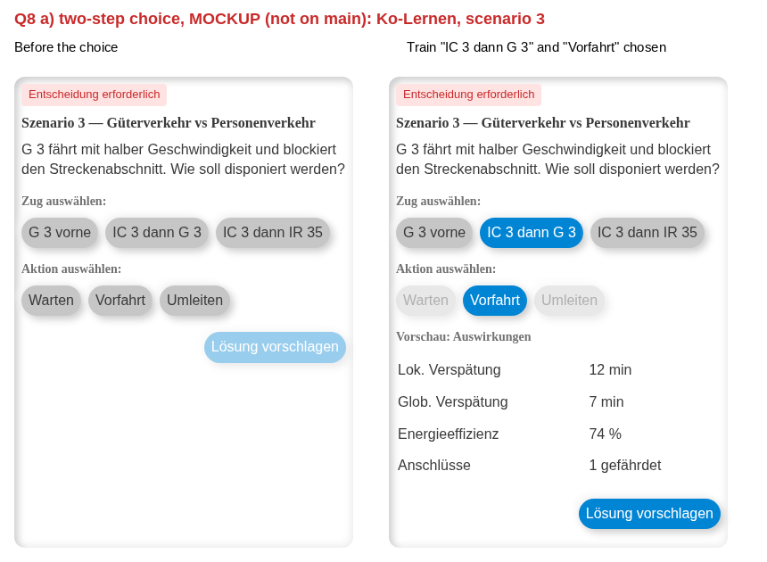

      *Caveat:* only the shared `Button.vue` and the platform CSS are real; layout, texts and the KPI
      preview are a mockup after the reference screenshot and F18/F19, in a screenshot harness
      without the panel frame. No emoji in the action buttons (the harness has no emoji font). In
      scenario 3 every train offers only "Vorfahrt", so "Warten" and "Umleiten" are greyed out once a
      train is chosen, as Q28 a) decides.
  - b) Flat list: the platform default, the list as separate recommendation cards in the shared
    `Recommendations.vue`, one card per train and action, the blocked ones included; only the KPI
    table's `feasible` row tells them apart. No new component. Both modes as the flat list,
    scenario 1's real lists from `payloads.recommendations()`, R0 selected:

    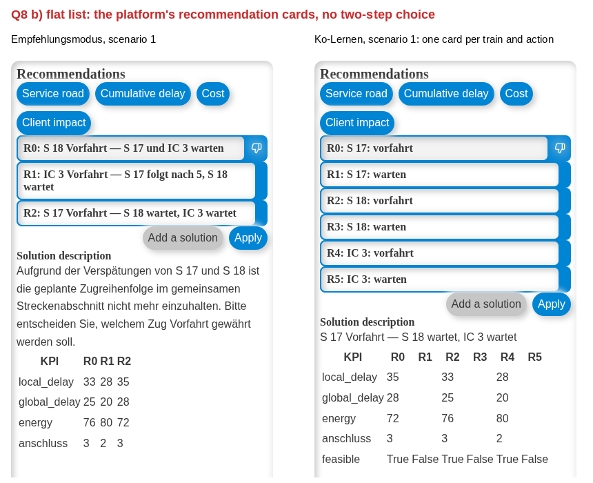

    *Caveat:* the shared `Recommendations.vue` (with `Button.vue`, `Card.vue`, the platform CSS,
    Railway's theme and English texts) as on `main`, with the card, button and KPI-table templates of
    Railway's `Assistant.vue` (tab 2), mounted in a screenshot harness: without the panel frame and
    its tab bar (`components/organisms/CAB/Assistant.vue`), English locale (Railway has no German
    yet, S7), the four catalog filter buttons of today's Railway page, and KPI rows by key, since
    today's table only knows `cost`, `nb_impacted_passengers`, `total_cost`, `delay`. Scenario 1,
    not the reference screenshot's scenario 3.
  - c) Flat list without the blocked actions: b) with the `feasible: "False"` entries left out of
    the list. Fewer cards, but the participant no longer sees that "Warten" was offered and is not
    possible, which `invalid_actions` does on purpose (§1.5.2).
  - *Proposal:* a): it is what the reference screenshot shows and keeps the blocked actions visible
    as blocked. The study lead may change the KPI preview without the option's label and the apply
    without a confirmation.
- ✅ ~~**(Q9) Dev stack: real services, or a full mock?**~~ **Decided 2026-11-07:** a).
  - a) Real Flask services on SQLite with `AUTH_DISABLED`, only Keycloak and OperatorFabric stubbed.
    Exercises the schemas and the managers; needs the services' Python dependencies (the
    Recommendation Service pins `torch`, which the Railway path does not import: the dev stack has
    its own reduced `devstack/requirements.txt`, S6).
  - b) One in-memory mock of all services. Faster to start, but the schema checks of S3 are not
    exercised and the mock drifts from the services.
- ✅ ~~**(Q10) Deployment:**~~ **Decided 2026-11-11:** its own compose, as proposed. The simulator in `config/dev/cab-standalone/docker-compose.yml` as a
  service, or in its own compose next to it (as PowerGrid's simulator,
  `usecases_examples/PowerGrid/docker-compose.yml`, reached through `host.docker.internal`)? *Proposal:* its own compose, as
  PowerGrid, plus the k8s values; decided with the platform maintainers.
- ✅ ~~**(Q11) Participant users:** how many (`P01`–`P20`?) and created how?~~ **Decided 2026-11-10:**
  none, one shared `railway_user` and no participant code: the Experiment is identified by the
  platform's trace session id (D10), as the post-logout survey already does; the study lead maps
  session ids to people. Simpler than d) below, which still asked for a code. A user exists twice: in
  Keycloak (the login) and in OperatorFabric's users (`entities: ["Railway"]`, so Railway's cards
  reach it); today there is only `railway_user`.
  - a) Seed files: the dev Keycloak export, `users-docker.yml` and the server's ConfigMap (§5 Config
    and deployment, S15). Versioned and there after every restart, as D12 asks; a changed count
    means editing the files and redeploying.
  - b) A script against the Keycloak and OperatorFabric admin APIs on the server. Flexible, but more
    code, and a manual step that D12 wants to avoid.
  - c) One shared user, the participant typed in as in `railway_sim`'s "Kürzel": no new users, but
    against the former D10 (one user per participant).
  - d) One shared user (`railway_user`), the participant code typed into the start dialog of Q3 d)
    together with the choice of the experiment, and sent with the session start; the simulator puts
    it into every event and context (D10's second half) and seeds the order with it (F29). No new
    users. What a user per participant adds over d):
    - not the platform's traces: the Historic Service stores no user at all
      (`TraceModel`: `id_trace`, `use_case`, `step`, `date`, `data`); the participant reaches the
      log only through the events' and contexts' `participant`;
    - not separation: OperatorFabric sends every Railway card to every user with the Railway entity;
    - the browser's session export, which names the login (`userLogin`), and a typo-free
      participant code.
  - ~~*Proposal:* a) for dev and the server; count from the study lead.~~ Replaced by the decision
    above.
- ✅ ~~**(Q12) Link map:** still needed next to the map and the ZWL? It was removed in
  `railway_sim`'s last commits. *Proposal:* no; follow-up if requested.~~ **Decided 2026-11-07:**
  needed. A third centre tab "Linienansicht" (F31), its data `infra.link_map` computed once per
  scenario in the simulator (S2), drawn by S17.
- ✅ ~~**(Q13) Which functions of the Szenario-Loader are kept?**~~ **Decided 2026-11-11:** d),
  following Q23 a): with the Testprotokoll dropped, keeping the single run leaves only d). The screenshot shows a single run
  ("Szenario" + "Modus" + "▶ Laden & Starten"), "Testprotokoll" and "Experiment" (§1.5.3); the plan
  had dropped the Testprotokoll in favour of the run list.
  The Testprotokoll is dropped (Q16 b, 2026-11-10), so only the single run and the Experiment
  remain to choose from.
  - ~~a) All three, as in the screenshot.~~ Out with Q16 b).
  - b) Experiment only; trying a scenario is done on the dev stack.
  - ~~c) Testprotokoll and Experiment; no single run without introduction and questions.~~ Out with
    Q16 b).
  - d) Single run and Experiment: each is a run list of Q6 (one run without introduction; six
    runs).
  - *Proposal:* d): the single run is one more run-list variant of Q6, cheap in the simulator; the
    cost is in the start dialog (Q3 d) and its tests. Since Q3 d) the Szenario-Loader is a start
    dialog, so the screenshot's look no longer argues for any option: the question is what the study
    needs. Decided by the study lead together with Q23 (single run and scenario picker dropped?):
    Q23 b) gives b).
- ✅ ~~**(Q14) After which runs come the reflection questions?**~~ **Fallen away 2026-11-10** with
  Q5 d): no questions between runs. In
  `railway_sim`'s Experiment only after
  Co-Learning runs, in the Testprotokoll (dropped, Q16 b) after its run in either mode.
  - a) As in `railway_sim`'s Experiment.
  - b) After every run of the Experiment.
  - *Proposal:* a), since it is what the study ran so far. Decided by the study lead.
- ✅ ~~**(Q15) A new use case, or the existing Railway use case extended?**~~ **Decided 2026-11-10:**
  b), the existing Railway use case extended, backwards compatible (D20). Impact radius checked on
  `main`:
  - a) A new use case following `docs/use_case_managment.md` (e.g. `Flatland`), Railway left as it
    is.
    - Extension points: a folder per service (`resources/<UC>/` with event manager, context manager,
      recommendation manager and both schemas), `resources/cabUsecases*/<UC>*.json` and their load
      scripts, a full `src/entities/<UC>/` (four panels, types, api, locales, theme, logo),
      `entities/config.ts`, the OperatorFabric entity and perimeters in `users-docker.yml`,
      `users-kubernetes.yml`, the ConfigMap and `realtimescreens.json`, Keycloak users,
      `VITE_<UC>_SIMU` in `env.d.ts`, `Dockerfile`, both compose files and `.env`, `CHAINS` in
      the survey chainer: about 20 files outside the new folders.
    - Base code: `ContextIn.use_case` in `context-service/api/schemas.py` is a fixed
      `OneOf(["PowerGrid", "Railway", "ATM"])` and must change; the name must fit the
      `use_case` columns (`String(10)` in the event, context and historic services).
    - No breaking change for today's Railway (GPS view, catalog recommendations, `railway_user`).
  - b) The existing Railway use case extended (what §4–§5 plan today).
    - Only Railway's own extension points change: `resources/Railway/` in the three services,
      `src/entities/Railway/`; registration, entity, perimeters, `railway_user` and
      `VITE_RAILWAY_SIMU` are reused as they are.
    - Base code: none.
    - No breaking changes for today's Railway (D20): the new parts appear only with the new data;
      the cost is a second path in `Context.vue`, `Assistant.vue` and the apply.
  - Independent of a) or b), the nginx route touches config outside the Railway extension points
    (as PowerGrid's); Q7 d needs no shared code.
  - *Proposal:* b): no base code changes, the smallest radius and, with D20, no breaking change; on `main` nothing in the repo
    feeds the old GPS view (no Railway simulator; only the Postman examples).

- ✅ ~~**(Q16) Is the Testprotokoll needed at all, or only for debugging?**~~ **Decided 2026-11-10:**
  b), dropped (F33, §1.7). In `railway_sim` it served
  "onboarding participants or testing individual scenarios" (its README):
  one run with scenario and mode chosen, introduction, reflection questions and a log (§1.5.3).
  - a) Keep it for onboarding: participants do a practice run before the Experiment.
  - b) Drop it: testing a scenario is covered by the dev stack (§6) and, in the study setup, by the
    single run ("Szenario" + "Modus" + "▶ Laden & Starten"); onboarding, if any, is a single run.
  - *Proposal:* b), unless the study plans a practice run with reflection questions. Decided by the
    study lead; the answer narrows Q13.
- ✅ ~~**(Q25) Pause at a decision: as PowerGrid (manual "Resume"), or resumed by the choice?**~~
  **Decided 2026-11-07:** b), the existing plan.
  PowerGrid today (`usecases_examples/PowerGrid/`): at an overload the simulator sends the event and
  the context, then `get_act_from_api()` pauses (`set_pause(True)`, `app/models/Communicate.py`) and
  its dashboard says "Click 'Resume' after making your selection in InteractiveAI". The applied
  recommendation (`POST /api/v1/recommendations`) is only stored; the run continues when the
  experimenter clicks "Resume" in the dashboard (`POST /continue_simulation`) and then reads it. With
  none stored it asks once more, then continues with a do-nothing action. A "Pause" button
  (`POST /pause_simulation`) pauses at any step.
  - a) As PowerGrid: the player pauses, the choice is stored, the experimenter resumes in a simulator
    dashboard. A second window and a person controlling time, against D8 and Q4.
  - b) The player pauses itself at the decision point and the applied choice resumes it (D19,
    §4.2.5): no dashboard, no "Resume", no do-nothing fallback.
- ✅ ~~**(Q26) Where does the Szenario-Loader get the scenario list and the introductions, and what
  does "✕ Beenden" do?**~~ **Decided 2026-11-10:** a). Before a session there is no context, the simulator's routes are not a
  status source (Components), and only the simulator reads the scenario files (Q2); the
  introductions (F22, F32) come from `railway_sim`'s `SCENARIO_INTROS`, today in its frontend.
  - a) A static `GET /api/v1/scenarios` on the simulator's HTTP app (id, name, introduction),
    fetched once when the page loads; the introductions move into the scenario files. "✕ Beenden"
    (`POST /api/v1/session/stop`) ends the session and posts a last context with
    `session.ended_at` set and the run not `complete`, so the Szenario-Loader returns to its start
    view (§4.2.6).
  - b) The names and introductions in Railway's locale files: no new route, but scenario texts in
    two places.
  - *Proposal:* a); it keeps the scenario texts in one place.
- ✅ ~~**(Q27) Where does the simulation run, so that the experimenter starts nothing outside the
  platform?**~~ **Decided 2026-11-10:** a), the simulator as its own always-on service (S15). Requirement (2026-11-10): the participant starts the Experiment in the page; no
  simulation is started by hand.
  - a) The simulator as its own always-on service (S15, Q10): deployed next to the platform and
    started with it (`restart: unless-stopped`, or a k8s Deployment), idle until the start dialog
    (Q3 d) posts the session start through `/railway-simu/`; it then plays the run list and posts
    events and contexts as any simulator. Nobody starts a simulation per experiment: the container
    runs from the deployment on, as the platform's services do. All its code is the
    `railway_use_case` package in `usecases_examples/Railway/` (session runner, HTTP app, start and
    next routes, `recommendations.json`).
  - b) Inside the Context Service. Not consistent with the platform design:
    - the Context Service stores and returns contexts and has no outbound calls (§4.1); its
      per-use-case extension point, `resources/<UC>/context_manager.py`, has only `set_context()`,
      `get_context()` and the `extra_operations()` hook run on every stored context, no route for
      commands such as "start", so a start route is a core change (`api/views.py`);
    - a simulation runs for minutes; the service runs `flask run --reload` (`entrypoint.sh`),
      whose reloader restarts the process and would end a running session, and a thread in a
      request handler is a new pattern;
    - Flatland and the scenario files would move into the service's image (built from
      `backend/context-service/` only), the opposite of "only the simulator reads the scenario
      files";
    - the simulator would write contexts into its own service, bypassing the interoperability API
      every simulator uses (D1, D19), and still post events to the Event Service.
  - What has to stay in the platform's Railway extension points, whatever the answer (each is
    loaded from the service's or the frontend's own folder): the two `MetadataSchemaRailway`
    (S3), `RailwayManager` with its copy of `recommendations.json` (S5), and
    `frontend/src/entities/Railway/` (S7–S12). Everything else is the `railway_use_case` package
    in `usecases_examples/Railway/`.
  - *Proposal:* a); it meets the requirement with the plan's existing design (Q3 d, S4, S15).
    Q10 and Q24 decide only where the always-on service is deployed.

- ✅ ~~**(Q28) Ko-Lernen: show actions a train does not offer?**~~ **Decided 2026-11-11:** a), all three
  actions, the ones not offered greyed out (S11). F19 shows `invalid_actions` as blocked;
  actions not in a train's `train_actions` (in scenario 3 every train offers only "Vorfahrt") are not
  covered. A train's action is one of three kinds (from the scenarios' `colearning_config`):
  - offered and possible: "Vorfahrt" in every scenario;
  - offered but in `invalid_actions`: "Warten" in scenarios 1, 2 and 5. It can be chosen, and the
    panel shows the reason ("Diese Aktion ist für dieses Szenario nicht möglich.", from
    `match_colearning()`). Applying it is blocked (§1.5.2). These are the scenarios' deliberate wrong
    answers, so they stay visible in every option;
  - not offered: "Umleiten" in every scenario, "Warten" in scenarios 3, 4 and 6.

  Options:
  - a) Show all three actions, the ones not offered greyed out, as the reference screenshot shows
    them before a train is chosen. The layout stays the same for every train and scenario. However,
    "Umleiten" is greyed out in all six scenarios.
  - b) Show only the offered actions. There are fewer buttons, but the row changes when another train
    is chosen, and in scenarios 3, 4 and 6 only "Vorfahrt" is left, so the choice of action is no real
    choice.
  - c) As `railway_sim`: all three before a train is chosen; then "Warten" stays and is greyed out if
    not offered, while "Vorfahrt" and "Umleiten" are hidden if not offered (`Assistant.vue`, the
    `v-if`/`:disabled` of the action buttons). This mixes a) and b): in scenarios 1, 2 and 5 it looks
    like b), in scenarios 3, 4 and 6 it shows "Warten" greyed and "Vorfahrt".

  Mockup of a) and b) with scenario 1 (S 18 and the invalid "Warten") and scenario 3 (only
  "Vorfahrt" offered), the same harness and caveats as Q8 a):

  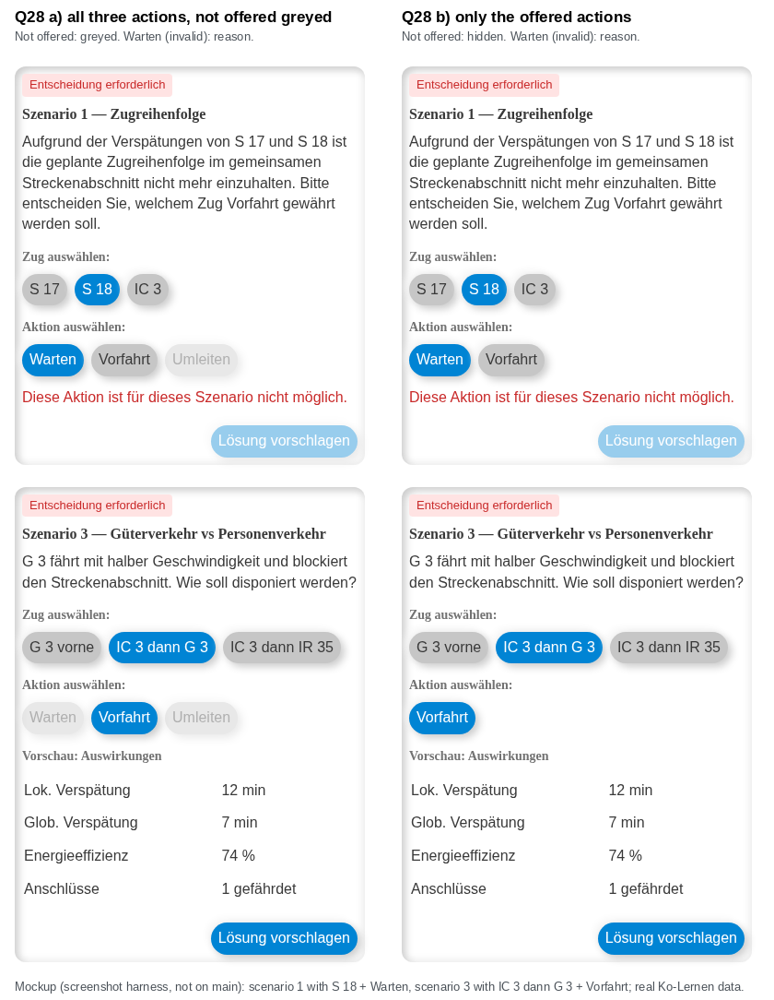
  - *Proposal:* a), as the reference screenshot. Left open on 2026-11-10 for the study lead; decided
    2026-11-11.

- ✅ ~~**(Q29) Session start: a context right away, and a session nobody ended?**~~ **Decided
  2026-11-10:** a); §4.2.6, §5 `app.py` and `loop.py`, T5 and the Assumptions follow it. Two gaps of
  §4.2.6:
  - Between `POST /api/v1/session` and "Weiter" the simulator posts no context. A reload then shows
    the start view again (no context of this `session_id`), and "▶ Laden & Starten" gets a 409.
    The run list in the 201 is the only status the frontend gets outside the context.
  - A participant who logs out without "✕ Beenden" leaves the session running. The next login (a
    new trace session) sees the start view, but its start gets a 409, and only a stop request by
    hand clears it.

  The gaps as planned, then each option on the same two cases. Notation: [UML sequence diagram in
  Mermaid](https://mermaid.js.org/syntax/sequenceDiagram.html); `S1` and `S2` stand for the trace
  session ids of two logins; in the options, the green blocks are what the option adds to §4.2.6.

  ```mermaid
  sequenceDiagram
      actor P as Participant
      actor P2 as Next participant
      participant FE as Frontend (CAB Railway page)
      participant Sim as Railway simulator (HTTP app and SessionRunner)
      participant Ctx as Context Service (cab_context)
      Note over P,Ctx: gap 1, a reload between Laden und Starten and Weiter
      P->>FE: Laden und Starten
      FE->>Sim: POST api v1 session with session_id S1
      Note over Sim: session S1 runs, run list built, no context posted
      Sim-->>FE: 201 with the run list
      FE->>P: introduction of run 1 and Weiter
      P->>FE: reloads the page
      FE->>Ctx: GET latest context
      Ctx-->>FE: the previous session's context, or none
      Note over FE: no context of S1, so the start view, the run list is lost
      P->>FE: Laden und Starten
      FE->>Sim: POST api v1 session with session_id S1
      Sim-->>FE: 409, a session runs
      Note over P: stuck, no Weiter and no new start
      Note over P,Ctx: gap 2, a session nobody ended
      Note over Sim: session S1 runs, run 3 of 6, still posts contexts and events
      P->>FE: logout without Beenden
      P2->>FE: logs in, trace session S2
      FE->>Ctx: GET latest context
      Ctx-->>FE: context of S1
      Note over FE: session_id is not S2, so the start view
      P2->>FE: Laden und Starten
      FE->>Sim: POST api v1 session with session_id S2
      Sim-->>FE: 409, a session runs
      Note over P2: stuck, no start
  ```

  Options:
  - a) `POST /api/v1/session` posts a first context right away (`session` with the run list,
    `scenario_position` 0, run 1 with `scenario.state` `ready`); the start dialog shows run 1's
    introduction from it, as between runs, and the 201 has no body to read. A start with another
    `session_id` ends the running session (sets its `ended_at`) and starts the new one; 409 only for
    the same `session_id` (a second tab, a double click). Both gaps are closed in the simulator;
    nobody acts by hand.

    ```mermaid
    sequenceDiagram
        actor P as Participant
        actor P2 as Next participant
        participant FE as Frontend (CAB Railway page)
        participant Sim as Railway simulator (HTTP app and SessionRunner)
        participant Ctx as Context Service (cab_context)
        Note over P,Ctx: gap 1 with a), a reload between Laden und Starten and Weiter
        P->>FE: Laden und Starten
        FE->>Sim: POST api v1 session with session_id S1
        Note over Sim: builds the run list of S1
        rect rgb(211, 249, 216)
        Sim->>Ctx: POST context with session S1, position 0, run 1 ready
        Sim-->>FE: 201, no body to read
        FE->>Ctx: GET latest context
        Ctx-->>FE: context of S1, run 1 ready
        end
        FE->>P: introduction of run 1 and Weiter
        P->>FE: reloads the page
        FE->>Ctx: GET latest context
        rect rgb(211, 249, 216)
        Ctx-->>FE: context of S1, run 1 ready
        FE->>P: introduction of run 1 and Weiter, as before the reload
        end
        P->>FE: Weiter
        FE->>Sim: POST api v1 session next
        Sim->>Ctx: POST context with run 1 running, step 0
        Note over P,Ctx: gap 2 with a), a session nobody ended
        Note over Sim: session S1 runs, run 3 of 6
        P->>FE: logout without Beenden
        P2->>FE: logs in, trace session S2
        FE->>Ctx: GET latest context
        Ctx-->>FE: context of S1
        Note over FE: session_id is not S2, so the start view
        P2->>FE: Laden und Starten
        FE->>Sim: POST api v1 session with session_id S2
        rect rgb(211, 249, 216)
        Note over Sim: another session_id, so it ends S1, sets its ended_at, builds the run list of S2
        Sim->>Ctx: POST context with session S2, position 0, run 1 ready
        Sim-->>FE: 201
        FE->>Ctx: GET latest context
        end
        FE->>P2: introduction of run 1 and Weiter
        opt the same session_id again, a second tab or a double click
            FE->>Sim: POST api v1 session with session_id S2
            Sim-->>FE: 409, nothing changes
        end
    ```

    S2's first context replaces S1's at once. A card of S1 still open in the feed stays until
    `deleteAllCards.sh` (Assumptions).
  - b) As planned, plus a Limitation and a README checklist line: the experimenter stops a session
    by hand (`POST /api/v1/session/stop`, e.g. with `curl` through `/railway-simu/`) when a
    participant is stuck. No code change; both gaps are closed by the experimenter, who has to be
    at hand.

    ```mermaid
    sequenceDiagram
        actor P as Participant
        actor P2 as Next participant
        participant FE as Frontend (CAB Railway page)
        participant Sim as Railway simulator (HTTP app and SessionRunner)
        participant Ctx as Context Service (cab_context)
        actor Exp as Experimenter
        Note over P,Exp: gap 1 with b), a reload between Laden und Starten and Weiter
        P->>FE: Laden und Starten
        FE->>Sim: POST api v1 session with session_id S1
        Sim-->>FE: 201 with the run list
        P->>FE: reloads the page
        Note over FE: no context of S1, so the start view
        P->>FE: Laden und Starten
        FE->>Sim: POST api v1 session with session_id S1
        Sim-->>FE: 409, a session runs
        rect rgb(211, 249, 216)
        P->>Exp: asks for help
        Exp->>Sim: POST api v1 session stop
        Sim->>Ctx: POST context with session.ended_at of S1
        P->>FE: Laden und Starten
        FE->>Sim: POST api v1 session with session_id S1
        Note over Sim: the same run list, seeded by S1
        Sim-->>FE: 201 with the run list
        FE->>P: introduction of run 1 and Weiter
        end
        Note over P,Exp: gap 2 with b), a session nobody ended
        Note over Sim: session S1 runs, run 3 of 6
        P->>FE: logout without Beenden
        rect rgb(211, 249, 216)
        Note over Exp: README checklist before the next participant
        Exp->>Sim: POST api v1 session stop
        Sim->>Ctx: POST context with session.ended_at of S1
        end
        P2->>FE: logs in, trace session S2
        P2->>FE: Laden und Starten
        FE->>Sim: POST api v1 session with session_id S2
        Sim-->>FE: 201 with the run list
        FE->>P2: introduction of run 1 and Weiter
    ```
  - *Proposal:* a): the context stays the only status source (design principles), a reload works,
    and nobody has to clean up between participants (one participant at a time, Assumptions).
    Needs one more `scenario.state` value, `ready`, set by `SessionRunner`, not by the player.
- **(Q30) Kubernetes: where does the Railway simulator run, and under which address does the
  frontend pod reach it?** Blocks S23. Found while implementing S15 (2026-11-11): the compose
  deployment (S15) runs the simulator on the platform's host, reached as
  `http://host.docker.internal:5124/`; on the public Kubernetes deployment that name does not
  resolve, and nginx does not start with an upstream it cannot resolve, so the ConfigMap's
  `/railway-simu/` location and `RAILWAY_SIMU_UPSTREAM` in `values.ovh.yaml` wait for the address.
  - a) Behind the passerelle, as PowerGrid's simulator
    (`https://interactivepowergrid.passerelle.irt-systemx.fr/`): a vhost for the Railway
    simulator on a host of SystemX's choice, running its own compose (S15).
  - b) In the cluster: a Deployment and Service for the simulator image, upstream
    `http://<service>.cab.svc.cluster.local:5124/`; needs the image built and pushed by
    `docker-build-push.yml` and a chart template.
  - *Proposal:* a), since it repeats PowerGrid's setup and needs no chart change; decided with
    SystemX (the platform maintainers).

### Handover

Where the handover notes of `railway_sim` (§9 "UI features", §3 "Target architecture") differ from
this plan.

- ✅ ~~**(Q17) Recommendations: the platform's cards, or the screenshot's KPI table?**~~ **Decided
  2026-11-10:** b), the platform's cards with the handover's labels; F18, F19, §1.5.2 and the
  Components follow it. Handover: the
  platform's recommendation cards, "no development", KPI labels "Lokale Verspätung",
  "Gesamtverspätung", "Energie", "Anschlüsse". Source: the handover's §1 "Short version" ("event
  cards, the assistant panel and recommendation cards work with no development", from the
  platform maintainers' directives), §9.1 row 4 ("Recommendation cards with KPIs (Empfehlungsmodus)
  | InteractiveAI | exists (check KPI names)") and §9.2 item 4 (one card per option, the four
  labels as a mapping of the KPI keys). Its reason is effort: reuse what the platform has and put
  the new frontend work into the centre panel; it does not compare with the screenshot. Plan (F18): a KPI table with one column per option,
  labels "Lok. Verspätung", "Glob. Verspätung", "Energieeffizienz", "Anschlüsse", which changes the
  Railway `Assistant.vue` (S11).
  - a) The screenshot's table and labels (F18 as planned): `railway_sim`'s Empfehlungsmodus
    (`Assistant.vue` at `b612187`), one column per option ("Option A", …), the option labels as
    buttons in an "Aktion" row, values with units ("… min", "… %", "… gefährdet") coloured by
    `railway_sim`'s thresholds, "Lösung vorschlagen" with a confirmation. A Railway panel of its own
    for the Empfehlungsmodus, next to `ColearningChoice.vue`.
  - b) The platform's cards with the handover's labels; F18 shrinks to the German labels. This is
    Railway's `Assistant.vue` on `main`: `Recommendations.vue`'s cards ("R0: <option label>", …),
    "Apply", and below them a KPI table, also one column per recommendation, with plain numbers.
    Not quite "no development": that table's rows are fixed to the catalog's keys (`cost`,
    `nb_impacted_passengers`, `total_cost`, `delay`), so they become the scenario's KPI keys, with
    their labels in Railway's locales (S7).

  Mockup of both with scenario 1's options, Option B / R1 selected; same harness and caveats as
  Q8 a):

  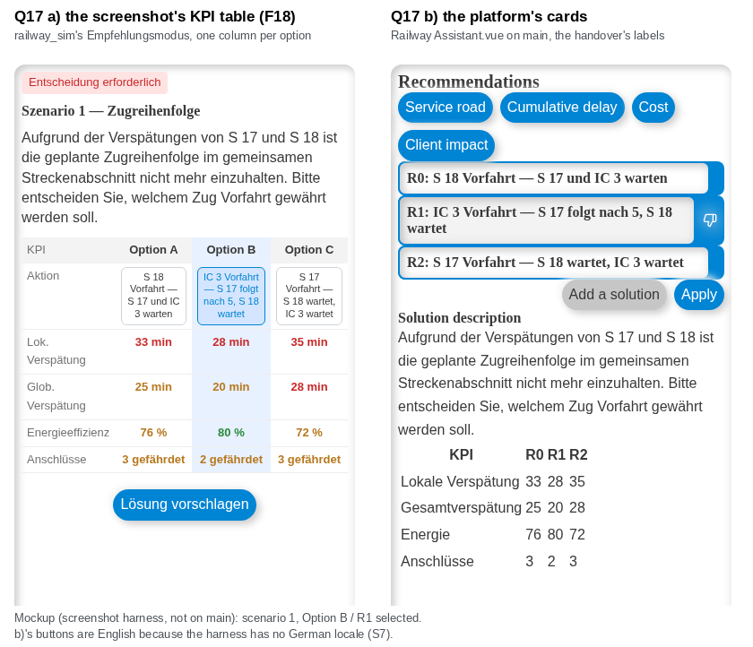
  - *Proposal:* a): the screenshot is the visual target.
- ✅ ~~**(Q18) Ko-Lernen two-step choice: centre panel or assistant panel?**~~ **Decided
  2026-11-10:** a), the assistant panel: b) is not less complex (the same components, plus shared
  state in both directions) and a) is the better UI (the reference screenshot, the choice next to
  the card and its decision text). Handover: in the centre
  panel. Source: the handover's §9.3 item 5: the flat list of train + action cards comes "without
  extra work"; "Decide with Janick whether the flat list is acceptable for the experiment. If not,
  build the two-step choice in the centre panel." Also §9.1 row 5 ("InteractiveAI cards / centre
  panel") and §9.4 item 16 (the train highlight, "only if the two-step choice (#5) is built"). It
  gives no reason for the centre panel; it follows from §1, where "the main new frontend work is
  the context view (centre panel)" and the assistant panel counts as finished platform code. Plan (Q8, F19): in the assistant panel, as in `railway_sim`, with the selected train
  highlighted in the Kartenansicht.
  - a) Assistant panel (Q8 a), decided): where `railway_sim` and the reference screenshot have it.
    The decision text, the choice and "Lösung vorschlagen" stay together on the right, next to the
    card; the map in the centre only highlights the selected train. In the use case only:
    Railway's own `Assistant.vue` and `ColearningChoice.vue` (S11).
  - b) Centre panel, as the handover suggests: the choice below the map, so the selected train and
    the choice are seen together; the assistant panel keeps the decision text only. The map gets
    less room (F3: the drawing fits the panel without scrolling), the choice is lost on the "ZWL
    Diagramm" and "Linienansicht" tabs unless each tab repeats it, and the apply then starts in
    `Context.vue`, not in the assistant panel, where the platform's request, `AWARD` trace and
    apply live (`onSelection()`, §4.2.5).

  Mockup of both from the reference screenshot; b) moves its choice region into the centre panel
  (green: where the choice sits):

  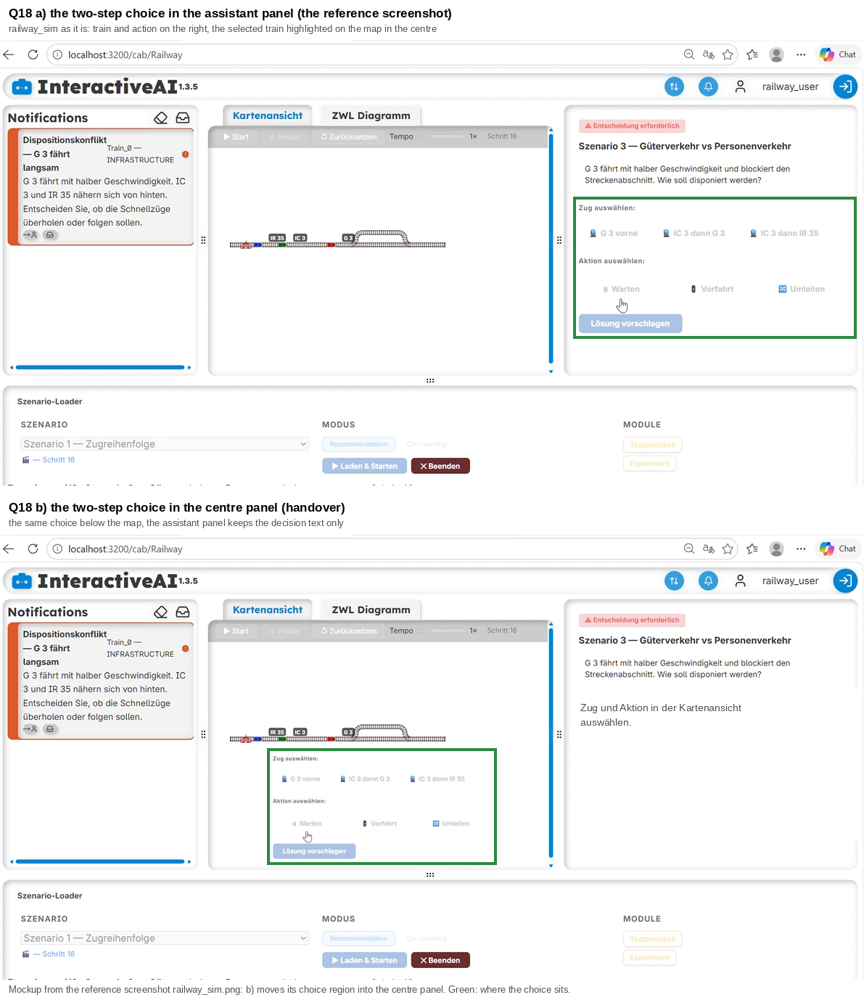

  Both options from opening the card to the applied choice. Notation: [UML sequence diagram in
  Mermaid](https://mermaid.js.org/syntax/sequenceDiagram.html); the brackets name the folder each
  component lives in: [Railway entity] = `frontend/src/entities/Railway/` (the frontend's extension
  point for Railway), [frontend shared] = `frontend/src/stores/` and `frontend/src/api/`,
  [recommendation service, Railway resources] = `backend/recommendation-service/resources/Railway/`,
  [usecases_examples Railway] = `usecases_examples/Railway/`; "(added)" and "(modified)" mark what
  S5 and S11 change, everything else stays as on `main`. Yellow: where the two options differ. The simulator part is the same in both options; only the frontend side differs.

  a) Assistant panel:

  ```mermaid
  sequenceDiagram
      actor P as Participant
      participant Notif as Notifications.vue [Railway entity]
      participant Asst as Assistant.vue [Railway entity] (modified)
      participant CC as ColearningChoice.vue [Railway entity] (added)
      participant Sel as colearning.ts [Railway entity] (added, selected train)
      participant Map as Context.vue with NetworkMap.vue [Railway entity] (modified)
      participant Store as services.ts and cards.ts [frontend shared] (unchanged)
      participant Rec as RailwayManager [recommendation service, Railway resources] (modified)
      participant Hist as Historic Service (unchanged)
      participant Sim as app.py [usecases_examples Railway] (added)
      P->>Notif: opens the decision card
      Notif->>Asst: card selected, run_mode colearning
      Asst->>Store: getRecommendation for the card
      Store->>Rec: POST recommendation request with the event
      Rec-->>Store: one recommendation per train and action from recommendations.json
      Store-->>Asst: the list
      rect rgb(255, 243, 191)
          Asst->>CC: shows the list grouped by train
          P->>CC: Zug auswählen
          CC->>Sel: selected train
          Sel-->>Map: highlights the train
      end
      P->>CC: Aktion auswählen
      Note over CC: matches train and action to a recommendation, KPI preview or the reason
      P->>CC: Lösung vorschlagen
      rect rgb(255, 243, 191)
          CC->>Asst: onSelection with the matched recommendation
      end
      Asst->>Store: sendTrace AWARD
      Store->>Hist: POST trace
      Asst->>Sim: POST railway-simu api v1 recommendations with actions[0] and event_id
      Asst->>Store: resolveCriticality, the panel closes
  ```

  b) Centre panel:

  ```mermaid
  sequenceDiagram
      actor P as Participant
      participant Notif as Notifications.vue [Railway entity]
      participant Asst as Assistant.vue [Railway entity] (modified)
      participant Sel as colearning.ts [Railway entity] (added, list, selected train and choice)
      participant Ctx as Context.vue with NetworkMap.vue [Railway entity] (modified)
      participant CC as ColearningChoice.vue in Context.vue [Railway entity] (added)
      participant Store as services.ts and cards.ts [frontend shared] (unchanged)
      participant Rec as RailwayManager [recommendation service, Railway resources] (modified)
      participant Hist as Historic Service (unchanged)
      participant Sim as app.py [usecases_examples Railway] (added)
      P->>Notif: opens the decision card
      Notif->>Asst: card selected, run_mode colearning
      Asst->>Store: getRecommendation for the card
      Store->>Rec: POST recommendation request with the event
      Rec-->>Store: one recommendation per train and action from recommendations.json
      Store-->>Asst: the list
      rect rgb(255, 243, 191)
          Asst->>Sel: hands the list to the centre panel (new)
          Note over Asst: shows the decision text only
          Sel-->>Ctx: list present, shows ColearningChoice below the map
          Ctx->>CC: the list grouped by train
          P->>CC: Zug auswählen
          CC->>Sel: selected train, the map highlights it
      end
      P->>CC: Aktion auswählen
      Note over CC: matches train and action to a recommendation, KPI preview or the reason
      P->>CC: Lösung vorschlagen
      rect rgb(255, 243, 191)
          CC->>Sel: the chosen recommendation (new)
          Sel-->>Asst: watches the choice, calls onSelection (new)
      end
      Asst->>Store: sendTrace AWARD
      Store->>Hist: POST trace
      Asst->>Sim: POST railway-simu api v1 recommendations with actions[0] and event_id
      Asst->>Store: resolveCriticality, the panel closes
      rect rgb(255, 243, 191)
          Sel-->>Ctx: list cleared, the choice disappears (new)
      end
  ```

  - Both stay in Railway's own folders; no shared code changes. Both add and modify the same
    components; they differ in what the components hold:

    | Component | a) Assistant panel | b) Centre panel |
    |---|---|---|
    | `ColearningChoice.vue` | added, shown by `Assistant.vue` | added, shown by `Context.vue` |
    | `colearning.ts` | added, holds the selected train | added, holds the list, the selected train and the choice |
    | `Assistant.vue` | modified: shows `ColearningChoice.vue` in Ko-Lernen runs and receives the choice directly | modified: hands the list over, shows the decision text only, watches for the choice |
    | `Context.vue` | modified anyway for the map, ZWL and link map (S8, S9, S17), plus the train highlight | the same, plus the choice below the map |
  - a) keeps the Components table's responsibility of `Context.vue`, "Not for controls that change
    the simulation"; b) would put the choice that changes the simulation there.
  - b) needs three more hand-overs through `colearning.ts` (the list to the centre panel, the
    choice back to `Assistant.vue`, clearing it after the apply), because the request and
    `onSelection()` stay in `Assistant.vue`, where the platform calls them. Moving them into
    `Context.vue` instead would copy the trace and apply path into a second place.
  - *Proposal:* a). Q8 a), the two-step choice, is decided.
- ✅ ~~**(Q19) Status line: also state and mode?**~~ **Decided 2026-11-11:** c), the mode only, in
  the progress bar (F23). Handover: scenario name, "Szenario 2 von 6", step,
  state ("Läuft", "Entscheidung erforderlich", "Abgeschlossen") and mode ("Empfehlungsmodus",
  "Ko-Lernen"). Plan: "Schritt N" above the drawing (F4), "`Experiment i/n · <scenario name> ·
  Schritt N`" in the bottom panel's progress bar (F23); state and mode are shown nowhere (only the open decision,
  F17, F35).
  - a) As planned (the screenshot's look).
  - b) Add state and mode to F4 (or F23): the badges "Läuft" and "Ko-Lernen" next to "Schritt N".
  - c) Add the mode only, to F23: "`Experiment i/n · <scenario name> — <mode> · Schritt N`", as
    `railway_sim`'s Experiment banner (§1.5.3).

  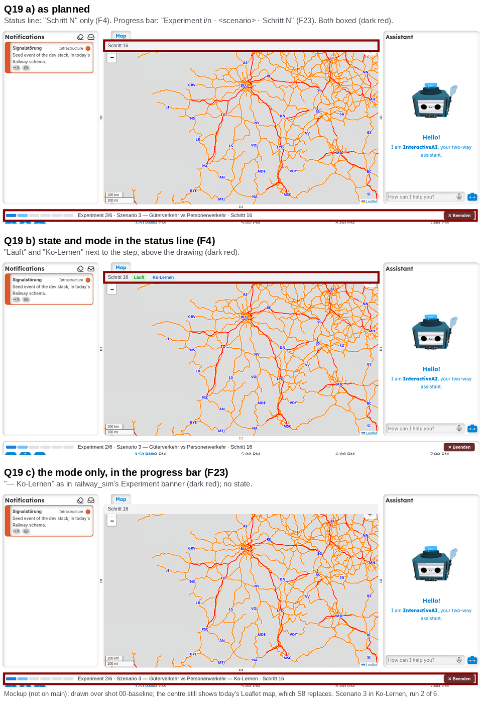

  *Caveat:* drawn over shot `00-baseline` (the Railway page on `main`, today's Leaflet map in the
  centre, which S8 replaces), not built; scenario 3 in Ko-Lernen, run 2 of 6.

  | | a) as planned | b) state and mode in F4 | c) mode in F23 |
  |---|---|---|---|
  | Cost | None on top of the plan: "Schritt N" in `StatusBar.vue` (S10) and the progress text in `ScenarioProgress.vue` (S12) are built anyway. | a), plus a mapping of `scenario.state` (`running`, `paused_for_decision`, `complete`) to three labels and colours and of `scenario.mode` to two labels; 5 texts × 3 locales (S7's files); Vitest for the mapping; shot `06-status`. | a), plus `scenario.mode` in the progress text and its two labels; 2 texts × 3 locales; the progress bar's shot. |
  | Advantages | Fewest texts; the screenshot's control bar row as it was. | All the handover asks; state and mode next to the drawing, where the participant looks. | The mode in every frame of the recordings and for the experimenter at a glance; the same as `railway_sim`'s Experiment banner, which the study used. |
  | Disadvantages | The mode is shown nowhere: only the assistant panel's layout (list or two-step choice, Q8) tells it; F23 drops the mode `railway_sim`'s banner had. | The state repeats what is shown already: `paused_for_decision` is the F35 prompt and the assistant panel's badge, `complete` never stays on screen (the Szenario-Loader takes over, Q3 d, Q22 b); only "Läuft" is new, and the moving trains show it. | No state, as the handover asked; the bottom panel is less in view than the status line. |

  - The same in all three: the frontend reads only the latest context, which carries `scenario.state`
    and `scenario.mode` already (§4.1.2); no shared code, no simulator change. "Schritt N" shows in
    both F4 and F23 in every option.
  - For the study lead in b) and c): the participant sees the mode named. `railway_sim` named it too
    (its Experiment banner), so the study did so already.
  - *Proposal (2026-11-11):* c), the gap a) leaves at the lowest cost, without repeating the state;
    replaces the earlier proposal b). Decided by the study lead.
- ✅ ~~**(Q20) Session start: simulator config or Szenario-Loader?**~~ **Decided 2026-11-10** with
  Q3 d): the start dialog. Handover: simplest is participant
  and mode in the simulator config, a start screen only if the experimenter cannot be at the
  machine. Plan: the Szenario-Loader as a start dialog (Q3 d). The handover's option is Q3 c). Decided with Q3.
- ✅ ~~**(Q21) Who decides the reflection questionnaire?**~~ **Decided 2026-11-10:** the study lead
  decides the questions (F24); with Q5 d) nothing in the platform changes but the `CHAINS.Railway`
  entry in `surveychainer.html`, which the maintainers review in the PR. Handover: with SystemX (the
  platform maintainers). Plan (Q5): the study lead.
  - *Proposal:* the study lead, with the maintainers' OK for options that touch the platform (Q5 a,
    c); Q5 d only adds a survey chain.
- ✅ ~~**(Q22) End screen: text and place?**~~ **Decided 2026-11-11:** b), F26 in the Szenario-Loader
  with the logout hint. Handover: "Vielen Dank – das Experiment ist beendet." in
  the centre panel. Plan (F26): `railway_sim`'s "✅ Experiment abgeschlossen — Alle Szenarien wurden
  erfolgreich durchgeführt und protokolliert. Vielen Dank für Ihre Teilnahme!" in the start dialog (Q3 d).
  - a) The handover's text as a centre-panel state, in place of the map.
  - b) F26 in the Szenario-Loader, as `railway_sim`'s end screen, plus a logout hint: "Bitte melden
    Sie sich jetzt oben rechts ab. Danach folgen die Reflexionsfragen." F26 alone does not say that
    the questionnaire comes only after the logout (F24, Q5 d), so a participant could close the tab
    and skip it. The dialog covers the panels, not the navbar, so the logout stays reachable;
    `railway_sim`'s "Schliessen" button is left out, as there is nothing to go back to.
    - `railway_sim`'s text says "Alle 6 Szenarien"; F26 leaves the number out, since the run list
      decides it (Q6).
    - With cards on the board, the logout first asks whether to delete them (`Navbar.vue`,
      `modal.info.DELETE_ALERTS`). The participant then sees that question before the
      questionnaire; the S15 checklist deletes the cards before a session anyway (F27).

  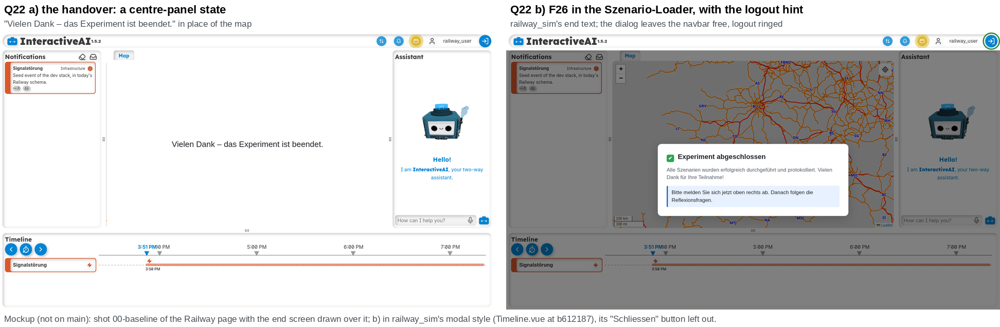

  *Caveat:* drawn over shot `00-baseline` (the Railway page on `main`), not built; b) in
  `railway_sim`'s modal style (`Timeline.vue` at b612187).
  - Technically b) is a little lighter, by a few lines, not by design:
    - b) adds one view to `ScenarioLoader.vue`, which has the start view, the introductions and
      the view between runs anyway (Q3 d) and already picks its view from the latest context; the
      end screen's condition (`session.ended_at` set, last run `complete`, §4.2.6) is one it
      checks.
    - a) needs the same condition in the dialog, which must not show its start view over the end
      state, plus a state in `Context.vue` that hides the map and shows the text: b)'s logic and a
      second component that knows the session state.
    - The same in both: the files (`Context.vue` changes anyway in S8, `ScenarioLoader.vue` is new
      anyway in S12), no shared code, shot `12-end`, the logout and the questionnaire. The logout
      hint is one line of text in the same view.

    So the choice rests on what the study used and on the hint, not on the code.
  - *Proposal:* b), F26 as planned (what the study used) with the logout hint; decided by the study
    lead.
- ✅ ~~**(Q23) Free-run mode and scenario picker: dropped or kept?**~~ **Decided 2026-11-11:** a), as
  proposed: the single run with the "Szenario" dropdown stays, so Q13 is d). Handover: both
  dropped. Plan: §1.7 drops free-run mode unless Q13 keeps the single run ("Szenario" + "Modus" +
  "▶ Laden & Starten", §1.5.3, Q13 d), which is `railway_sim`'s Free Mode with the scenario dropdown.
  - a) Keep the single run; Q13 decides which functions stay.
  - b) Drop it: Q13 b), and the "Szenario" dropdown goes.
  - *Proposal:* a), resolved together with Q13 (Q16 is decided: b).
- ✅ ~~**(Q24) Deployment: InteractiveAI's compose or its own?**~~ **Decided 2026-11-11 with Q10:** its own. Handover: the simulator in
  InteractiveAI's compose, on the same server. Plan (Q10): its own compose next to it, as
  PowerGrid's simulator. Both run on the same server and are reached only through the platform's
  nginx (D1).
