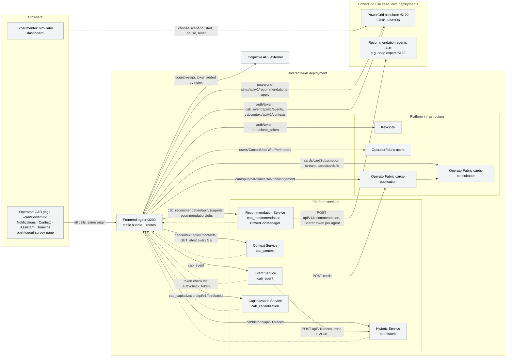
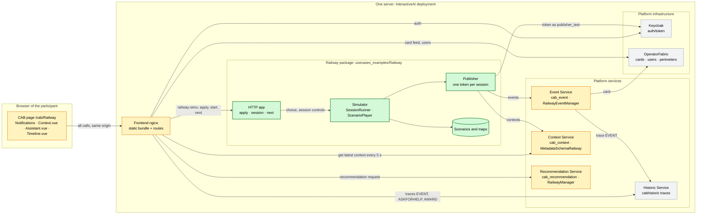
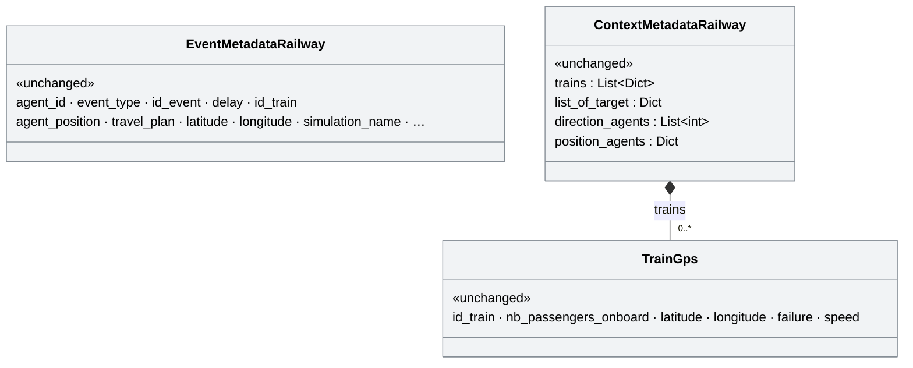
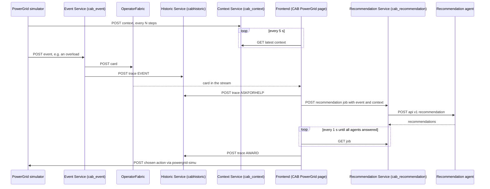
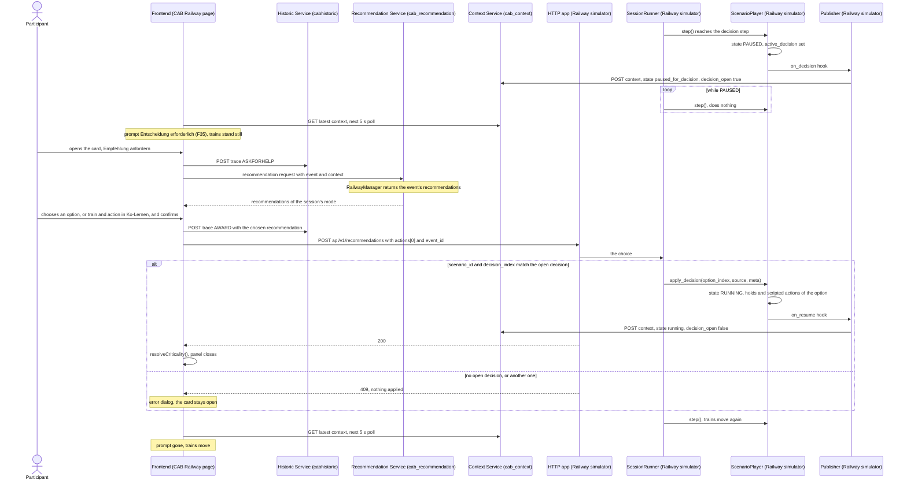

# Railway use case on the InteractiveAI pipeline

## Goal

Two names are used throughout:

- **`railway_sim`**: the old standalone prototype, to be replaced (branch `FHNWtec-version`, head
  `b612187`, merge base `ca4e325`): a separate Flask server next to the platform plus an Angular app
  in an iframe. It polled the Flask server every second, fetched a token per request, posted
  notification cards straight to OperatorFabric and did not use the Context Service. It is the
  reference for the user-facing features (§1), not for the design.
- **`railway_use_case`**: the new implementation this plan builds: the cleaned simulator (§5
  "Simulator") on the platform's generic pipeline, with the platform and frontend changes of §5.

`railway_use_case` brings the Railway dispatcher experiment (six scripted Flatland scenarios, two
decision modes) into InteractiveAI so that it runs on the platform's generic pipeline, the same one
PowerGrid uses:

- the simulator only **sends** events and contexts (Event Service, Context Service); it reads no
  platform service and receives only the operator's choice and the session controls, through the
  frontend's proxy, as PowerGrid's simulator does (Q1, Q3);
- the frontend only **reads** the context and draws it in the centre panel;
- recommendations come from the Recommendation Service: Railway's extension point
  (`RailwayManager`) returns the ones the decision's event carries; there is no Railway agent, a
  deviation from the maintainers' directive still to be confirmed (Q2);
- every operator action is logged by the platform (Historic Service traces).

At the end, the CAB page `/cab/Railway` looks the same as, or very close to, the reference screenshot
[`railway_sim.png`](railway-use-case/railway_sim.png): notifications on the left, "Kartenansicht" / "ZWL Diagramm" tabs in the
centre, the decision panel on the right, the "Szenario-Loader" at the bottom. The whole flow can be
run and screenshotted without Docker.

## Status

- **2026-11-07:** plan initialised. Nothing implemented yet.
- **Base:** `main` at `600a1ce` (release 1.5.2).
- **Inputs:**
  - the cleaned simulator: `railway_sim`'s simulator, cleaned and headless (Flatland
    4.2.6, 38 pytest tests, no HTTP), delivered outside the repo; its layout and API are in
    §5 "Simulator". It is the functional reference for the simulation and the payload drafts.
  - [`railway_sim.png`](railway-use-case/railway_sim.png): the screenshot of `railway_sim`, the
    visual target.
  - the platform maintainers' integration directives and the handover notes of `railway_sim`; their
    requirements are collected in §2.
- **Motivation:** `railway_sim`'s design cannot be logged, cannot be deployed next to
  PowerGrid on the public server and loaded the platform with continuous requests. The experiments
  depend on the Railway use case running on the generic pipeline; the platform maintainers asked
  for it within a week (early November 2026).

| Carried out | Commit |
|---|---|
| - | - |

| Remaining | Planned commit message |
|---|---|
| S6, S16, S1–S5, S7–S9, S17, S10–S15 | see the step tables of §7 (in this order) |

## Design principles

- **The simulator talks to the platform only through the interoperability APIs:** events to
  `/cab_event/`, contexts to `/cabcontext/`, never to OperatorFabric. (§2 D1–D3, D14.)
- **Each context is complete and self-contained.** The frontend only sees the latest one and there is
  no "changes only" mechanism, so every context carries the static infrastructure, the train states
  and the full history the ZWL needs. (§2 D4.)
- **The frontend draws everything from the context.** No images, no status or history endpoints of
  the simulator; the centre panel is a pure function of the latest context plus local UI state. (§2 D5.)
- **Recommendations come from the Recommendation Service**, in the documented response format, so
  the platform shows and logs them. They are hard-coded in the scenario files: the simulator puts
  the open decision's recommendations into the event that carries the decision, and
  `RailwayManager` returns them. No agent, no copy of the scenarios outside the simulator. (§2 D6,
  Q2.)
- **The simulator sets the pace;** the participant does not control time. No play, pause, speed or
  reset in the participant UI. (§2 D8, Q4.)
- **The operator's choice returns to the simulator the way PowerGrid's does:** one POST per applied
  recommendation through the frontend's same-origin proxy. The experiment controls (start a session,
  next scenario) use the same route. (Q1, Q3.)
- **Requests are sent on change, not on a fixed timer:** one token per session (refreshed when it
  expires), a context at each change and, while trains move, every N steps (N steps ≈ one 5 s poll
  at the configured pace). (§2 D7.)
- **One code base per concern:** the simulator and the scenario definitions live in one Python
  package; only the simulator reads the scenario files. (Q2.)
- **All text the participant sees is German**, from locale files, not hard-coded; the Railway page
  also exists in English and French, picked by the browser language as for PowerGrid. (§2 D9, Q7.)
- **Base classes and shared platform code stay untouched; only existing extension points are used**
  (the per-use-case folders `resources/<use case>/` of the services, `src/entities/<use case>/`,
  the registration JSONs, users and config). Where a step needs more, it says so: the nginx
  route and `start-webui.sh` (S11), `CHAINS` in `surveychainer.html` (S12, Q5),
  `cypress.config.ts` (S16). (Q15.)
- **As close as possible to PowerGrid's pattern** where Railway needs the same thing (apply path,
  simulator layout, start dialog); deviations are explicit questions (Q1, Q2, Q25).
- **Follow the code where the docs disagree:** `/cabcontext/` instead of the documented
  `/cab_context/`, `actions[0]` instead of "the actions array" (§2 D4, D18).
- **Schemas only gain optional fields;** old fields are still accepted (Breaking changes).
- **Everything can run without Docker:** the real Flask services with SQLite and their existing
  `AUTH_DISABLED` switch, plus a small gateway that stands in for Keycloak and OperatorFabric. (§3, Q9.)

Reused concepts:

| Need | Reused concept | Instead of |
|---|---|---|
| Show scenario events as cards | Event Service → OperatorFabric card feed (`RailwayEventManager`, `cabProcess`) | posting cards to OperatorFabric directly |
| Give the frontend the simulation state | Context Service + `servicesStore.getContext()` polling | simulator endpoints `/state`, `/history`, `/render` |
| Ask for recommendations | Recommendation Service → `RailwayManager.get_recommendation()`, Railway's extension point, answering in the response format of `docs/AIAgent_integration.md` from the event's metadata (§4.1.2) | a Railway agent service (PowerGrid's pattern, Q2), a Railway-only recommendation endpoint |
| Return the operator's choice | PowerGrid's apply path: `applyRecommendation()` → nginx same-origin proxy (`/powergrid-simu/` → `/railway-simu/`) → simulator `POST /api/v1/recommendations`, runtime upstream via `start-webui.sh` placeholders | a status poll from the frontend; a new platform service |
| Log the choice | `sendTrace(... 'AWARD')` in the Railway `Assistant.vue`, the historic traces | the old `ExperimentLogger` JSON files |
| Close the card after a decision | `cardsStore.resolveCriticality()` + `appStore.tab.assistant = 0`, as today in `onSelection` | a "decision applied" card from the simulator |
| Layout (left, centre tabs, right, bottom) | `views/CAB.vue` slots and the entity components `Railway/CAB/{Notifications,Context,Assistant,Timeline}.vue` | a separate app in an iframe |
| Reflection questionnaire | the survey chainer `public/surveys/surveychainer.html` (per-use-case `CHAINS`, `frontend/README.md` "Changing the questionnaires") and `views/Survey.vue`'s message handling | a questionnaire form of its own |
| Simulator layout in the repo | `usecases_examples/PowerGrid/` (own compose, own port, own README) | a new top-level folder |
| Participant identity | one Keycloak/OperatorFabric user per participant, as `railway_user` today (`users-docker.yml`, `dev-users-0.json`) | a participant code typed into the UI |
| Run the services without Keycloak | `AUTH_DISABLED=true` + `DEFAULT_USE_CASE` in `cab_common_auth`, started as in `docs/developer-guide.md` ("Test Mode using python virtualenv"), on the host ports of `docker-compose.yml` | patching the decorators |
| Register the use case | `resources/cabUsecases*/Railway*.json` + the load scripts, the steps of `docs/use_case_managment.md` | hard-coded registration |
| New proxy target | `README.md` "How runtime nginx configuration works": `__NAME__` placeholder, `SUBST_VARS` in `start-webui.sh`, the location in every nginx config and in the k8s ConfigMap | a build-time URL in the bundle |
| Record user-visible changes | `CHANGELOG.md`: each feature commit adds its line under `## Unreleased`, the release commit turns it into a version (as `7ccf097` → `fa2917f`) | a changelog of the plan |
| Clear old cards | `resources/deleteAllCards.sh` | MongoDB deletes from the simulator |
| e2e tests with screenshots and video | Cypress (already a dev dependency, `cypress.config.ts`) | a new browser-test framework |
| ZWL distances, link map | `_compute_marey_mapping`, `_build_link_map` of `railway_sim` (`app.py`) | a new algorithm |

## Terms

- **Scenario** (`scenario`, `experiment_scenarios/scenarioN.py`): one scripted run on one map with 2–3
  trains, timed events and one decision point. Six exist, `scenario1`…`scenario6`, German texts. Not a
  Flatland random env: nothing is generated or computed live.
- **Session** (`session`, `make_session()`): one participant playing an ordered list of scenarios.
  Fields `session_id`, `participant`, `mode`, `scenario_order`, `scenario_position`, `started_at`.
- **Participant** (`session.participant`): pseudonym such as `P01`; equals the login of the
  participant's platform user.
- **Mode** (`session.mode`): `recommendation` ("Empfehlungsmodus": choose one of the scenario's
  options) or `colearning` ("Ko-Lernen": choose a train and an action, mapped to an option by
  `match_colearning()`).
- **Action** (Ko-Lernen): `vorfahrt`, `warten`, `umleiten` (labels "Vorfahrt", "Warten", "Umleiten").
  `invalid_actions` are offered on purpose but not feasible.
- **Event** (scenario): `train_delay` (holds a train `duration` steps) or `info` (only a card). Each
  becomes an InteractiveAI event (`POST /cab_event/api/v1/events`) and an OperatorFabric card.
- **Decision point** (`decision_points[i]`, `decision_index`): the step where the player pauses
  (`paused_for_decision`) until an option is applied. The card that carries it has
  `data.decision_index` set; a **decision event** ("Entscheidung erforderlich") is sent only when no
  scenario event falls on that step (scenario 4).
- **Option** (`options[k]`, `option_index`): one scripted outcome of a decision point with fixed KPIs
  `local_delay`, `global_delay`, `energy`, `anschluss`.
- **Context** (`POST /cabcontext/api/v1/contexts`): the full snapshot of §4.1.2.
- **Recommendation**: one item of `RailwayManager`'s answer `{title, description, use_case, agent_type, kpis,
  actions}`; `actions[0]` = `{scenario_id, decision_index, option_index[, train, action]}`.
- **Kartenansicht** (network map): the Flatland grid with tracks, stations and trains. Not a
  geographic map: the Leaflet map of today's Railway view goes away.
- **ZWL** (Zeit-Weg-Linien, time-distance or Marey diagram): distance along the scenario's line
  (`marey_link`) against step.
- **Link map** (`infra.link_map`, tab "Linienansicht"): the scenario's line (`marey_link`) laid out
  straight in three rows: the main track in the middle, side tracks above and below. Not a second
  network map: it shows only the cells reachable from the line.
- **Train** (scenario): three identifiers for one train: the Flatland handle (`"0"`, the key in
  `history` frames), `id_train` (`"Train_0"`, in events, `planned_paths` and `actions[0].train`) and
  the display name (`name`, "S 17"). Labels shown to the participant always use the name.
- **Step** (`scenario.step`): one simulation step; 1 step/s by default.
- **Dev stack**: the Docker-free local setup of §3, §6 and §7 Phase 1. Not a deployment.

## Components

| Component | Responsibility | Change |
|---|---|---|
| Railway simulator (`usecases_examples/Railway/`) | Plays the scenarios of a session, sends events and contexts, waits for the operator's choice. Not for drawing, logging or computing recommendations. | 🟩 added: the scenarios run on the platform instead of in a separate server with its own UI. |
| Railway publisher | Sends events and contexts to the platform with one reused token. Not for OperatorFabric or any other target. | 🟩 added: the platform logs every scenario event. |
| Railway simulator HTTP endpoints | Receive the applied recommendation and the experiment controls (start, next scenario). Not a status, image or history source. | 🟩 added: choosing a recommendation moves the trains on. |
| `RailwayManager` (Recommendation Service) | Answers Railway recommendation requests with the recommendations the event of the open decision carries. Not for ranking or changing recommendations, and not for knowing scenarios. | 🟨 modified: "Get recommendation" shows the scenario's options with their KPIs (or the Ko-Lernen choices); events without them still get today's catalog. |
| `MetadataSchemaRailway` (Event and Context Service) | Says which Railway fields an event or context may carry. Not for the meaning of the fields. | 🟨 modified: the services accept the scenario, session and infrastructure fields. |
| Railway `Context.vue` (centre panel) | Shows the latest context: map, ZWL, link map, status. Not for controls that change the simulation. | 🟨 modified: the participant sees the track network, the time-distance diagram and the link map instead of a geographic map. |
| Railway `Assistant.vue` (right panel) | Shows the event, asks for recommendations, lets the operator choose and apply one. Not for computing options. | 🟨 modified: German KPI table; in Ko-Lernen the choice is "train, then action" as in the screenshot. |
| Railway `Timeline.vue` (bottom panel) | The "Szenario-Loader": session start, progress, next scenario, reflection questions, end screen. Not for play/pause/speed. | 🟨 modified: the experimenter starts a session and the participant moves to the next scenario here. |
| Railway questionnaire (`public/surveys/railway/`) | The reflection questions (when and where: Q5). Not PowerGrid's post-logout survey. | 🟩 added: participants answer the reflection questions in the platform. |
| Railway locales (`de`, `en`, `fr`) | The texts of the Railway page in the browser's language, German for the participants. Not a translation of the other use cases, and not the scenario texts (Q7 d1). | 🟩 added: the Railway page is in German. |
| Frontend nginx `/railway-simu/` | Same-origin route from the browser to the simulator endpoints. Not for the platform services. | 🟩 added: no CORS and no public simulator port. |
| Dev gateway (`usecases_examples/Railway/devstack/`) | Stands in for Keycloak and OperatorFabric and routes to the locally started services, so the platform runs without Docker. Not for any deployment. | 🟩 added: developers and automated checks can run and screenshot the full flow on one machine. |
| Cypress Railway e2e | Clicks through a scenario and records screenshots and a video. Not a load test. | 🟩 added: from the first step on, every change to the page is shown in screenshots, and the final look and flow are checked against the reference screenshot. |
| Participant users (`P01`…) | One platform user per participant, so every logged action carries the participant. Not the experiment's session or order. | 🟩 added: each participant logs in with their own pseudonym (Q11). |
| Railway simulator deployment unit | Runs the simulator next to the platform on the same server. Not a second entry point: it is reached only through the frontend nginx. | 🟩 added: the experiment runs on the public deployment (Q10). |
| Event, Context, Historic Services, OperatorFabric, Keycloak | Platform services. | ⬜ unchanged |

## 1. Functional requirements (user's view)

Sources: the cleaned simulator, `railway_sim`'s frontend and the screenshot. "F-n"
labels are used in the step tables. All texts are German as quoted.

### 1.1 Layout (screenshot)

- **F1** The CAB page `/cab/Railway` with the platform header (logo, version, user, logout). The
  logged-in user is the participant.
- **F2** Left: the platform's "Notifications" feed with the event cards (title, train/type line,
  criticality marker, description, the two small actions); the descriptions (2–3 sentences) are
  not cut off.
- **F3** Centre: tabs "Kartenansicht" (default), "ZWL Diagramm" and "Linienansicht" (Q12; not in the
  screenshot), the drawing fitting the panel
  without scrolling (maps up to 25 × 25 cells).
- **F4** Above the drawing, a status line in place of the old control bar: "Schritt N" (the old
  "Start", "Pause", "Zurücksetzen", "Tempo" are dropped, Q4).
- **F5** Right: the decision panel (see 1.4).
- **F6** Bottom: the "Szenario-Loader" (see 1.5).

### 1.2 Centre panel: Kartenansicht

- **F7** Tracks drawn per cell from the Flatland transition ints: straight, curve, switch, crossing,
  dead end; sleepers as in the screenshot.
- **F8** Trains as coloured blocks at their cell, with the direction of travel, and a dark label with
  the train name ("IR 35", "IC 3", "G 3"). Trains not yet departed or arrived are hidden.
- **F9** Held trains (`failure`) in red, with the delay if space allows.
- **F10** Stations ("`Station <id>`") and train start markers; optionally each train's target cell.
- **F11** The view refreshes with every new context; trains do not jump more than the context
  interval allows (5 s poll, §2 D7).
- **F35** While a decision is open, a prompt "Entscheidung erforderlich – bitte Ereigniskarte
  öffnen" above the drawing; optionally the trains involved highlighted (those held, or the
  decision's trains in Ko-Lernen).
- **F36** Optional (nice to have): a train table with name, planned and actual departure and
  arrival, delay and status ("wartet", "unterwegs", "angekommen").

### 1.3 Centre panel: ZWL Diagramm

- **F12** x = distance along the scenario's line, y = step; one line per train in its colour with its
  name; cells off the line are not drawn.
- **F13** The current step as a horizontal line.
- **F14** The planned path as a dashed line (from `planned_departure` and `route`).
- **F31** Linienansicht: the scenario's line as three rows of track (main line in the middle, side
  tracks above and below, their level labelled), stations, and the trains placed through
  `link_map.mapping`; trains off the mapped cells are not drawn. One line per scenario, so no line
  selector (`railway_sim`'s dropdown had one entry).

### 1.4 Right panel: event and decision

- **F15** Clicking a card opens the assistant: "`<title> erkannt.`" and the "Empfehlung anfordern"
  button (today: "Get recommendation from maze").
- **F16** On a card without a decision (pure delay info) `RailwayManager` returns an empty list; the panel
  says "Keine Entscheidung erforderlich".
- **F17** Header of an open decision: badge "⚠ Entscheidung erforderlich", the scenario name, the
  decision description.
- **F18 Empfehlungsmodus:** one recommendation per option; a KPI table with rows "Lok. Verspätung",
  "Glob. Verspätung", "Energieeffizienz", "Anschlüsse" (values as "… min", "… %", "… gefährdet") and
  one column per option ("Option A", "Option B", …); "Lösung vorschlagen" with a confirmation "Lösung
  bestätigen" ("Möchtest du diese Lösung wirklich anwenden?", "Abbrechen" / "Bestätigen"). The two
  modes are compared in §1.5.2.
- **F19 Ko-Lernen:** "Zug auswählen:" (one button per train, label from `train_labels`), then
  "Aktion auswählen:" ("⏸ Warten", "🚦 Vorfahrt", "🔀 Umleiten"), then "Lösung vorschlagen".
  Infeasible combinations (`kpis.feasible = "False"`) are visible but blocked with the reason (the
  recommendation's `description`); `feasible` is not shown as a KPI. Optional "Vorschau:
  Auswirkungen" KPI preview. The selected train is highlighted in the Kartenansicht (local UI state, as
  `railway_sim`'s `/session/selected_train`).
- **F20** After applying: the panel closes, the card loses its criticality, the trains move again
  ("✓ Lösung angewendet.").

### 1.5 Bottom panel: Szenario-Loader and experiment flow

Three columns, as in the screenshot: "Szenario" (dropdown of §1.5.1), "Modus" (§1.5.2) and
"Module" (§1.5.3). Which of them are kept is Q13.

- **F21** Session start by the experimenter: the participant is the logged-in user (shown, not
  typed, D10), mode ("Empfehlungsmodus" / "Ko-Lernen", D9; or the run list of Q6), "▶ Laden &
  Starten", "✕ Beenden".
- **F22** Before each scenario: the scenario introduction ("📋 Szenario-Einführung — Run i/n", texts
  per scenario from `railway_sim`'s `SCENARIO_INTROS`), then the scenario starts.
- **F23** While running: "`Experiment i/n · <scenario name> · Schritt N`".
- **F24** After a run (which runs: Q14): "📋 Reflexionsfragen — Run i/n", two of the five questions at random,
  free text "Ihre Antwort...":
  "Auf welche Logik habe ich mich gestützt?", "Welche Informationen fehlten, die mir geholfen hätten?",
  "Welche Faktoren habe ich für meine Entscheidung berücksichtigt?", "Was ist die wichtigste
  Erkenntnis für das nächste Mal?", "Gab es ein Bauchgefühl, das ich ignoriert habe?"
- **F25** "Weiter" starts the next scenario only after the questions are answered or skipped.
- **F26** End: "✅ Experiment abgeschlossen — Alle Szenarien wurden erfolgreich durchgeführt und
  protokolliert. Vielen Dank für Ihre Teilnahme!"
- **F27** A new session starts with a clean feed (no cards of the previous participant).

#### 1.5.1 Scenarios

The "Szenario" dropdown lists the six scenarios by their `name`, in this order. All are scripted:
trains, events, the decision and its outcomes are fixed in `experiment_scenarios/scenarioN.py`
(§1.6.1, §1.6.2). Departure and arrival are planned steps.

| Scenario | Map | Trains (departure → arrival) | Situation | Decision at step |
|---|---|---|---|---|
| "Szenario 1 — Zugreihenfolge" | `map1` 25 × 25 | S 17 (1 → 60), S 18 (22 → 77), IC 3 (33 → 68) | An obstacle holds S 17 for 30 steps, a signal fault holds S 18 for 18 steps; the planned order on the shared section no longer works. Who gets priority? | 40 |
| "Szenario 2 — Türstörung" | `map2` 15 × 20 | S 17 (1 → 35), IR 35 (10 → 35), S 17-2 (13 → 39) | A door fault holds S 17 for 6 steps; IR 35 and S 17-2 reach a single-track section at the same time. Who passes first? | 15 |
| "Szenario 3 — Güterverkehr vs Personenverkehr" | `map3` 15 × 20 | G 3 (1 → 40, always half speed), IC 3 (12 → 34), IR 35 (14 → 36) | The slow freight train blocks the section, the two fast trains catch up. Follow, or let G 3 pull aside? | 16 |
| "Szenario 4 — Verschobene Kreuzung" | `map4` 15 × 20 | IR 35 (1 → 20), G 4 (17 → 38), IC 3 (20 → 41) | A signal fault holds IR 35 for 17 steps; it reaches the crossing section together with G 4 and IC 3. Who gets priority? | 22 |
| "Szenario 5 — Fahrt auf Sichtweite" | `map5` 25 × 25 | P 205 (1 → 80), G 501 (15 → 80), P 312 (12 → 85) | A speed limit of 40 km/h delays P 205 by 8 steps; crossing conflict with G 501 and P 312 on the single-track section. Which order? | 22 |
| "Szenario 6 — Anschlusskonflikt" | `map6` 15 × 20 | IC 3 (1 → 20), S 12 (9 → 23), IR 35 (18 → 32) | A fault holds IC 3 for 8 steps; the connection to S 12 is at risk. Does S 12 wait? | 13 |

- **F32** Each scenario has a German introduction ("📋 Szenario-Einführung"), taken from
  `railway_sim`'s `SCENARIO_INTROS`; there, scenario 5's name was misspelt "Sichtweise", the
  scenario file's "Sichtweite" is used.

#### 1.5.2 Modes: Recommendation and Co-Learning

Both modes play the same scenario with the same decision point and the same options (§1.6.2);
they differ in who builds the solution and when the KPIs are shown.

| | "Recommendation" (`recommendation`, "Empfehlungsmodus") | "Co-Learning" (`colearning`, "Ko-Lernen") |
|---|---|---|
| Who proposes | The system: all options of the decision point, side by side. | The participant: picks a train, then an action. |
| What the panel shows | The KPI table of all options (F18). | "Zug auswählen:", "Aktion auswählen:" ("⏸ Warten", "🚦 Vorfahrt", "🔀 Umleiten"), then the KPIs of the chosen combination only ("Vorschau: Auswirkungen", F19). |
| How the choice becomes an option | The chosen column is the option. | `match_colearning()` maps train and action to an option: `train_to_option` if the scenario has it, otherwise the first option where the train is not held ("Vorfahrt"), held ("Warten") or rerouted ("Umleiten"). |
| Infeasible choices | none | Actions in `invalid_actions` are shown but blocked: "Diese Aktion ist für dieses Szenario nicht möglich." |
| Button | "Lösung vorschlagen" → "Lösung bestätigen" | "Lösung vorschlagen" |
| Recorded as | `decisions[].source = "recommendation"` | `decisions[].source = "colearning"` with `train` and `action` |

In all six scenarios only "Vorfahrt" leads to an option: "Warten" is offered in scenarios 1, 2 and 5
but always blocked, "Umleiten" is offered in none. So Co-Learning is in effect "which train gets
priority", worded by `train_labels` where the scenario has them.

#### 1.5.3 Modules: Testprotokoll and Experiment

The two buttons of the "Module" column; in `railway_sim` both asked for a participant
code ("Kürzel") and logged decisions and reflection answers to JSON files. Next to them, "Szenario" +
"Modus" + "▶ Laden & Starten" start one run without introduction or questions (`railway_sim`'s "Free
Mode", decisions not logged there).

| | "Testprotokoll" | "Experiment" |
|---|---|---|
| Purpose | Onboarding a participant, or trying one scenario. | The study session. |
| Runs | One. | Six: every scenario once, 3 in each mode. |
| Scenario and mode | Chosen by the participant in the dialog. | Not chosen: the first mode is random, the scenarios are shuffled and split, first half in the first mode, second half in the other. |
| Steps shown | "1 Anmeldung → 2 Szenario → 3 Reflexion → 4 Protokoll", banner "🧪 Testprotokoll läuft — Schritt 2/3". | Banner "`Experiment i/6 · <name> — <mode> · Schritt N`". |
| Introduction | Before the run. | Before each run. |
| Reflection questions | After the run: two of the five, "Absenden & Protokoll speichern". | After Co-Learning runs only, two of the five, "Weiter ▶". |
| End | "✓ Testprotokoll abgeschlossen", shows the saved log. | "✅ Experiment abgeschlossen …" (F26). |

- **F33** Testprotokoll: a session whose run list (Q6) has one run, scenario and mode chosen in the
  Szenario-Loader, with introduction, reflection questions and an end screen.
- **F34** Experiment: a session with the six-run list of Q6, introduction before each run, reflection
  questions as decided in Q14, end screen F26.
- In the platform the participant code is the logged-in user (D10), so neither module asks for a
  "Kürzel"; every run is logged by the platform (traces), the single run included.

### 1.6 Simulation (from the cleaned simulator)

- **F28** Six scenarios, maps `map1`–`map6`, events at fixed steps, one decision point each; arrival
  steps as in `tests/test_sim.py`'s `EXPECTED_ARRIVALS`.
- **F29** Scenario order per session shuffled with the participant as seed (same order on restart).
- **F30** Ko-Lernen mapping and feasibility by `match_colearning()` / `colearning_view()`.

#### 1.6.1 Events: hard-coded, at fixed steps

Every event is written into the scenario file (`events[]`) with its step, type, train, hold and card
text. No rule detects a conflict: `ScenarioPlayer.step()` fires an event when the step counter reaches
its `timestep`, once. Two types:
- `train_delay`: holds the train for `duration` steps, and sends a card;
- `info`: only sends a card (the conflict cards).

A card goes out as an InteractiveAI event unless the event says `push_card: false` (none does). The
card that falls on the decision point's step carries `decision_index`; when no event falls on that
step (scenario 4), the publisher sends a decision event "Entscheidung erforderlich" with the decision
description (`payloads.decision_event()`).

| Scenario | Step | Type | Train | Hold | Card title | Carries the decision |
|---|---|---|---|---|---|---|
| 1 | 14 | `train_delay` | S 17 | 30 | "Betriebsstörung — S 17" | |
| 1 | 25 | `train_delay` | S 18 | 18 | "Signalstörung — S 18" | |
| 1 | 40 | `info` | S 17 | - | "Dispositionskonflikt — Zugreihenfolge" | yes |
| 2 | 3 | `train_delay` | S 17 | 6 | "Türstörung — S 17" | |
| 2 | 15 | `info` | IR 35 | - | "Dispositionskonflikt — Entscheidung erforderlich" | yes |
| 3 | 16 | `info` | G 3 | - | "Dispositionskonflikt — G 3 fährt langsam" | yes |
| 4 | 5 | `train_delay` | IR 35 | 17 | "Signalstörung — IR 35" | |
| 4 | 22 | decision event | - | - | "Entscheidung erforderlich" | yes |
| 5 | 5 | `train_delay` | P 205 | 8 | "Streckenkontrolle — Vmax 40 km/h" | |
| 5 | 22 | `info` | P 205 | - | "Dispositionskonflikt — Kreuzungsreihenfolge" | yes |
| 6 | 5 | `train_delay` | IC 3 | 8 | "Betriebsstörung — IC 3" | |
| 6 | 13 | `info` | IC 3 | - | "Anschlusskonflikt — IC 3 verspätet" | yes |

Scenario 3 has no delay event: its conflict comes from G 3's fixed half speed.

#### 1.6.2 Recommendations: hard-coded per scenario

The question, the options, their KPIs and their outcomes are written into the scenario file
(`decision_points[0]`); nothing is computed. The simulator only reshapes them with
`payloads.recommendations()` and sends them with the decision's event (S5, Q2): one recommendation per option in Recommendation mode, one per train
and offered action in Co-Learning (blocked ones with `feasible: "False"` and the reason). The
outcome of an option is fixed too: holds per train (`holds`) and scripted moves
(`scripted_actions`).

| Scenario | Option | Label | Lok. Verspätung | Glob. Verspätung | Energieeffizienz | Anschlüsse | Co-Learning choice ("Vorfahrt" for) |
|---|---|---|---|---|---|---|---|
| 1 | A | "S 18 Vorfahrt — S 17 und IC 3 warten" | 33 | 25 | 76 | 3 | S 18 |
| 1 | B | "IC 3 Vorfahrt — S 17 folgt nach 5, S 18 wartet" | 28 | 20 | 80 | 2 | IC 3 |
| 1 | C | "S 17 Vorfahrt — S 18 wartet, IC 3 wartet" | 35 | 28 | 72 | 3 | S 17 |
| 2 | A | "IR 35 wartet — S 17-2 passiert zuerst" | 14 | 8 | 78 | 1 | S 17-2 |
| 2 | B | "IR 35 weiterfahren — S 17-2 wartet" | 24 | 14 | 72 | 2 | IR 35 |
| 3 | A | "IC 3 + IR 35 folgen G 3 mit halber Geschwindigkeit" | 20 | 18 | 85 | 2 | "G 3 vorne" |
| 3 | B | "G 3 weicht aus — IC 3 überholt, G 3 fährt vor IR 35" | 12 | 7 | 74 | 1 | "IC 3 dann G 3" |
| 3 | C | "G 3 weicht aus — IC 3 + IR 35 überholen" | 8 | 4 | 72 | 0 | "IC 3 dann IR 35" |
| 4 | A | "G 4 + IC 3 zuerst — IR 35 wartet 15 Schritte" | 16 | 8 | 78 | 1 | "G4 dann IC3" |
| 4 | B | "IR 35 zuerst — G 4 + IC 3 warten 12 Schritte" | 24 | 14 | 72 | 2 | IR 35 |
| 4 | C | "IR 35 wartet 12 Schritte — G 4 passiert, IC 3 wartet 20 Schritte" | 18 | 10 | 75 | 1 | "G4 dann IR35" |
| 5 | A | "P 205 Vorfahrt — G 501 und P 312 warten" | 20 | 14 | 78 | 2 | P 205 |
| 5 | B | "G 501 Vorfahrt — P 205 und P 312 warten" | 29 | 20 | 72 | 3 | G 501 |
| 5 | C | "P 312 Vorfahrt — P 205 und G 501 warten" | 28 | 23 | 70 | 3 | P 312 |
| 6 | A | "S 12 passieren lassen — Passagiere über Anschlussverlust informieren, Späterer Anschluss: IR 35" | 0 | 8 | 90 | 0 | S 12 |
| 6 | B | "S 12 wartet 7 Schritte — Anschluss für IC 3 sichern" | 7 | 4 | 82 | 2 | IC 3 |

The decision questions (`description`, shown under the badge, F17):
1. "Aufgrund der Verspätungen von S 17 und S 18 ist die geplante Zugreihenfolge im gemeinsamen
   Streckenabschnitt nicht mehr einzuhalten. Bitte entscheiden Sie, welchem Zug Vorfahrt gewährt
   werden soll."
2. "IR 35 und S 17-2 nähern sich gleichzeitig einem eingleisigen Abschnitt. Entscheiden Sie, welcher
   Zug zuerst passiert."
3. "G 3 fährt mit halber Geschwindigkeit und blockiert den Streckenabschnitt. Wie soll disponiert
   werden?"
4. "Infolge der Signalstörung hat IR 35 Verspätung und nähert sich gleichzeitig mit G 4 und IC 3 dem
   Kreuzungsabschnitt. Bitte entscheiden Sie, welchem Zug Vorfahrt gewährt werden soll."
5. "Durch die Geschwindigkeitsreduktion auf dem Streckenabschnitt ist die ursprünglich geplante
   Kreuzungsreihenfolge nicht mehr möglich. Welchem Zug soll Vorfahrt gewährt werden?"
6. "IC 3 hat durch die Betriebsstörung 8 Zeitschritte Verspätung. S 12 nähert sich dem
   Kreuzungspunkt. Soll S 12 auf IC 3 warten oder normal weiterfahren?"

Changing a text, an option or a KPI means editing the scenario file; only the simulator reads it
(Q2).

### 1.7 Dropped on purpose

- Play, pause, speed and reset controls (Q4); free-run mode, live conflict detection, `/resolve`;
  the participant code dialog ("Kürzel"), replaced by the login (D10).

## 2. Design requirements

The target requirements for integrating the Railway use case into the existing InteractiveAI
architecture. Labels `D1`… are stable (referenced by the steps); the groups only order them.

### 2.1 Platform base

- **D13 Base:** `main` of InteractiveAI, version 1.3.4 or later (`main` is at 1.5.2), deployed
  locally as described in the README.
- **D1 One server, one generic pipeline.** No separate application server next to the platform: the
  simulator is deployed with the platform and reached only through it. The pipeline
  is the one PowerGrid uses; keeping it generic is what makes logging possible and what allows the
  public deployment, which is shared with PowerGrid.
- **D17 Reference documentation:** the Event Service, Context Service and AI agent integration docs
  (`docs/AIAgent_integration.md`, the `Docs` branch's `docs/overview.md`, `docs/getting-started.md` and `docs/api/`), the Postman collections in
  `docs/postman_collections/` and each service's OpenAPI page (`/docs`). On `main` also:
  `README.md` (setup, runtime nginx placeholders, default ports, credentials),
  `docs/use_case_managment.md` (adding a use case to the three services),
  `docs/developer-guide.md` (one service in a virtualenv without Docker), `frontend/README.md`
  (custom entity, survey chains, Cypress), `docs/troubleshooting.md` (`checkPorts.sh`) and
  `CHANGELOG.md`. The plan follows them and updates them where the Railway use case changes what
  they say (§5 Documentation).

### 2.2 What the platform already provides, and the main new work

- **D15 Cards, assistant panel and recommendation cards exist.** A posted event is shown as a card;
  clicking a card opens the assistant, whose "Get recommendation" button asks the Recommendation
  Service, which hands the request to the use case's manager; an answer in the documented format is shown as recommendation cards with
  KPIs. Railway adapts only its own panel: wording, KPI labels and layout (§1.4, Q17).
- **D5 The centre panel (context view) is the main new frontend work.** The frontend only reads the
  context, through the Context Service: the Railway `Context.vue` reads the latest context only and
  draws the Flatland infrastructure and the time-distance diagram from it; no images, state or
  history from the simulator (D11).

### 2.3 Interoperability APIs

- **D14 The simulator replaces the example publisher script** (the script on an older branch that
  sends three events and their contexts): it sends the same kinds of requests, driven by the
  scenarios.
- **D2 Events** go to `POST /cab_event/api/v1/events`. Required: `use_case`, `title`, `description`,
  `criticality` (`HIGH` / `MEDIUM` / `LOW`), `start_date`; optional: `end_date`, `parent_event_id`,
  `data`. The response carries the event `id`.
- **D4 Contexts** go to `POST /cabcontext/api/v1/contexts` with `use_case` and `date`. The docs
  (handover notes and `Docs` branch) write `/cab_context/`, but every nginx config on `main` (dev compose,
  k8s ConfigMap) routes only `/cabcontext/`, and PowerGrid's simulator and the frontend use it; a
  post to `/cab_context/` falls through to the static `location /`, and nginx answers 405. `data` is free:
  it holds whatever the centre panel needs (grid, train positions in the grid, steps, time-distance
  data) instead of the GPS coordinates of the example. The frontend reads `GET
  /cabcontext/api/v1/contexts` (the latest context of the user's use case; the documented
  `GET …/contexts/{date}` returns the one closest to a date); there is no "changes only"
  mechanism.
- **D6 Recommendations.** Directive: recommendations come from an agent called by the
  Recommendation Service. Railway deviates (Q2, to be confirmed): `RailwayManager` receives
  `{event, context}` from the Recommendation Service and answers
  with the documented JSON list of `{title, description, use_case, agent_type, kpis, actions}`
  (`docs/AIAgent_integration.md`); KPI values are strings (`"best": "False"` style). The list is the
  event's `recommendations`, built by the simulator; no agent is called (Q2).
- **D3 Never post to OperatorFabric directly** (`:2102/cards`, `/cardspub`) and never log in as
  `admin`. The simulator authenticates as `publisher_test` (`POST /auth/token`, form-encoded
  `username`, `password`, `grant_type=password`, `clientId=opfab-client`) and sends
  `Authorization: <token_type> <access_token>`.
- **D19 The simulator only sends.** It posts events and contexts from the player's hooks (D2, D4)
  and reads no platform service. It receives only the operator's choice and the session controls,
  through the frontend's proxy (Q1, Q3). At a decision point it pauses until the choice arrives,
  then applies it (`apply_decision`).
- **D18 Not documented by the platform:** nothing Railway needs (no agent, so no agent token or
  timeout, Q2). The way back of the chosen recommendation *is*
  documented, on the `Docs` branch (`docs/overview.md`, `docs/getting-started.md` §3 "Implement a
  recommendations endpoint"): the platform calls the simulator at `POST /api/v1/recommendations`
  with the chosen recommendation's actions (Q1). The doc says "the actions array", PowerGrid's and
  ATM's frontends post `actions[0]`; Railway follows the code.

### 2.4 Payload rules

- **D16** Use the routed paths (`/cab_event/`, `/cabcontext/`, D4); every context has a `date`; all
  dates carry a timezone (UTC ISO 8601); a field always has the same type (no number sent as a
  string in one payload and as an int in the next); no unused imports or fields copied from the
  example script.
- **D7 Request budget:** no continuous requests; contexts are sent on change, not on a timer.
  - Simulator → platform: one token per session, reused until it expires. Contexts at start, at
    each event, at the decision, after the decision, at the end, and every N steps while trains
    move: ≈ 10–20 contexts and 2–4 events per scenario. More than one context per frontend poll
    interval is wasted, since the frontend sees only the latest. Fact checked on `main`: the
    frontend polls the context every **5 s** (`stores/services.ts`, `delay = 5000`), not every
    30 s as documented, so N is chosen for ≈ 5 s.
  - Frontend → simulator: no polling (D11); one request per applied choice (Q1) and per session
    control (start, next, stop; Q3).
  - Pace: `RAILWAY_STEPS_PER_SECOND`, default 1 step/s as in `railway_sim`, so a scenario (30–90
    steps) takes 1–1.5 min plus the decision time. The trains jump by the steps between two
    polls (Limitations).
- **D11** No polling of the simulator: `railway_sim`'s continuous calls (`/state`,
  `/session/status`, `/render`, …) are not carried over; on `main` the only call, the post to
  `VITE_RAILWAY_SIMU + '/transport_plan'`, becomes the apply of Q1. The variable stays, as the proxy
  path.

### 2.5 Use case and experiment

- **D8** The participant must not control simulation time.
- **D9** All participant-visible text German; KPI names shown in German.
- **D10** Every logged action carries the participant: one platform user per participant; the
  participant code is also in every event and context.
- **D12** Registration: the Railway use case registered in all three services and in the users'
  perimeters, without manual steps after a restart (today `railway_user` needs `loadTestConf.sh`).

## 3. Test requirements (no Docker)

- **T1** The full flow (login → cards → recommendation → apply → next scenario → end) runs on one
  machine without Docker: real Event, Context, Recommendation and Historic services on SQLite with
  `AUTH_DISABLED=true`, `DEFAULT_USE_CASE=Railway`; the dev gateway stands in for Keycloak
  (`/auth/token`, `/auth/check_token`) and OperatorFabric (`/users/CurrentUserWithPerimeters`,
  `/cards/cardSubscription` stream, `/cards/cards/{id}`, `/cardspub/cards/userAcknowledgement/{uid}`,
  and the card publication the Event Service calls).
- **T2** One command starts the dev stack, one runs the Cypress Railway test; both on one line, for
  a Linux sandbox and the developer's macOS host. The frontend runs either as `vite` dev server
  (HMR) or as a built bundle, chosen by one variable.
- **T3** The simulator has a fast pace setting (`RAILWAY_STEPS_PER_SECOND`) so a scenario runs in
  seconds in tests, and a decision can be applied by the test through the UI.
- **T4** The Cypress test saves screenshots at fixed points (cards visible, decision open per mode,
  after apply, questionnaire, end) and a video of the run, to compare with `railway_sim.png`. It
  exists before the first UI change (S16, with a baseline of today's page), and every step that
  changes the page adds its screenshots to it (§7).
- **T5** Unit tests: simulator (`tests/test_sim.py` kept), publisher (token reuse, request budget),
  the simulator's HTTP app (apply, 409 on a choice for another decision, session start, next, stop),
  the decision event's recommendations per mode, schema tests in the Event and Context services,
  `RailwayManager` with and without `recommendations` in the event (catalog fallback); Vitest tests for the grid decoding, the ZWL mapping and the link-map placement.
- **T6** CI is optional: a job running the simulator tests and the backend schema tests; the Cypress
  job only if it stays under the CI time budget (follow-up otherwise).

## 4. Design

In arc42's terms: the building block view ([arc42 section 5](https://docs.arc42.org/section-5/)) holds
the static structure, the building blocks and their data models; the runtime view ([arc42 section
6](https://docs.arc42.org/section-6/)) holds the behaviour, as sequence diagrams. Each shows the
current design (`main`) next to the target.

### 4.1 Building block view

**Current (`main`): InteractiveAI and the PowerGrid use case.** The platform as it runs today
with PowerGrid, the reference the Railway design follows (Q1, Q2, Q15). Checked in the code and
the nginx configs: `frontend/src/api/*.ts`,
`config/dev/cab-standalone/nginx-cors-permissive.conf` and `docker-compose.yml`,
`backend/event-service/api/clients/`, `resources/PowerGrid/manager.py`,
`usecases_examples/PowerGrid/config/API_POWERGRID_CAB.toml`.

Notation: [flowchart in Mermaid](https://mermaid.js.org/syntax/flowchart.html); boxes are building
blocks, solid arrows are calls in the direction of the request, labels name the route and the
main endpoints; dotted arrows are the token checks every service makes for each request it receives
(only the first is labelled). Every block is unchanged (grey).



What the diagram shows:
- **One entry point:** the browser and the simulator call the platform only through the frontend
  nginx (`/auth/`, `/cab_event/`, `/cabcontext/`, …); only nginx reaches the services. The
  simulator uses the platform's public URL and logs in as `publisher_test`.
- **Information flows:**
  - events: simulator → Event Service → a card in OperatorFabric (cards-publication) and an
    `EVENT` trace in the Historic Service → the card stream the browser subscribes to;
  - contexts: simulator → Context Service ← the browser reads the latest one every 5 s;
  - recommendations: browser → Recommendation Service (`agents`, `recommendation/jobs`) →
    `PowerGridManager` → the agents; the browser polls the job;
  - the operator's choice: browser → `/powergrid-simu/api/v1/recommendations` → simulator (Q1),
    plus an `AWARD` trace and a feedback to the Capitalization Service;
  - operator actions: browser → `cabhistoric/api/v1/traces` (`ASKFORHELP`, `AWARD`, …).
- **Token checks** (dotted): each of the five services validates the caller's token through nginx's
  `/auth/check_token` (`URL_INTROSPECT=http://frontend:80/auth/check_token`), which forwards to
  Keycloak.
- **Outside the platform:** the simulator with its experimenter dashboard (scenario choice and run
  controls, Q6) and the agents run as their own deployments; the cognitive API is external and
  nginx adds its token.
- **Not drawn:** the static files (bundle, `/surveys/` questionnaires) served by nginx's `location
  /`; the unused `/rl-api/` route; the frontend's rare calls (`cab_event` event delete,
  `cab_recommendation/api/v1/procedure`).

Who polls, who pushes (checked in the frontend's timers and API calls, `stores/services.ts`,
`stores/cards.ts`, `api/*.ts`):

| Service | How the frontend talks to it | When |
|---|---|---|
| Context Service | polled, `GET /cabcontext/api/v1/contexts` | every 5 s (`delay = 5000`) |
| OperatorFabric cards (the events) | a stream, not polled: one long-lived `/cards/cardSubscription` connection, OperatorFabric sends each new or changed card | opened with the use-case page, reconnected when it drops |
| Recommendation Service | on demand, "Get recommendation"; PowerGrid then polls the job (`GET …/recommendation/jobs/{id}`) | per request; job every 1 s until all agents answered |
| Historic Service | write only, one trace per operator action (`EVENT`, `ASKFORHELP`, `AWARD`, …) | when the action happens |
| Capitalization Service | write only, a feedback on the chosen recommendation | on apply |
| OperatorFabric users, Keycloak | user and perimeters, token and its refresh | at login, before the token expires |
| Cognitive API (external) | fetched with a recommendation request and with the session export | on demand |

The Event Service is never polled: events reach the browser as cards through the stream. The
simulator pushes (one login, then `POST` events and contexts, PowerGrid a context every N steps,
its "Context sending frequency") and never polls; the platform calls it only to apply a chosen
recommendation (Q1).

**Target.** Notation: [flowchart in Mermaid](https://mermaid.js.org/syntax/flowchart.html); boxes are building
blocks, arrows are calls in the direction of the request, labels name the endpoint. Subgraphs are
deployment units: one server for everything, the dev stack (§6) replaces Keycloak and
OperatorFabric with its gateway and keeps the rest.



Legend: green added, yellow modified (dashed border), grey unchanged.

- **No arrow from the browser to the simulator except through nginx's `/railway-simu/`** (Q1, Q3),
  and no arrow from the simulator to OperatorFabric (§2 D3).
- **Only the simulator reads the scenario files** (Q2); the Recommendation Service gets the
  recommendations of the open decision with the event, so it has no arrow to the Railway package.
- **Event Service:** only its Railway schema changes (S3); its card and trace calls are today's.
- **The simulator reaches Keycloak, the Event and the Context Service through the frontend nginx**
  with the platform's public URL, as PowerGrid's does; nginx is left out of the arrows.
- **Deployment unit of the Railway package:** own compose next to the platform or a service in its
  compose (Q10); the diagram holds either way.

#### 4.1.1 Current data model

Source files: `backend/event-service/resources/Railway/schemas.py`,
`backend/context-service/resources/Railway/schemas.py`, `frontend/src/entities/Railway/types.ts`.

Notation: [UML class diagram in Mermaid](https://mermaid.js.org/syntax/classDiagram.html).



`EventMetadataRailway` and `ContextMetadataRailway` stand for the two `MetadataSchemaRailway`
classes. Both are marshmallow schemas with the default `unknown = RAISE`: a field not listed is
rejected with a 422. This is why the schemas must change (S3).

Current context (today's schema, illustrative; also the dev stack's seed context in S6):

```json
{
  "use_case": "Railway",
  "date": "2024-03-15T10:00:00",
  "data": {
    "trains": [
      {"id_train": "AB001", "nb_passengers_onboard": 468, "latitude": 46.58, "longitude": 0.33, "failure": true}
    ]
  }
}
```

#### 4.1.2 Target data model

```mermaid
classDiagram
    namespace Event_Service {
        class EventMetadataRailway {
            «modified»
            agent_id · event_type · id_event · delay · id_train · …
            +scenario_id : str
            +timestep : int
            +decision_index : int or null
            +recommendations : List~Recommendation~ or null
            +session_id : str
            +participant : str
            +mode : str
        }
    }
    namespace Context_Service {
        class ContextMetadataRailway {
            «modified»
            trains · list_of_target · direction_agents · position_agents
            +session : Session
            +scenario : ScenarioState
            +infra : Infra
            +history : List~Frame~
            +decisions : List~Decision~
        }
        class Session {
            «added»
            session_id · participant · mode · scenario_order · scenario_position · started_at
        }
        class ScenarioState {
            «added»
            id · name · step · state · decision_open
        }
        class Infra {
            «added»
            map · rows · cols · grid · stations · marey_link
            marey_mapping · planned_paths · link_map
        }
        class Train {
            «added»
            id_train · name · position · direction · done · failure
            planned_departure · planned_arrival · actual_departure · actual_arrival · delay · route
        }
        class Decision {
            «added»
            scenario_id · decision_index · timestep · option_index · option_label · kpis · source · train · action
        }
    }
    namespace Recommendation_Service {
        class Recommendation {
            «added»
            title · description · use_case · agent_type · kpis · actions
        }
        class RailwayAction {
            «added»
            scenario_id · decision_index · option_index · train · action
        }
    }
    ContextMetadataRailway *-- "1" Session : session
    ContextMetadataRailway *-- "1" ScenarioState : scenario
    ContextMetadataRailway *-- "1" Infra : infra
    ContextMetadataRailway *-- "0..*" Train : trains
    ContextMetadataRailway *-- "0..*" Decision : decisions
    EventMetadataRailway *-- "0..*" Recommendation : recommendations
    Recommendation *-- "0..1" RailwayAction : actions
    Decision ..> RailwayAction : recorded from
    style EventMetadataRailway fill:#fff3bf,stroke:#e67700,stroke-width:2px,stroke-dasharray:4 2,color:#000
    style ContextMetadataRailway fill:#fff3bf,stroke:#e67700,stroke-width:2px,stroke-dasharray:4 2,color:#000
    style Session fill:#d3f9d8,stroke:#2b8a3e,stroke-width:2px,color:#000
    style ScenarioState fill:#d3f9d8,stroke:#2b8a3e,stroke-width:2px,color:#000
    style Infra fill:#d3f9d8,stroke:#2b8a3e,stroke-width:2px,color:#000
    style Train fill:#d3f9d8,stroke:#2b8a3e,stroke-width:2px,color:#000
    style Decision fill:#d3f9d8,stroke:#2b8a3e,stroke-width:2px,color:#000
    style Recommendation fill:#d3f9d8,stroke:#2b8a3e,stroke-width:2px,color:#000
    style RailwayAction fill:#d3f9d8,stroke:#2b8a3e,stroke-width:2px,color:#000
```



Namespaces `Event_Service`, `Context_Service` are the services' schemas, `Recommendation_Service`
the response format `RailwayManager` returns; `_` stands for a space.
`Train` replaces `TrainGps` as the content of `trains` (the list stays `List(Dict())` in the schema).
`Frame` is one entry of `history`: `{"<handle>": {position, direction, moving, target, done}}`.

Legend: green «added», yellow «modified» (new fields with `+`), grey «unchanged».

**Example 1, event** (from `payloads.event_payload()`; values illustrative; `id_event` joins it to
the trace and `decision_index` to the recommendations' `actions`):

```diff
 {
   "use_case": "Railway",
   "title": "Dispositionskonflikt — G 3 fährt langsam",
   "description": "G 3 fährt mit halber Geschwindigkeit. ...",
   "criticality": "HIGH",
   "start_date": "2026-11-20T09:00:16+00:00",
   "data": {
     "id_event": "4f1c…_scenario3_16",
     "event_type": "INFRASTRUCTURE",
     "id_train": "Train_0",
     "agent_id": "0",
     "delay": 0,
+    "scenario_id": "scenario3",            // added
+    "timestep": 16,                        // added
+    "decision_index": 0,                   // added: not null -> this card carries the decision
+    "recommendations": [ … ],              // added: the list of Example 3, null without a decision
+    "session_id": "4f1c…",                 // added
+    "participant": "P01",                  // added
+    "mode": "colearning"                   // added
   }
 }
```

**Example 2, context** (shortened; `session.session_id` joins it to the events):

```diff
 {
   "use_case": "Railway",
   "date": "2026-11-20T09:00:16+00:00",
   "data": {
-    "trains": [{"id_train": "AB001", "latitude": 46.58, "longitude": 0.33, "failure": true}],
+    "trains": [{"id_train": "Train_0", "name": "G 3", "position": [7, 9], "direction": 1, "done": false,
+                "failure": false, "planned_departure": 1, "planned_arrival": 40, "actual_departure": 1,
+                "actual_arrival": null, "delay": 0, "route": [[7, 2], [7, 3]]}],   // modified: grid cells instead of GPS
+    "session": {"session_id": "4f1c…", "participant": "P01", "mode": "colearning",
+                "scenario_order": ["scenario3", "scenario1"], "scenario_position": 0,
+                "started_at": "2026-11-20T08:59:00+00:00"},                          // added
+    "scenario": {"id": "scenario3", "name": "Szenario 3 — Güterverkehr vs Personenverkehr",
+                 "step": 16, "state": "paused_for_decision", "decision_open": true},  // added
+    "infra": {"map": "maps/map3.json", "rows": 15, "cols": 20, "grid": [[0, 0]],
+              "stations": [{"id": 1, "r": 7, "c": 17, "name": "Station 1"},
+                           {"id": "start_0", "r": 7, "c": 2, "name": "G 3", "type": "start"}],
+              "marey_link": {"start": [7, 1], "end": [7, 18]},
+              "marey_mapping": {"7,2": 1, "7,3": 2},
+              "planned_paths": {"Train_0": [[1, 1], [3, 2]]},
+              "link_map": {"grid": [[1025, 1025], [1025, 1025], [1025, 1025]],
+                           "mapping": [[[7, 2], [1, 1]], [[5, 9], [0, 7]]],
+                           "levels": [[[5, 9], -1]]}},                           // added: static per scenario
+    "history": [{"0": {"position": [7, 2], "direction": 1, "moving": true, "target": [7, 17], "done": false}}],  // added
+    "decisions": []                                                                    // added
   }
 }
```

**Example 3, recommendations** (Ko-Lernen; Empfehlungsmodus has one item per option without
`train`/`action`): built by the simulator's `payloads.recommendations()`, sent in the event's
`recommendations` and returned as they are by `RailwayManager`:

```json
[
  {"title": "IC 3 dann G 3: vorfahrt", "description": "G 3 weicht aus — IC 3 überholt, G 3 fährt vor IR 35",
   "use_case": "Railway", "agent_type": "AI",
   "kpis": {"local_delay": "12", "global_delay": "7", "energy": "74", "anschluss": "1", "feasible": "True"},
   "actions": [{"scenario_id": "scenario3", "decision_index": 0, "option_index": 1, "train": "Train_1", "action": "vorfahrt"}]}
]
```

Nothing is removed from the schemas: the GPS fields stay optional, so old publishers are still
accepted; only the Railway frontend stops reading them (see Breaking changes).
  
What changes, and why:

| Change | Why |
|---|---|
| 🟨 Railway events carry the scenario, step, decision, the decision's recommendations and the session. | The Recommendation Service and the log know which decision a card belongs to, what to offer and who saw it. |
| 🟨 Railway contexts carry the session, scenario state, track network, train states, history and decisions. | The centre panel draws the map and the ZWL from the latest context alone. |
| 🟨 The Recommendation Service answers Railway requests with the scenario's options or the train-and-action choices. | The platform shows them as recommendation cards and logs the chosen one. |
| 🟩 The chosen recommendation is sent to the simulator. | The trains move on according to the choice. |

Kept small on purpose:

- no new endpoint in the platform services, no new card process, no new trace step;
- no new event type: all events are `INFRASTRUCTURE`;
- `infra` is computed once per scenario and repeated, not sent separately: the Context Service has no
  second channel (≤ 30 KB per context, 25 × 25 grid at most); the link map is part of it (three rows
  as long as the line, a few KB);
- the link map has no `incompleteCells`, which `railway_sim` always sent empty.

### 4.2 Runtime view

#### 4.2.1 Current: the card stream, how events reach the browser

Everything a simulator posts to `/cab_event/` reaches the browser as an OperatorFabric card
through one stream; contexts do not, they are polled. The Event Service turns each event into a
card (`base_event_manager.py`, `create_card()`):

| Event field (`POST /cab_event/api/v1/events`) | Card field |
|---|---|
| `title` | `title.parameters.title` |
| `description` | `summary.parameters.summary` |
| `criticality` (`HIGH`, `MEDIUM`, `LOW`, `ROUTINE`) | `data.criticality`, and `severity` (`ALARM`, `ACTION`, `COMPLIANT`, `INFORMATION`) |
| `data` (the use case's own fields, e.g. PowerGrid `line`, `kpis`; Railway `id_train`, `delay`) | `data.metadata` |
| `parent_event_id` | `data.parent_event_id` |
| `start_date`, `end_date` | `startDate`, `endDate` |
| the event's id | `processInstanceId`; the card id is `cabProcess.<event id>` |
| `use_case` | `entityRecipients: [use case]`: only users of that use case receive it |

- **Messages:** one per change, `ADD`, `UPDATE`, `DELETE`, `ACK`. An event posted again with the
  same unique fields comes back as an `UPDATE` of the same card; deleting an event deletes its
  card; an acknowledgement on another screen arrives as `ACK`.
- **What the browser does with each message** (`stores/cards.ts`): keeps the use case's card list
  (for `hydrated` use cases it first fetches the full card, `/cards/cards/{id}`), records an
  `EVENT` trace for the session export, and feeds the Notifications feed (left), the Timeline
  (bottom) and the use case's own panels: the selected card's `data.metadata` is what "Get
  recommendation" sends as `event`.
- **Resolving a card:** after a decision, `resolveCriticality()` sets the card's criticality to
  `ND` in this browser only; the card on the server is unchanged.

#### 4.2.2 Current: one PowerGrid event up to the applied choice

Notation: [UML sequence diagram in Mermaid](https://mermaid.js.org/syntax/sequenceDiagram.html);
token checks and the frontend nginx are left out.



- **Order:** simulator → Event Service → OperatorFabric → browser; only then, and only when the
  operator asks, browser → Recommendation Service → agents; the choice goes browser → simulator.
  The Recommendation Service never creates events or calls the simulator.
- **Every event comes from the simulator:** PowerGrid's `event_type`s `KPI`, `agent`,
  `anticipation`, `consignation` are all posted by its simulator (`Communicate.send_event_online()`).
  Railway's decision takes the same path: the scenario event on the decision step carries
  `decision_index`, or, when no event falls on that step (scenario 4), the simulator posts a
  decision event "Entscheidung erforderlich" when the player pauses (§1.6.1); either is a card like
  any other.
- **Pause:** at an overload PowerGrid's simulator pauses and waits until the experimenter clicks
  "Resume" in its dashboard; the applied recommendation is only stored until then (Q25). Not drawn.

#### 4.2.3 Target: one scenario with one decision

Notation: [UML sequence diagram in Mermaid](https://mermaid.js.org/syntax/sequenceDiagram.html). The
first note spans the participants on the one server; the frontend runs in the participant's browser
and reaches the server through the frontend nginx, which is not drawn.


- **Who calls whom matches the building blocks:** the simulator only sends (events, contexts), the
  frontend only reads the context and calls the simulator once per decision (Q1).
- **Event Service:** the card and the `EVENT` trace are today's behaviour (`base_event_manager.py`).
- **Contexts at the other events** (D7) are not drawn; on the decision step the decision's context
  covers the event's.
- **Between scenarios** the player waits for "next scenario" from the Szenario-Loader, through the same
  HTTP app (Q3); not drawn.

#### 4.2.4 Target: pausing and resuming at a decision

From the context that announces the open decision to the simulation running again. The event that
carries the decision has been posted just before (§4.2.3).

Notation: [UML sequence diagram in Mermaid](https://mermaid.js.org/syntax/sequenceDiagram.html); the
frontend nginx and the token checks are left out, the browser reaches the simulator's HTTP app
through `/railway-simu/` (Q1).



- **The pause is part of the scenario:** the player pauses itself at the decision point; there is no
  pause command and no "Resume" button, and the participant never controls time (D8, Q4). The
  operator's choice is what resumes it (D19), unlike PowerGrid's manual "Resume" (Q25).
- **No requests while paused:** nothing changes, so the simulator sends no context until the choice
  arrives (D7); the frontend keeps its 5 s poll.
- **No timeout, no default:** the run waits until a matching choice arrives; PowerGrid instead falls
  back to a do-nothing action. A choice for another decision (a stale tab, a second click) is refused
  with 409 and changes nothing.
- **Apply order as today's Railway `onSelection()`:** the `AWARD` trace first, then the post; the
  card is resolved only on success, otherwise the http plugin's error dialog shows and the card
  stays open. So a refused choice still leaves an `AWARD` trace (Limitations).

## 5. Change inventory

### Simulator (`usecases_examples/Railway/`)

Starting point, the standalone `railway_sim` prototype to be replaced, in its cleaned, headless form
(the cleaned simulator; Python 3.10+, `flatland-rl==4.2.6`, `numpy<2`, `pytest`):

| Path | Content |
|---|---|
| `sim/scenario_player.py` | `ScenarioPlayer`: plays one scenario step by step; `Hooks` for the integration |
| `sim/dispatcher.py` | moves the trains along their routes in Flatland |
| `sim/timetable.py` | planned and actual times per train |
| `sim/map_loader.py` | `maps/mapN.json` → Flatland env, shortest routes |
| `sim/decisions.py` | decision rules: holds, Ko-Lernen matching (`match_colearning()`, `colearning_view()`) |
| `sim/marey.py` | data for the ZWL and the link map |
| `integration/payloads.py` | draft, no HTTP: builds the context, event and recommendation JSON |
| `integration/session.py` | draft: participant, mode, scenario order (`make_session()`) |
| `experiment_scenarios/`, `maps/` | the six scripted scenarios (German texts), `map1`–`map6` (drawn maps) |
| `run_scenario.py`, `config.py` | terminal demo (`PRINT_PAYLOADS = True` prints the JSON) |
| `tests/test_sim.py` | pytest: 38 tests (13 test functions, three of them parametrized), all green on Flatland 4.2.6 |

```python
from sim.scenario_player import ScenarioPlayer, Hooks, PAUSED, COMPLETE
p = ScenarioPlayer(scenario, Hooks(on_event=..., on_decision=..., on_step=..., on_resume=..., on_complete=...))
p.step()                      # one simulation step; does nothing while PAUSED / COMPLETE
p.apply_decision(i, source="recommendation" | "colearning", meta={...})
p.state, p.step_index, p.active_decision, p.decisions, p.history, p.frame(), p.timetable
```

There is no thread and no timer: the caller sets the pace (`railway_sim` stepped once per
second).

Added:
- `sim/`, `experiment_scenarios/`, `maps/`, `tests/test_sim.py`, `requirements.txt`: the cleaned
  simulator, unchanged (S1).
- `sim/marey.py`: `marey_mapping()`, `planned_paths()` and `link_map()`, ported from `railway_sim`'s
  `_compute_marey_mapping`, `/plans` and `_build_link_map`; `infra_payload()` adds
  them (S2).
- `integration/publisher.py`: `Publisher` with token cache and refresh on expiry or 401, `send_event()`,
  `send_context()`; base URL, user, password from `RAILWAY_PLATFORM_URL`, `RAILWAY_PUBLISHER_USER`,
  `RAILWAY_PUBLISHER_PASSWORD` (S4).
- `integration/loop.py`: `SessionRunner`: plays `scenario_order`, hooks → publisher, context policy of
  D7, waits while paused, applies the received choice, waits for "next scenario" between scenarios;
  pace `RAILWAY_STEPS_PER_SECOND` (S4).
- `app.py`: one small HTTP app (Flask, as PowerGrid's simulator): `POST /api/v1/recommendations`
  (apply; 409 when it does not match the open decision, §4.2.4), `POST /api/v1/session` (start:
  participant, mode or run list), `POST /api/v1/session/next`,
  `POST /api/v1/session/stop`, `GET /health` (S4).
- `devstack/`: gateway, start script, seed script with today's Railway event and context (S6),
  the simulator added to the start script (S4); `Dockerfile`, `docker-compose.yml`, `README.md` (S15).

Modified:
- `integration/payloads.py`: `infra_payload()` with `marey_mapping`, `planned_paths`;
  `event_payload()` adds `recommendations()` of the session's mode to the event that carries the
  decision (S5).
- `integration/session.py`: `make_session()` accepts a run list `[(scenario_id, mode)]` (Q6).
- `run_scenario.py`, `config.py`: kept as the terminal demo.

### Platform backend

Modified:
- `backend/event-service/resources/Railway/schemas.py`: fields of §4.1.2 (`decision_index` allows null;
  `recommendations` as `List(Dict(), allow_none=True)`).
- `backend/context-service/resources/Railway/schemas.py`: `session`, `scenario`, `infra` (`Dict`),
  `history`, `decisions` (`List(Dict())`).
- `backend/recommendation-service/resources/Railway/manager.py`: `get_recommendation()` returns the
  event's `recommendations` when the event comes from the simulator (`scenario_id` set; an empty
  list without a decision, F16); otherwise today's catalog path. The event's `mode` field
  (Recommendation or Co-Learning) must not reach the catalog's `mode` switch
  (`basic`/`deontic`/`risk`/…): the simulator's events never take the catalog path (S5).
- tests in `event-service/tests`, `context-service/tests`, `recommendation-service/tests`.

### Frontend

Added:
- `src/entities/Railway/CAB/NetworkMap.vue` (Kartenansicht), `ZwlDiagram.vue`, `LinkMap.vue`
  (Linienansicht), `StatusBar.vue` (with the optional train table, F36), `ColearningChoice.vue`,
  `ScenarioLoader.vue` (used by `Timeline.vue`).
- `src/entities/Railway/grid.ts`: transition-int decoding into track pieces; `zwl.ts`: points per
  train; `linkmap.ts`: placement on the link map; Vitest tests next to them.
- The selected Ko-Lernen train (F19) as Railway UI state shared by `ColearningChoice.vue` and
  `NetworkMap.vue` (the app store's Railway slice, no new store).
- `src/entities/Railway/locales/de.json` and `src/entities/Railway/i18n.ts`, which registers it as
  `de-Railway` (Q7 d); Railway's `en.json` and `fr.json` get the translations.
- `public/surveys/railway/reflection.html` + `CHAINS.Railway` in `surveychainer.html`.
- `cypress/e2e/railway.cy.ts`; Cypress `video` and screenshot folders in `cypress.config.ts` (S16, extended by every UI step, §6).

Modified:
- `src/entities/Railway/CAB/Context.vue`: tabs "Kartenansicht", "ZWL Diagramm", "Linienansicht"; Leaflet
  map removed.
- `src/entities/Railway/CAB/Assistant.vue`: KPI keys `local_delay`, `global_delay`, `energy`,
  `anschluss` with German labels; Ko-Lernen choice; apply to `/api/v1/recommendations`; the
  "Lösung hinzufügen" button hidden for Railway.
- `src/entities/Railway/CAB/Timeline.vue`: the Szenario-Loader.
- `src/entities/Railway/types.ts`: `Context`, `Metadata`, `Action` of §4.1.2.
- `src/entities/Railway/api.ts`: `applyRecommendation()` → `VITE_RAILWAY_SIMU + '/api/v1/recommendations'`;
  `startSession()`, `nextScenario()`, `stopSession()`.
- `frontend/default.conf`, `start-webui.sh`: `/railway-simu/` location with the
  `__RAILWAY_SIMU_UPSTREAM__` placeholder (`SUBST_VARS`, with a default as `POWERGRID_SIMU_UPSTREAM`
  has, since `start-webui.sh` exits on an unset placeholder), next to `/powergrid-simu/` in every nginx
  config that has it: `config/dev/cab-standalone/nginx-cors-permissive.conf`,
  `nginx-kubernetes.conf` and the ConfigMap (§5 Config and deployment).

### Config and deployment

Modified:
- `config/dev/cab-standalone/.secrets.example`, `.env.example`: `VITE_RAILWAY_SIMU=/railway-simu`,
  `RAILWAY_SIMU_UPSTREAM`.
- `config/dev/cab-standalone/docker-compose.yml`, `docker-compose-hub.yml`: the variables passed to
  `frontend`; `VITE_RAILWAY_SIMU` is also a build argument, so a changed value needs a rebuild.
- `config/dev/cab-standalone/users-docker.yml`, `config/dev/cab-keycloak/export/dev-users-0.json`,
  `deploy-chart/configmap-assistant-platform.yaml`: participant users `P01`… with `entities:
  ["Railway"]` (count: Q11).
- `deploy-chart/configmap-assistant-platform.yaml`: the `/railway-simu/` location in the nginx key
  too, since the ConfigMap overrides the image's `default.conf`; pushed with `apply-nginx-conf.sh`
  only after the pod that substitutes `__RAILWAY_SIMU_UPSTREAM__` runs (README's ordering rule) (S15).
- `deploy-chart/values.ovh.yaml`: `RAILWAY_SIMU_UPSTREAM` on the frontend pod (S15).

Unchanged on purpose: Event, Context, Historic Service code outside the Railway schemas; OperatorFabric
config and perimeters (`cabProcess` already covers Railway); PowerGrid and ATM entities; the
post-logout survey.

### Documentation

Modified:
- `README.md`: "About The Project" names the Railway use case next to PowerGrid with a link to
  `usecases_examples/Railway/README.md`; key variables `VITE_RAILWAY_SIMU=/railway-simu`,
  `RAILWAY_SIMU_UPSTREAM`; "Default ports" with the Recommendation
  Service (5400) and the Railway simulator (5124); "Authentication data" with the participant users
  (S15).
- `CHANGELOG.md`: one line under `## Unreleased` per user-visible step (S3–S5, S7–S12, S15, S17).
- `docs/developer-guide.md`: "Running All Services without Docker" pointing to the dev stack (S6).
- `frontend/README.md`: an entity's own extra language (`de.json` + registration) (S7);
  the Railway reflection chain next to "Changing the questionnaires" (S12); the Railway visual check
  under the Cypress section (S16); `VITE_RAILWAY_SIMU` as a proxy path under "Environment
  variables" (S15).
- `docs/postman_collections/Event-service.postman_collection.json`: the "event Railway" examples
  replaced by §4.1.2 Example 1 (S3).

Added: `usecases_examples/Railway/README.md` (S6, extended in S16, S1, S13 and S15), in the layout of
`usecases_examples/PowerGrid/README.md`.

Unchanged on purpose: `docs/use_case_managment.md` (PowerGrid stays its example; Railway follows
it), `docs/troubleshooting.md` (`checkPorts.sh` already takes a compose file),
`docs/Install_Prequisites.md`, the images in `docs/img/`, the Recommendation-service and OF Postman
collections (their Railway requests still pass; events without `scenario_id` get the catalog),
`resources/README.md`.

## 6. Local dev stack and visual checks

- **Processes:** Event (5000), Context (5100), Historic (5200), Recommendation (5400) services (the
  host ports of `docker-compose.yml`) via `flask run` as in `docs/developer-guide.md`, but with
  `create_app('dev')` and `DATABASE_URL=sqlite:///<service>.db` instead of `create_app('test')`, whose
  `sqlite:///:memory:` loses the registration on restart; `AUTH_DISABLED=true`,
  `DEFAULT_USE_CASE=Railway`; the simulator app (5124); the gateway on 3200 serving the frontend
  (`FRONTEND=vite` proxies to the Vite dev server, `FRONTEND=dist` serves `frontend/dist`).
- **Gateway** (Python, `devstack/gateway.py`): routes `/cab_event/`, `/cabcontext/`,
  `/cab_recommendation/`, `/cabhistoric/` to the services and `/railway-simu/` to the simulator, as
  nginx does on the server; answers `/auth/token` with a fixed token and
  `/users/CurrentUserWithPerimeters` with the participant (`entities: ["Railway"]`); keeps cards in
  memory: `POST /cardspub/cards` (target of the Event Service's `CARDS_PUBLICATION_SERVICE`), the
  `/cards/cardSubscription` stream in the shape of `types/cards.ts` `CardEvent`, `/cards/cards/{id}`,
  acknowledgements.
- **Setup:** `devstack/start.sh` creates the SQLite files, registers the Railway use case in the three
  services from `resources/cabUsecases*/Railway*.json` (as `loadTestConf.sh` does), starts all
  processes and stops them on Ctrl-C.
- **Commands** (one line each, from the repo root):
  - start: `RAILWAY_STEPS_PER_SECOND=4 FRONTEND=vite usecases_examples/Railway/devstack/start.sh`
  - shortest: `usecases_examples/Railway/devstack/start.sh` (1 step/s, built bundle)
  - visual check: `cd frontend && CYPRESS_BASE_URL=http://localhost:3200 npx cypress run --spec cypress/e2e/railway.cy.ts`
- **Output:** screenshots in `frontend/cypress/screenshots/railway.cy.ts/`, the video in
  `frontend/cypress/videos/`; both gitignored. Named shots, each added by the step that changes what
  it shows:

  | Shot | Shows | Added by |
  |---|---|---|
  | `00-baseline` | today's Railway page (Leaflet map) with the seed card and context | S16 |
  | `01-feed` | cards sent by the simulator in the feed | S4 |
  | `02-recommendations` | the scenario's recommendations in today's assistant panel | S5 |
  | `03-german` | the page in German | S7 |
  | `04-map` | the Kartenansicht | S8 |
  | `05-zwl` | the ZWL Diagramm | S9 |
  | `13-link-map` | the Linienansicht | S17 |
  | `06-status` | status line and open decision in the centre panel | S10 |
  | `07-decision-recommendation`, `08-decision-colearning`, `09-after-apply` | the decision panel per mode, after applying | S11 |
  | `10-intro`, `11-reflection`, `12-end` | the Szenario-Loader: introduction, reflection questions, end screen | S12 |

- **Documenting a step:** the step copies its shots into `docs/plans/railway-use-case/shots/`
  (committed, replacing older versions of the same shot) and links them from its "Carried out" row,
  so the plan and the PR show the effect of each step; videos stay local. Until S12, the spec starts
  a session with `cy.request` to `/railway-simu/api/v1/session` instead of the Szenario-Loader.
- **Against the full Docker stack** the same Cypress spec runs with `CYPRESS_BASE_URL` pointing to it
  and a participant login (`CYPRESS_USER`, `CYPRESS_PASSWORD`).

## 7. Phases and steps

Each step is one commit, green on its own, with its tests and documentation (§5 Documentation);
a user-visible step adds its line under `## Unreleased` in `CHANGELOG.md`. A step that changes
the page also adds its shots to `railway.cy.ts` and commits them (§6 "Documenting a step"). Phases
are in the order they are carried out; step labels are stable IDs, not the order.

### Phase 1: local dev stack and visual check

The dev stack and the screenshots come first, so every later step can be run and shown on it.

| Step | Done | Commit | Content | Req. | Needs | Blocked by |
|---|---|---|---|---|---|---|
| S6 | | `feat(railway): run the platform locally without Docker.` | `devstack/` gateway and start script, §6; seed script posting one Railway event and the §4.1.1 context in today's schema; `usecases_examples/Railway/README.md` with the dev stack, `docs/developer-guide.md`; a smoke script that posts one event and reads the context back. | T1, T2 | - | - |
| S16 | | `test(railway): screenshot and record the Railway page on the dev stack.` | `cypress/e2e/railway.cy.ts` (login through the gateway, `/cab/Railway`, shot `00-baseline`), `video` and screenshot settings in `cypress.config.ts`, one-line command in the Railway README and `frontend/README.md`; `shots/00-baseline.png`. | T2, T4 | S6 | - |

### Phase 2: simulator in the repo

| Step | Done | Commit | Content | Req. | Needs | Blocked by |
|---|---|---|---|---|---|---|
| S1 | | `chore(railway): add the scripted Railway simulator under usecases_examples.` | Add the cleaned simulator (without `__pycache__`), `tests/test_sim.py` green; simulator section in the Railway README. | F28–F30 | - | - |
| S2 | | `feat(railway): add ZWL distances, planned paths and the link map to the scenario infrastructure.` | `sim/marey.py`, `infra_payload()`; tests for every scenario's `marey_link` and `link_map`. | F12, F14, F31 | S1 | - |

### Phase 3: platform contract

| Step | Done | Commit | Content | Req. | Needs | Blocked by |
|---|---|---|---|---|---|---|
| S3 | | `feat(railway): accept scenario, session and infrastructure fields in Railway events and contexts.` | Both `MetadataSchemaRailway`; service tests with the payloads of §4.1.2; Postman Railway event example. | D2, D4, T5 | - | - |
| S4 | | `feat(railway): publish events and contexts from a session runner and receive the operator's choice.` | `publisher.py`, `loop.py`, `app.py` apply and session routes; simulator in the dev stack's start script with `RAILWAY_STEPS_PER_SECOND`, `/railway-simu/` in the dev gateway and `VITE_RAILWAY_SIMU=/railway-simu` for the dev frontend; tests with `requests_mock` for the token reuse and request count, Flask test client for the routes; shot `01-feed`. | D3, D7, D8, D14, D16, D18, D19, F20, F21, F25, T3, T5 | S1, S3, S16 | Q3, Q6, Q26 |
| S5 | | `feat(railway): answer recommendation requests with the scenario's options carried by the decision's event.` | `payloads.event_payload()` adds `recommendations`; `RailwayManager` returns them, catalog for other events; tests; shot `02-recommendations`. | D6, D15, F16, F18, F19, T5 | S1, S3, S4 | Q2 (confirmation) |


### Phase 4: frontend

Each step adds its shots (§6) and commits them, and adds its new texts to Railway's `de.json`,
`en.json` and `fr.json` (S7's files).

| Step | Done | Commit | Content | Req. | Needs | Blocked by |
|---|---|---|---|---|---|---|
| S7 | | `feat(i18n): show the Railway page in German, English and French.` | Railway `de.json` registered as `de-Railway`, Railway texts translated; `frontend/README.md`; shot `03-german`. | D9, F1, F2, F5, F6 | S16 | - |
| S8 | | `feat(railway): draw the track network and the trains from the context.` | `NetworkMap.vue`, `grid.ts` + Vitest; `Context.vue` tabs; Leaflet view removed; shot `04-map`. | D5, F3, F7–F11, T5 | S2, S7 | - |
| S9 | | `feat(railway): draw the time-distance diagram from the context history.` | `ZwlDiagram.vue`, `zwl.ts` + Vitest; shot `05-zwl`. | F12–F14 | S8 | - |
| S17 | | `feat(railway): draw the link map from the context.` | `LinkMap.vue` (track pieces from `grid.ts`), `linkmap.ts` + Vitest for the placement; third tab; shot `13-link-map`. | F31 | S8 | - |
| S10 | | `feat(railway): show scenario status and the open decision in the centre panel.` | `StatusBar.vue`, decision prompt "Entscheidung erforderlich – bitte Ereigniskarte öffnen", optional train table; shot `06-status`. | F4, F17, F23, F35, F36 | S8 | Q19 |
| S11 | | `feat(railway): choose and apply recommendations in German, train then action in Ko-Lernen.` | `Assistant.vue`, `ColearningChoice.vue`, `api.ts` apply; nginx `/railway-simu/` location with its default upstream in every nginx config and `start-webui.sh`, `.secrets.example`, `.env.example`, compose files, `CHANGELOG.md` "Changed" line (the migration of the breaking apply target); shots `07`–`09`. | D11, F15–F20 | S5, S7, S8 | Q8, Q17, Q18 |
| S12 | | `feat(railway): start sessions, ask the reflection questions and move to the next scenario.` | `ScenarioLoader.vue` (Szenario, Modus, Module), intros, `public/surveys/railway/`, end screen; `frontend/README.md`; shots `10`–`12`, the spec starts sessions through the Szenario-Loader. | F21–F26, F32–F34 | S4, S7 | Q3, Q5, Q6, Q13, Q14, Q16, Q20–Q23, Q26 |

### Phase 5: final check and deployment

| Step | Done | Commit | Content | Req. | Needs | Blocked by |
|---|---|---|---|---|---|---|
| S13 | | `test(railway): check the full run in both modes against the reference screenshot.` | The spec plays one scenario per mode from login to the end screen; all shots and the video refreshed; side-by-side comparison with `railway_sim.png` (remaining differences listed) in the Railway README. | T4 | S8–S12, S17 | - |
| S14 | | `ci(railway): run the simulator and Railway schema tests.` | CI job; Cypress job only if fast enough. | T5, T6 | S1–S5 | - |
| S15 | | `feat(deploy): deploy the Railway simulator next to the platform.` | `Dockerfile`, compose, `RAILWAY_SIMU_UPSTREAM` on the server, participant users and their perimeters in the seed files (no `loadTestConf.sh` after a restart), ConfigMap location; README checklist with `deleteAllCards.sh` before a session; `README.md`, `frontend/README.md`, `docs/AIAgent_integration.md`-style references checked against D17. | D1, D10, D12, D13, D17, F27 | S4, S5 | Q10, Q11, Q24 |

## Limitations

The code's own list will be the docstring of `integration/loop.py` (simulator) and the `TODO`s.

- Scenario KPIs and outcomes are hand-written; nothing is computed live (by design of the scenarios).
- Some planned arrivals do not fit the travel times, so delays can look odd (scenario data, TODO in
  `experiment_scenarios/`).
- Scenario texts: scenario 2's conflict card says "Train 0" instead of "S 17", and the KPI delays are
  shown in "min" although the simulation counts steps (§1.6.1, §1.6.2; TODO in
  `experiment_scenarios/`).
- With a 5 s context poll, trains move in jumps of up to 5 steps at 1 step/s, and the decision prompt
  appears up to 5 s after the pause.
- No decision timeout: a participant who never decides keeps the run paused (§4.2.4).
- A refused choice (409) still leaves an `AWARD` trace, as today's apply order does (§4.2.4).
- `resolveCriticality()` acts in this browser only: after a reload the decision card shows its
  criticality again.
- The simulator keeps the session in memory: a restart loses it (the seeded order replays, F29).
- Co-Learning is in effect "which train gets priority": "Warten" is always blocked, "Umleiten" never
  offered (§1.5.2).
- Recommendations come only from the scenario files: no free-text "Add a solution" ("Lösung hinzufügen"
  button hidden for Railway).
- Reflection answers are a downloaded JSON file, as for the post-logout survey, not stored by the
  platform (Q5).

## Assumptions

Not checked in code; they hold by construction of the experiment setup or are checked at setup.

- One Railway participant at a time per deployment and per simulator process (PowerGrid users may
  use the same deployment meanwhile).
- The experimenter starts each session at the participant's machine, on the participant's
  logged-in page, and the participant logs in with their own user (login = pseudonym).
- Old cards are deleted before a session (`resources/deleteAllCards.sh`, in the README checklist).
- The Context Service returns the latest context for the use case; contexts of the same scenario are
  not reordered.
- Only the simulator reads the scenario files (one package, one image); the recommendations of a
  decision fit into one event (a few KB; `RailwayManager` does not check it) and pass unchanged
  through the card's `data.metadata` into the recommendation request.
- The frontend nginx reaches the simulator; the simulator reaches the platform's `/cab_event/`,
  `/cabcontext/` and `/auth/token`.
- The dev stack is never exposed beyond localhost (no auth); on the server, the simulator's routes
  are reached only through the platform's nginx, without authentication of their own.
- The participants' browsers are set to German, so the page shows German (Q7 d; checked at setup).

## New patterns

Compared with `main`; the reused concepts are listed under the design principles.

| New | Reuses | Defined in |
|---|---|---|
| Recommendations carried by the event and returned by the use case's manager, no agent; the catalog stays for events without `scenario_id` | `RailwayManager`, today's catalog manager; the documented response format | Q2, S5 |
| A simulator that pauses itself at a decision and is resumed by the applied choice, refusing a choice for another decision | PowerGrid's apply path and `POST /api/v1/recommendations` | Q25, §4.2.4 |
| A decision event sent by the simulator when no scenario event falls on the decision step | the Event Service, like any other event | §1.6.1 |
| Scenario and mode order seeded by the participant | `make_session()` of the cleaned simulator | F29, Q6 |
| Experiment controls (session start, next scenario) from the bottom panel to the simulator | PowerGrid's apply path | Q3, S4, S12 |
| A use case registering an extra UI language itself, including the platform texts its page shows | vue-i18n's `mergeLocaleMessage()`, the `<locale>-<entity>` naming of `setupEntitiesLocales()` | Q7, S7 |
| Docker-free dev gateway with Keycloak/OperatorFabric stand-ins | `AUTH_DISABLED`, the nginx routes of `nginx-cors-permissive.conf` | §6, S6 |
| Screenshots of every UI step committed with the plan, from a baseline on | Cypress screenshots and video (gitignored output), the plan's material folder | §6, S16 |

Not new on purpose: no platform endpoint, no event type, no trace step, no card process, no new
frontend dependency (SVG by hand), no new test framework (Cypress, Vitest).

## Breaking changes

None for callers of the platform APIs: the schemas only gain optional fields.

- **Railway centre panel:** the Leaflet GPS map and the `latitude`/`longitude` waypoints are gone.
  Affected: publishers of the old GPS contexts (the example script on an older branch). Migration:
  none; the old fields are still accepted but not shown, on purpose (the experiment uses grid maps).
- **Railway apply target:** `applyRecommendation()` posts to `/api/v1/recommendations` instead of
  `/transport_plan` under `VITE_RAILWAY_SIMU`, and `VITE_RAILWAY_SIMU` becomes the proxy path
  `/railway-simu`. Affected: deployments with `VITE_RAILWAY_SIMU` set to a host URL. Migration:
  `.secrets.example`, `README.md`, `frontend/README.md`, a rebuild (build argument) and a
  `CHANGELOG.md` "Changed" line (S11). The new nginx placeholder has a default, so deployments
  without the Railway simulator still start.
- **`RailwayManager`:** answers events with `scenario_id` from their `recommendations`.
  Compatibility: other Railway events (Postman, seed) keep today's catalog with its
  `basic`/`deontic`/`risk`/`risk_tie_break` modes.
- **Railway KPI table:** keys `cost`, `nb_impacted_passengers`, `total_cost`, `delay` are no longer
  shown; the catalog's recommendations show their keys as given (fallback label = key).
- **Railway page, other panels:** the bottom panel shows the Szenario-Loader instead of the shared
  `Timeline` (Q3), the "Add a solution" button is hidden, Railway texts change (e.g. "Get
  recommendation from maze" → "Empfehlung anfordern", F15), and a German browser shows the page,
  platform header and feed included, in German (Q7 d). Affected: users of today's Railway page
  (`railway_user`, kept). Migration: none; `CHANGELOG.md` "Changed" lines (S7, S11, S12).

## Follow-ups (not in this PR)

| Follow-up | Why not in this PR | From | Findings | Issue |
|---|---|---|---|---|
| Store reflection answers in the platform. | Needs a trace step or service change, outside the generic pipeline. | Q5, Limitations | - | - |
| Export script of the decision log over the historic traces. | Needed after the experiment, not for running it. | §2 D10 | - | - |
| Cypress job in CI. | Only if the run fits the CI budget. | T6 | - | - |
| Mark a "best" option. | The scenarios define none. | §2 D6 | - | - |
| Scenario texts (cards, decision questions, option labels) in English and French. | Needs per-language texts in the scenario files and the language in the session. | Q7 | - | - |
| Fetch the context once more right after an event. | Platform-wide polling change. | Limitations | - | - |

## Code Review Findings

None yet.

## Open questions

- ✅ ~~**(Q1) How does the operator's choice reach the simulator?**~~ **Decided 2026-11-07:** a), to
  stay as close as possible to the existing PowerGrid pattern.
  - a) The frontend posts `actions[0]` to the simulator through the nginx proxy `/railway-simu/`,
    as PowerGrid does (`/powergrid-simu/` → `POST /api/v1/recommendations`). One request per decision;
    the choice is also logged as an `AWARD` trace. PowerGrid's path today:
    - "Apply" calls `applyRecommendation()` (`frontend/src/entities/PowerGrid/api.ts`), which posts
      to `/powergrid-simu/api/v1/recommendations` on the page's own origin;
    - the frontend nginx forwards `/powergrid-simu/` to the runtime upstream
      `POWERGRID_SIMU_UPSTREAM`, so there is no CORS and no public simulator port;
    - the simulator applies it at `POST /api/v1/recommendations`
      (`usecases_examples/PowerGrid/PowerGrid_poc_simulator_app.py`).

    For Railway this means a `/railway-simu/` location in every nginx config and the ConfigMap,
    `RAILWAY_SIMU_UPSTREAM`, and one small simulator endpoint. It replaces today's post to
    `VITE_RAILWAY_SIMU + '/transport_plan'` (`frontend/src/entities/Railway/api.ts`).
  - b) The simulator polls the Historic Service for `AWARD` traces (`GET /cabhistoric/api/v1/traces`
    is unauthenticated). No simulator endpoint, but continuous requests, which the directives forbid.
  - c) A platform change so the Recommendation Service forwards the choice. Not generic, not ours.
  - What a) means beyond the Railway code:
    - it is the platform's documented simulator callback (§2 D18), which the handed-over design,
      showing the simulator as a client only without an endpoint, left out;
    - it changes the shared deployment (nginx configs, ConfigMap), which PowerGrid also runs on and
      the platform maintainers own;
    - it fits D1 (no separate application server) the way PowerGrid's simulator does: the endpoint
      is reached only through the platform's nginx.

    b) would break the no-continuous-requests rule (§2 D7), c) would need a change to the platform
    services. Q3 can use the same route.
- 💡 **(Q2) Where does the agent run?**
  **Decided 2026-11-07: d), for simplicity: the recommendations are hard-coded in the scenario
  files, so no agent is needed.** Refined: the open decision's recommendations travel in the
  **event** that carries the decision, not in the context. The browser sends that card's metadata
  as `event` with every recommendation request, while its context can be one poll (5 s) old; the
  context schema stays as §4.1.2 plans it. The simulator builds them with `payloads.recommendations()`
  (it imports Flatland anyway, so nothing has to move); `RailwayManager` returns them (S5).
  Remainder: the platform maintainers' directives say "recommendations come from an agent called
  by the Recommendation Service". d) keeps the Recommendation Service, its response format, the
  recommendation cards and the `ASKFORHELP`/`AWARD` traces, but calls no agent. The maintainers
  confirm that this is acceptable (as for Q1); otherwise b) (an agent route in the simulator's HTTP
  app) is the fallback, with the same response.
  Background: PowerGrid's agent is a service of its own (FastAPI, own `Dockerfile` and port, the
  layout of `docs/AIAgent_integration.md`), called by `PowerGridManager` with `RL_AGENT[_<n>]_*`
  variables and a Bearer token. The Recommendation Service is pulled, never pushed: the browser
  sends the root card's metadata as `event` and its last polled context as `context`
  (`recommendationAsk()`); the service reads no other platform service (§4.1).
  - a) Inside `RailwayManager`, with a copy of the scenarios: two copies, Railway domain code in the
    service.
  - b) A route of the simulator's HTTP app, called by `RailwayManager` over HTTP, like PowerGrid's
    agent: one package, one copy of the scenarios. The fallback.
  - c) A separate agent container from the same package: b) plus one image to deploy.
  - d) No agent: the recommendations come from the simulator, refined to travel in the event (above).
- 💡 **(Q3) Where are sessions started and how does the participant move to the next scenario?**
  Existing concepts in InteractiveAI (`main`):
  - No chain of scenarios, no experiment and no per-scenario introduction: PowerGrid plays one
    scenario per simulator run, picked by the experimenter in the simulator's dashboard (Q6,
    screenshot under b).
  - A chain exists only for questionnaires: the post-logout survey chainer (Q5) has a language
    choice, a start screen ("Press Start button below") and a progress line ("Survey 1 of 4:
    …"). It is the platform's only "intro → item i of n → done" sequence:

    

  - A start dialog inside the use-case page: PowerGrid's `AgentChoice.vue`, a modal over the CAB
    page at the start of a session (choose the agents, then "Start"), owned by the PowerGrid
    folder. A Railway introduction before a run can follow it (a Railway-owned modal, no shared
    code).
  - Progress within a run: the bottom panel of PowerGrid and of today's Railway is the shared
    `Timeline` component (the session's cards on a time axis with a "now" line from the context
    date). The Szenario-Loader of a) takes that panel's place for Railway, so the timeline goes;
    there is no progress across runs anywhere in the platform.

    Both, as real components with sample data (*caveat:* mounted in a screenshot harness outside
    the CAB page, with the platform's CSS and texts but 3 sample agents, 4 sample cards and a fixed
    "now"; the platform's web font does not load there, so headings show a serif font):

    
  - a) In the bottom panel "Szenario-Loader" (as in the screenshot), posting to the simulator through
    `/railway-simu/` (Q1's route): start, next, stop. No status polling: the Szenario-Loader itself
    (bottom panel) reads the latest context, the same one the centre panel draws from, for the run
    position (`session.scenario_position`) and the scenario state (`scenario.state`).
  - b) In a separate experimenter page of the simulator (as PowerGrid's simulator dashboard), the
    participant only answers questions; the experimenter clicks "next".
    PowerGrid's dashboard: the scenario dropdown and "Start" / "Pause" / "Stop and reset" (red
    boxes), outside the InteractiveAI page:

    
  - c) Simulator config only; every scenario started by the experimenter from a terminal.
  - *Proposal:* a), which keeps the screenshot's look; b) can be added later on the same endpoints.
- 💡 **(Q6) One mode per session, or both modes per session?** The cleaned simulator has one mode per
  session; `railway_sim`'s experiment played 6 runs, 3 per mode, first mode random.
  - The modules answer most of it (§1.5.3): the Experiment defines both modes in one session (six
    runs, 3 + 3), the Testprotokoll one run with its scenario and mode, the single run likewise.
    So the session needs a run list either way; which modules are kept is Q13.
  - Existing concept in InteractiveAI: none for playing scenarios in a row. PowerGrid plays one
    scenario per simulator run; the experimenter picks it in the simulator's dashboard ("🧩
    Scenario"), and starts, pauses, resets and loads the next one there (screenshot under Q3 b,
    [`powergrid_dashboard.png`](railway-use-case/powergrid_dashboard.png)). What spans several
    scenarios is the platform's trace session (login to logout, `utils/traceSessionExport.ts`),
    whose export covers all of them.
  - Remainder: the order. `railway_sim`'s Experiment drew the first mode and the order at random on
    every start; the proposal seeds both with the participant, so a restart replays the same order.
  - *Proposal:* a run list `[(scenario_id, mode)]` in the session, built by default as `railway_sim`'s
    Experiment did but seeded by the participant. Decided by the study lead.
  - Data model impact of the run list: the mode moves from `session.mode` to the current run
    (`scenario.mode`), and `session.scenario_order` holds the runs; §4.1.2 still shows the cleaned
    simulator's one-mode session and changes with this decision.
- 💡 **(Q4) Drop play, pause, speed and reset?** The screenshot shows them in the control bar above
  the Kartenansicht ("▶ Start", "⏸ Pause", "↻ Zurücksetzen", "Tempo" slider with "1×"; red boxes
  below), the design requirement D8 says the participant must not control time. *Proposal:* drop
  them; keep "Schritt N" in the status line (green box); the pace is `RAILWAY_STEPS_PER_SECOND`.

  
- 💡 **(Q5) Reflection questionnaire.** Existing concept: the post-logout survey
  (`frontend/README.md` "Post-logout survey"). `public/surveys/surveychainer.html` plays a chain of
  questionnaire pages (vendored from the hmisurveys repository, GPL-3.0) in an iframe; `CHAINS`
  holds one chain per use case (today only PowerGrid, in `en`/`fr`; Railway plays `DEFAULT_CHAIN`);
  the platform pre-fills the participant (trace session id) and the condition (use case); on
  "Finish" the answers are posted to the embedding page and downloaded as JSON; nothing goes to the
  backend. It is opened only after logout (`/survey` route, `utils/survey.ts`), not during a session.
  `railway_sim` had no final questionnaire, only per-run reflection dialogs (A:
  Experiment, after Co-Learning runs only; B: Testprotokoll, after its run; two of the five
  questions at random; answers sent with the run's log to its own server) and an end screen
  without questions (C). It branched off before the post-logout survey existed (1.4.1).
  *Caveat:* the image is a reconstruction, not a screenshot of the running app: the dialogs'
  markup and styles from `railway_sim`'s `Timeline.vue` (`b612187`), rendered without the platform's
  global CSS and without an emoji font (the boxes are 📋, 🧪, ✅); the two questions are one
  possible draw.

  

  - a) A Railway questionnaire page for the existing survey chainer, opened in the bottom panel after
    each scenario; answers downloaded as JSON (as the post-logout survey) with participant and scenario.
  - ~~b) An OperatorFabric card with a response form (card bundle, answers stored by OperatorFabric).~~
    **Discarded 2026-11-07:** a new pattern. No use case, doc or bundle uses OperatorFabric
    responses: the only bundle, `resources/bundles/cab-bundle`, has one display state without a
    response, and the frontend does not show OperatorFabric's card templates at all (it reads the
    card stream and draws cards with its own components, `api/cards.ts`: subscription, read,
    delete, acknowledge). b) would need a response state in the bundle and response handling in
    the shared frontend code, against Q15's principle.
  - c) An external survey tool with the participant code.
  - d) One questionnaire for the whole use case, in the existing design: a `CHAINS.Railway` entry
    in `surveychainer.html` with a Railway reflection page, played by the post-logout survey after
    the Experiment, exactly as PowerGrid's chain. Nothing new besides the chain entry and the page:
    no questionnaire during the session, no new parameter, the existing participant and condition
    pre-fill and JSON download. Trade-offs: the questions are asked once, at the end, not after
    each run; the answers are not tied to a scenario (the chainer knows the participant and the use
    case, not the runs played); F24, F25 and Q14 fall away, and the Experiment goes from one run's
    end straight to the next run's introduction.
  - *Proposal:* d) if the study accepts one reflection at the end, since it reuses the survey
    unchanged; otherwise a). Decided by the study lead; storing answers in the platform is a
    follow-up.
  - For a) and d) the Railway page needs a German questionnaire page; the chainer's `CHAINS` are
    per language, so `CHAINS.Railway` gets a `de` entry next to `en`/`fr` (Q7 d).
- ✅ ~~**(Q7) How is the Railway page German while the rest of the platform follows the browser?**~~
  **Decided 2026-11-07:** d) with d1): Railway texts and the platform texts its page shows in
  Railway's `de.json`, `en.json`, `fr.json`, registered as `de-Railway` from the Railway folder and
  picked by the browser language; the scenario texts stay German in the scenario files.
  PowerGrid today: the browser language picks the UI language, `en` or `fr` (`plugins/i18n.ts`,
  `SUPPORT_LOCALES`, fallback `en`); `views/CAB.vue` switches to that language's entity messages
  (`fr-PowerGrid`); there is no language switch in the UI. Only the post-logout survey asks the
  operator for a language (1.5.2, per-language `CHAINS`). Adding `de` to `SUPPORT_LOCALES` needs a
  `de.json` for every entity, since `setupEntitiesLocales()` imports each entity × locale.
  - a) A per-entity locale (`ENTITIES_CONFIG.Railway.locale = 'de'`) applied on entering the page, with
    `de` locale files (missing keys fall back to English).
  - b) German strings in the Railway `en.json`/`fr.json`. No new mechanism, but wrong files.
  - c) Rely on the browser language being German: PowerGrid's approach, plus `de` in
    `SUPPORT_LOCALES`. Works only on browsers set to German.
  - d) All three languages for Railway with the existing mechanism: the German texts of
    `railway_sim` in a new Railway `de.json`, translated into Railway's `en.json` and
    `fr.json`; the browser language picks one, as for PowerGrid. Per use case, without shared code:
    - in a German browser `views/CAB.vue` already switches to `de-Railway`, and vue-i18n looks up
      `de-Railway`, then `de`, then `en`; so Railway only registers its own `de.json` as
      `de-Railway` (`i18n.global.mergeLocaleMessage()`), from a module in `src/entities/Railway/`
      imported by its panels;
    - `SUPPORT_LOCALES` stays `en`, `fr`: adding `de` there would make `setupEntitiesLocales()` import
      a `de.json` for every use case, and a missing one stops the loop and the languages after it;
    - PowerGrid and ATM are unchanged; the platform texts the Railway page shows (header, feed,
      logout, the assistant's generic buttons) go into Railway's `de.json` too: `de-Railway` is
      looked up first, so they apply on the Railway page only. Pages outside a use case (login,
      post-logout survey) stay English in a German browser;
    - the participants' browsers set to German (an assumption checked at setup, Assumptions);
    - the scenario texts (card titles and descriptions, decision questions, option labels, §1.6.1,
      §1.6.2) come from the simulator, not from the locale files. Two ways:
      - d1) they stay German in the scenario files, in every UI language; English and French
        scenario texts are a follow-up;
      - d2) they move into Railway's `de.json`/`en.json`/`fr.json` as keys
        (`railway.scenario3.event16.title`, …): the simulator sends the keys, the
        Railway panels translate them with `t()` (card text in `Notifications.vue`, question and
        options in `Assistant.vue`). Costs: OperatorFabric's card bundle (`cab-bundle/i18n.json`)
        passes title and summary through as they are, for every use case, so the feed shows keys
        unless every place that shows card text is Railway's; the traces and the session export
        hold keys, not readable texts; the simulator's tests and terminal demo need the texts
        from the frontend files; one source of texts becomes two (scenario file for the logic,
        locale files for the words).
  - *Proposal:* d) with d1): it keeps PowerGrid's mechanism and touches no shared code (Q15); the
    registration uses vue-i18n's API from the Railway folder, which no use case does today (New
    patterns). d2) only if English or French participants are planned.
- 💡 **(Q8) Ko-Lernen: two-step choice in the assistant panel, built from the flat recommendation list?**
  The screenshot shows it; the list already has one recommendation per train and action.
  Two-step choice: first "Zug auswählen:" (one button per train), then "Aktion auswählen:"
  ("Warten", "Vorfahrt", "Umleiten"), then the KPI preview and "Lösung vorschlagen" (F19). The
  alternative is the platform default: the list shown as separate recommendation cards.
  - Which runs are Ko-Lernen is not Q8's question but the run list's (Q6): the cleaned simulator
    has one mode per session (`make_session(participant, mode, scenario_ids)`) and no Experiment;
    `railway_sim`'s Experiment set the mode per run (3 + 3, first mode random, §1.5.3).
  - `railway_sim` answers the remainder: after train and action it showed only the
    matched option's KPIs ("Vorschau: Auswirkungen"), not its label, and "Lösung vorschlagen"
    applied it at once, without the confirmation the Empfehlungsmodus has (`applyColearning()` in
    its `Assistant.vue`).
  - *Proposal:* yes; the panel groups the list by `actions[0].train`, shows the KPI preview without
    the option's label and applies the matching recommendation without a confirmation, as in
    `railway_sim`. The study lead may change the last two.
- ✅ ~~**(Q9) Dev stack: real services, or a full mock?**~~ **Decided 2026-11-07:** a).
  - a) Real Flask services on SQLite with `AUTH_DISABLED`, only Keycloak and OperatorFabric stubbed.
    Exercises the schemas and the managers; needs the services' Python dependencies (the
    Recommendation Service pins `torch`, which the Railway path does not import: a reduced
    requirements file for the dev stack may be needed, checked in S6).
  - b) One in-memory mock of all services. Faster to start, but the schema checks of S3 are not
    exercised and the mock drifts from the services.
- 💡 **(Q10) Deployment:** the simulator in `config/dev/cab-standalone/docker-compose.yml` as a
  service, or in its own compose next to it (as PowerGrid's simulator,
  `usecases_examples/PowerGrid/docker-compose.yml`, reached through `host.docker.internal`)? *Proposal:* its own compose, as
  PowerGrid, plus the k8s values; decided with the platform maintainers.
- 💡 **(Q11) Participant users:** how many (`P01`–`P20`?) and created how (seed files, or a script
  against Keycloak and OperatorFabric)? *Proposal:* seed files for dev, a script for the server; count
  from the study lead.
- ✅ ~~**(Q12) Link map:** still needed next to the map and the ZWL? It was removed in
  `railway_sim`'s last commits. *Proposal:* no; follow-up if requested.~~ **Decided 2026-11-07:**
  needed. A third centre tab "Linienansicht" (F31), its data `infra.link_map` computed once per
  scenario in the simulator (S2), drawn by S17.
- 💡 **(Q13) Which functions of the Szenario-Loader are kept?** The screenshot shows a single run
  ("Szenario" + "Modus" + "▶ Laden & Starten"), "Testprotokoll" and "Experiment" (§1.5.3); the plan
  had dropped the Testprotokoll in favour of the run list.
  - a) All three, as in the screenshot; each is a run list of Q6 (one run; one run with
    introduction and questions; six runs).
  - b) Experiment only; trying a scenario is done on the dev stack.
  - c) Testprotokoll and Experiment; no single run without introduction and questions.
  - *Proposal:* a): it keeps the screenshot's look and costs only the run-list variants. Decided by
    the study lead. Whether the Testprotokoll is needed at all is Q16.
- 💡 **(Q14) After which runs come the reflection questions?** (Falls away with Q5 d.) In
  `railway_sim`'s Experiment only after
  Co-Learning runs, in the Testprotokoll after its run in either mode.
  - a) As in `railway_sim`.
  - b) After every run, in both modules.
  - *Proposal:* a), since it is what the study ran so far. Decided by the study lead.
- 💡 **(Q15) A new use case, or the existing Railway use case extended?** Impact radius checked on
  `main`:
  - a) A new use case following `docs/use_case_managment.md` (e.g. `Flatland`), Railway left as it
    is.
    - Extension points: a folder per service (`resources/<UC>/` with event manager, context manager,
      recommendation manager and both schemas), `resources/cabUsecases*/<UC>*.json` and their load
      scripts, a full `src/entities/<UC>/` (four panels, types, api, locales, theme, logo),
      `entities/config.ts`, the OperatorFabric entity and perimeters in `users-docker.yml`,
      `users-kubernetes.yml`, the ConfigMap and `realtimescreens.json`, Keycloak users,
      `VITE_<UC>_SIMU` in `env.d.ts`, `Dockerfile`, both compose files and `.env`, `CHAINS` in
      the survey chainer: about 20 files outside the new folders.
    - Base code: `ContextIn.use_case` in `context-service/api/schemas.py` is a fixed
      `OneOf(["PowerGrid", "Railway", "ATM"])` and must change; the name must fit the
      `use_case` columns (`String(10)` in the event, context and historic services).
    - No breaking change for today's Railway (GPS view, catalog recommendations, `railway_user`).
  - b) The existing Railway use case extended (what §4–§5 plan today).
    - Only Railway's own extension points change: `resources/Railway/` in the three services,
      `src/entities/Railway/`; registration, entity, perimeters, `railway_user` and
      `VITE_RAILWAY_SIMU` are reused as they are.
    - Base code: none.
    - Breaking changes for today's Railway (see Breaking changes), softened by the catalog
      fallback of `RailwayManager`.
  - Independent of a) or b), the nginx route touches config outside the Railway extension points
    (as PowerGrid's); Q7 d needs no shared code.
  - *Proposal:* b): no base code changes and the smallest radius; on `main` nothing in the repo
    feeds the old GPS view (no Railway simulator; only the Postman examples).

- 💡 **(Q16) Is the Testprotokoll needed at all, or only for debugging?** In `railway_sim` it served
  "onboarding participants or testing individual scenarios" (its README):
  one run with scenario and mode chosen, introduction, reflection questions and a log (§1.5.3).
  - a) Keep it for onboarding: participants do a practice run before the Experiment.
  - b) Drop it: testing a scenario is covered by the dev stack (§6) and, in the study setup, by the
    single run ("Szenario" + "Modus" + "▶ Laden & Starten"); onboarding, if any, is a single run.
  - *Proposal:* b), unless the study plans a practice run with reflection questions. Decided by the
    study lead; the answer narrows Q13.
- ✅ ~~**(Q25) Pause at a decision: as PowerGrid (manual "Resume"), or resumed by the choice?**~~
  **Decided 2026-11-07:** b), the existing plan.
  PowerGrid today (`usecases_examples/PowerGrid/`): at an overload the simulator sends the event and
  the context, then `get_act_from_api()` pauses (`set_pause(True)`, `app/models/Communicate.py`) and
  its dashboard says "Click 'Resume' after making your selection in InteractiveAI". The applied
  recommendation (`POST /api/v1/recommendations`) is only stored; the run continues when the
  experimenter clicks "Resume" in the dashboard (`POST /continue_simulation`) and then reads it. With
  none stored it asks once more, then continues with a do-nothing action. A "Pause" button
  (`POST /pause_simulation`) pauses at any step.
  - a) As PowerGrid: the player pauses, the choice is stored, the experimenter resumes in a simulator
    dashboard. A second window and a person controlling time, against D8 and Q4.
  - b) The player pauses itself at the decision point and the applied choice resumes it (D19,
    §4.2.4): no dashboard, no "Resume", no do-nothing fallback.
- 💡 **(Q26) Where does the Szenario-Loader get the scenario list and the introductions, and what
  does "✕ Beenden" do?** Before a session there is no context, the simulator's routes are not a
  status source (Components), and only the simulator reads the scenario files (Q2); the
  introductions (F22, F32) come from `railway_sim`'s `SCENARIO_INTROS`, today in its frontend.
  - a) A static `GET /api/v1/scenarios` on the simulator's HTTP app (id, name, introduction),
    fetched once when the page loads; the introductions move into the scenario files. "✕ Beenden"
    (`POST /api/v1/session/stop`) ends the session and posts a last context with
    `scenario.state = "complete"`, so the Szenario-Loader returns to its start view.
  - b) The names and introductions in Railway's locale files: no new route, but scenario texts in
    two places.
  - *Proposal:* a); it keeps the scenario texts in one place. Blocks S4 and S12.

### Handover

Where the handover notes of `railway_sim` (§9 "UI features", §3 "Target architecture") differ from
this plan.

- 💡 **(Q17) Recommendations: the platform's cards, or the screenshot's KPI table?** Handover: the
  platform's recommendation cards, "no development", KPI labels "Lokale Verspätung",
  "Gesamtverspätung", "Energie", "Anschlüsse". Plan (F18): a KPI table with one column per option,
  labels "Lok. Verspätung", "Glob. Verspätung", "Energieeffizienz", "Anschlüsse", which changes the
  Railway `Assistant.vue` (S11).
  - a) The screenshot's table and labels (F18 as planned).
  - b) The platform's cards with the handover's labels; F18 shrinks to the German labels.
  - *Proposal:* a): the screenshot is the visual target.
- 💡 **(Q18) Ko-Lernen two-step choice: centre panel or assistant panel?** Handover: in the centre
  panel. Plan (Q8, F19): in the assistant panel, as in `railway_sim`, with the selected train
  highlighted in the Kartenansicht.
  - a) Assistant panel (Q8 as proposed).
  - b) Centre panel.
  - *Proposal:* a). Only relevant if Q8 keeps the two-step choice.
- 💡 **(Q19) Status line: also state and mode?** Handover: scenario name, "Szenario 2 von 6", step,
  state ("Läuft", "Entscheidung erforderlich", "Abgeschlossen") and mode ("Empfehlungsmodus",
  "Ko-Lernen"). Plan: "Schritt N" above the drawing (F4), "`Experiment i/n · <scenario name> ·
  Schritt N`" in the Szenario-Loader (F23); state and mode are shown nowhere (only the open decision,
  F17, F35).
  - a) As planned (the screenshot's look).
  - b) Add state and mode to F4 (or F23).
  - *Proposal:* b), small and helpful to the experimenter; decided by the study lead.
- 💡 **(Q20) Session start: simulator config or Szenario-Loader?** Handover: simplest is participant
  and mode in the simulator config, a start screen only if the experimenter cannot be at the
  machine. Plan: the Szenario-Loader (Q3 a). The handover's option is Q3 c). Decided with Q3.
- 💡 **(Q21) Who decides the reflection questionnaire?** Handover: with SystemX (the platform
  maintainers). Plan (Q5): the study lead.
  - *Proposal:* the study lead, with the maintainers' OK for options that touch the platform (Q5 a,
    c); Q5 d only adds a survey chain.
- 💡 **(Q22) End screen: text and place?** Handover: "Vielen Dank – das Experiment ist beendet." in
  the centre panel. Plan (F26): `railway_sim`'s "✅ Experiment abgeschlossen — Alle Szenarien wurden
  erfolgreich durchgeführt und protokolliert. Vielen Dank für Ihre Teilnahme!" in the bottom panel.
  - *Proposal:* F26 as planned (what the study used); decided by the study lead.
- 💡 **(Q23) Free-run mode and scenario picker: dropped or kept?** Handover: both dropped. Plan: §1.7
  drops free-run mode, but §1.5.3 and Q13 a) keep the single run ("Szenario" + "Modus" + "▶ Laden &
  Starten"), which is `railway_sim`'s Free Mode with the scenario dropdown: the plan contradicts
  itself.
  - a) Keep the single run: remove "free-run mode" from §1.7; Q13 decides which functions stay.
  - b) Drop it: Q13 b) or c), and the "Szenario" dropdown goes.
  - *Proposal:* a), resolved together with Q13 and Q16.
- 💡 **(Q24) Deployment: InteractiveAI's compose or its own?** Handover: the simulator in
  InteractiveAI's compose, on the same server. Plan (Q10): its own compose next to it, as
  PowerGrid's simulator. Both run on the same server and are reached only through the platform's
  nginx (D1). Decided with Q10 and the platform maintainers.
